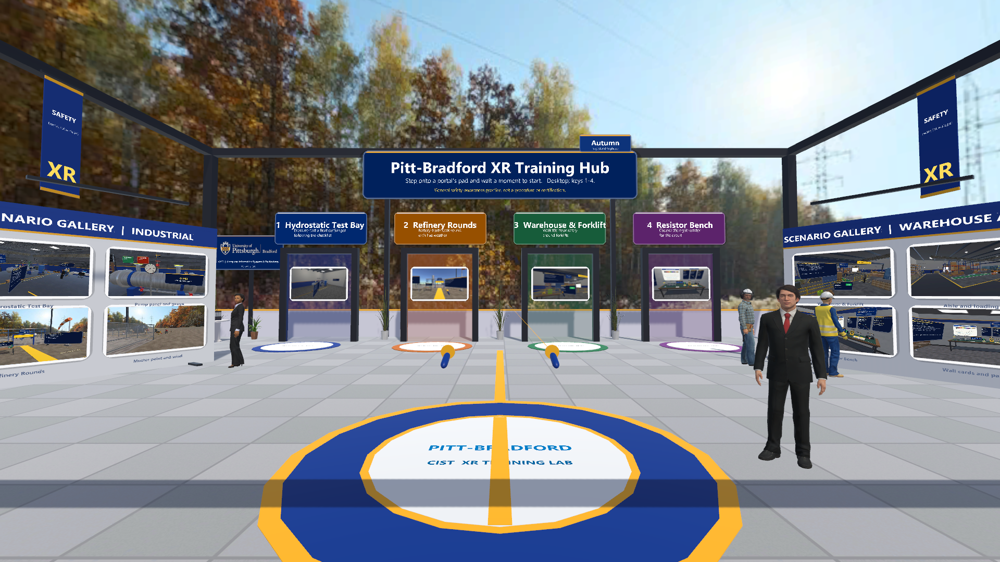
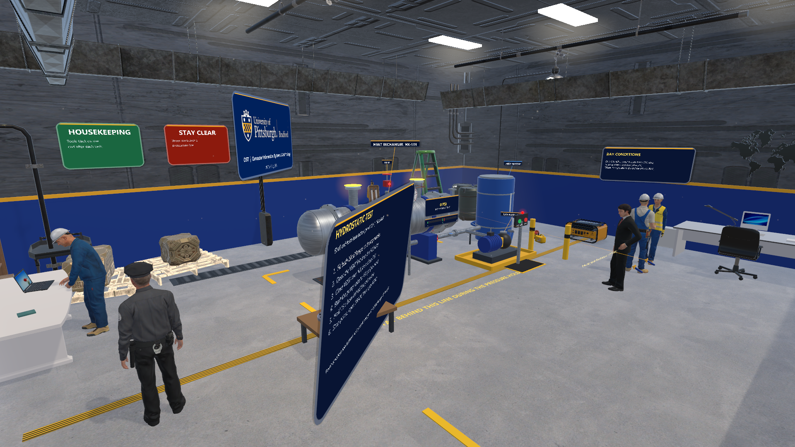
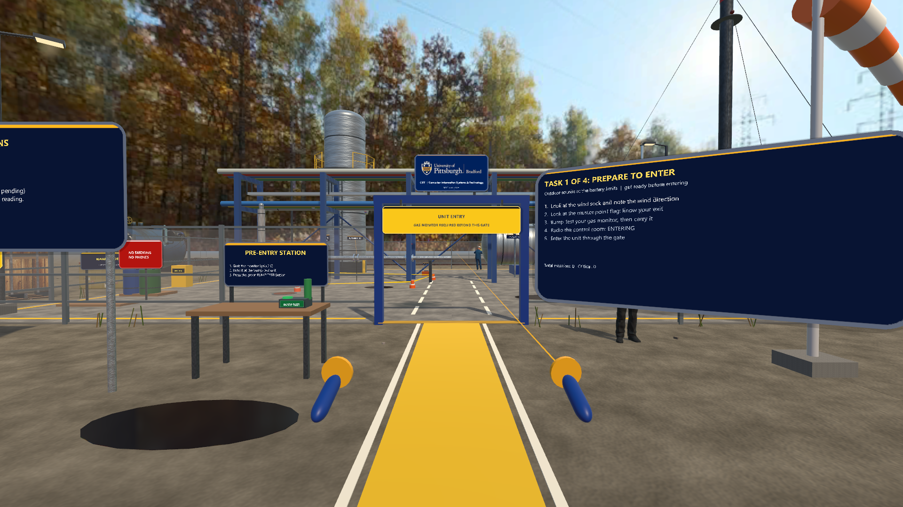
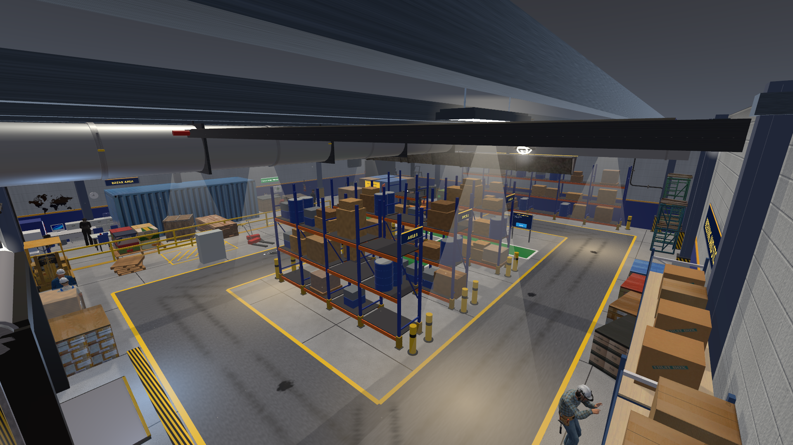
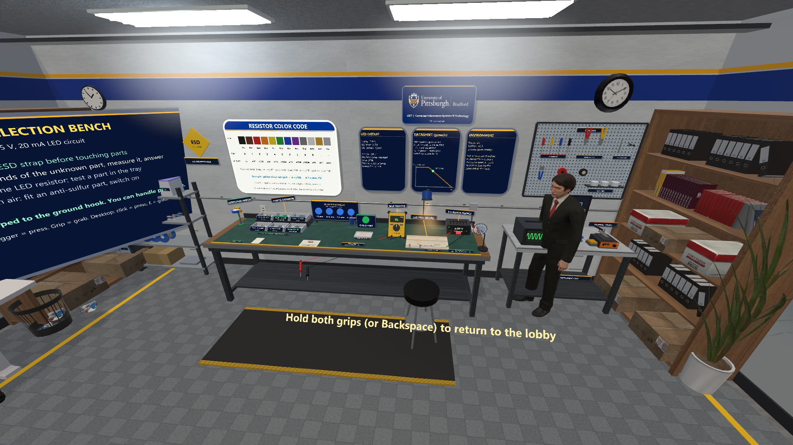
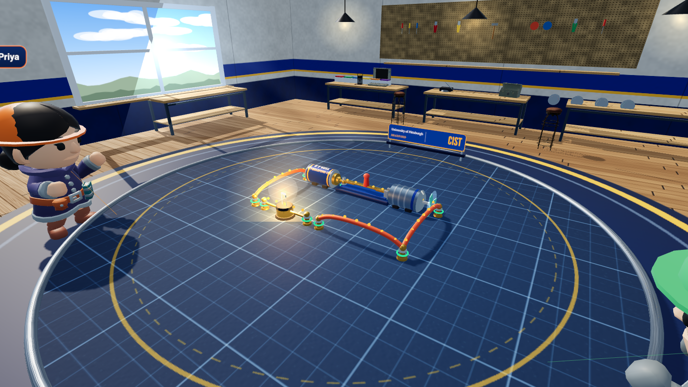
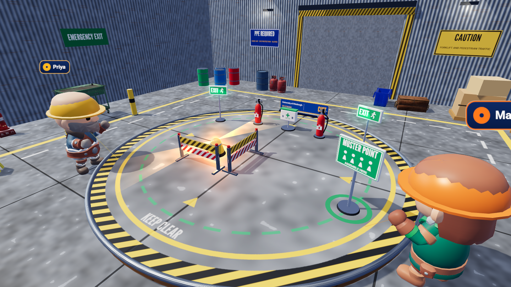
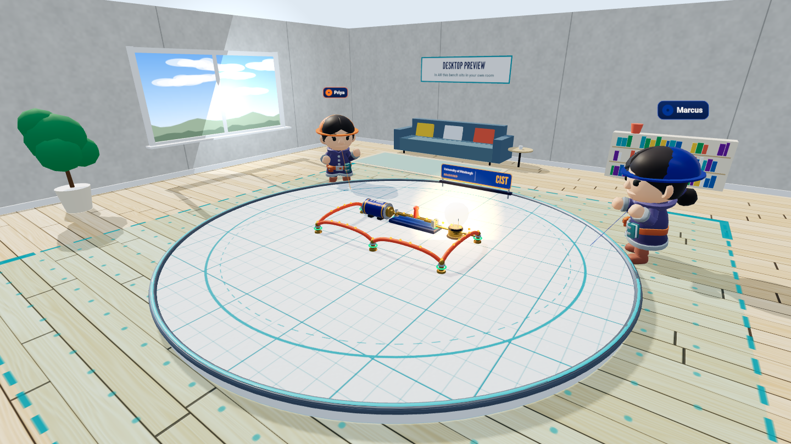

# VR, MR, and AR SDK Examples

Small, separate examples of what each technology in [SDK-list.md](SDK-list.md) does best: ten SDK and framework demos, shared multiplayer WebXR labs, a browser Practice Lab, and a Unity training hub with four scenarios. Each example uses its SDK directly; a browser demo does not stand in for a native SDK integration.



*The Unity hub lobby (Unity editor render, desktop, not a headset).*

**New here?** Start with [docs/HOW-TO-RUN.md](docs/HOW-TO-RUN.md). The full documentation list is in [docs/README.md](docs/README.md).

## What's here

| Folder | Technology | Example |
|---|---|---|
| `vive-steamvr/` | Unity 6, OpenXR / SteamVR | Training hub: a lobby with portals to four scenarios (hydrostatic test, refinery rounds, warehouse and forklift, resistor bench). [How the projects fit together](docs/UNITY-PROJECTS-GUIDE.md) |
| `multi-player/v2/` | Three.js + WebXR | Circuit Lab and Site Safety Lab v2: shared rooms in a lit workshop or safety bay (`?theme=safety`) |
| `multi-player/ar-circuit/` | Three.js + WebXR | AR Circuit Lab: the v2 circuit bench placed on a real surface, sharing rooms with the Circuit Lab |
| `multi-player/vr/`, `multi-player/ar/` | Three.js + WebXR | Circuit Lab v1 and Site Safety Layout v1 (AR hit-test alignment) |
| `training-simulations/` | Three.js + WebXR | Fieldwork XR Practice Lab: eleven hands-on industrial, manufacturing-quality and draft life-science scenarios |
| `webxr/`, `a-frame/`, `threejs/`, `babylonjs/` | Browser XR | Color Field, Orbit Garden, Prism Bloom, Luminous Totem |
| `openxr/`, `meta-xr/`, `steamvr/`, `unity-xri/` | Unity SDKs | Instance lifecycle, Quest passthrough, action-driven toggle, grab feedback |
| `arcore-android/`, `apple-spatial/` | ARCore, ARKit / visionOS | Plane detection and placement, SwiftUI spatial atlas |

Each folder's README covers setup, prerequisites and limits. The native SDK folders hold scripts to copy into a Unity or Xcode project, not full projects.

## Screenshots

### Unity training hub (new)

Walk onto a portal pad in the lobby (or point at the doorway and pull the trigger, or press 1 to 4) to load a scenario. From any scenario you can come back by pointing at the **Lobby** panel above the left controller, holding both grips, or pressing Backspace. [Step-by-step walkthrough of every scene](Scenario-Walkthrough.pptx).

| 1 · Hydrostatic Test Bay | 2 · Refinery Rounds |
|---|---|
|  |  |
| **3 · Warehouse & Forklift** | **4 · Resistor Bench** |
|  |  |

*Unity editor renders, desktop mode. The hub's Asset Store art and people stay local; see [vive-steamvr/hub](vive-steamvr/hub/README.md) and [docs/BUILD-THE-HUB.md](docs/BUILD-THE-HUB.md).*

### Multiplayer WebXR labs

| Circuit Lab v2 | Site Safety Lab v2 | AR Circuit Lab (new) |
|---|---|---|
| [](multi-player/v2/) | [](multi-player/v2/?theme=safety) | [](multi-player/ar-circuit/) |

### Browser SDK demos

| WebXR | A-Frame | Three.js | Babylon.js |
|---|---|---|---|
| [](webxr/) | [](a-frame/) | [](threejs/) | [](babylonjs/) |

Desktop views. Immersive sessions need a headset or an emulator. The [VR emulator captures](tools/vr-capture/README.md) show the Practice Lab and Circuit Lab in an emulated Quest 3 session (not a physical headset).

## Run it

- **Main menu:** `scripts\start-demo.cmd` opens a launcher with every demo, guide and deck, working offline.

  

- **Browser demos only:** `python -m http.server 8000` from the repository root, then open `http://localhost:8000/<folder>/`. Libraries are bundled in `vendor/`.
- **Multiplayer:** the labs need the WebSocket relay:

  ```powershell
  cd multi-player
  npm install
  npm start
  ```

  Then open `http://localhost:8443/multi-player/v2/`. Headsets and phones on the network need HTTPS with a trusted certificate. See [multi-player/README.md](multi-player/README.md).
- **Unity hub:** open `vive-steamvr/hub` in Unity 6000.3.20f1, build the scenes, then play `Lobby` ([docs/HOW-TO-RUN.md](docs/HOW-TO-RUN.md#3-the-hub-lobby-local-only)). Player builds for the VR Stage PC: [docs/BUILDS.md](docs/BUILDS.md).
- **On a headset browser:** the browser examples are set up for GitHub Pages at `https://jpcst52.github.io/xr-training-lab/` (not live yet; see [docs/GITHUB-PAGES.md](docs/GITHUB-PAGES.md)). Multiplayer rooms do not work on Pages.

## Slide decks

| Deck | What it covers |
|---|---|
| [Scenario walkthrough](Scenario-Walkthrough.pptx) (new) | From the lobby through every step of the four hub scenes, with markers showing where each valve, button and station is |
| [Repository guide](Repository-Guide.pptx) | A tour of every folder |
| [Project overview](Project-Overview.pptx) | What the project is and how to explore it |
| [Run the XR examples](Run-the-XR-Examples.pptx) | Launch steps and what to look for in each example |
| [Multiplayer WebXR examples](multi-player/Multiplayer-WebXR-Examples.pptx) | The labs, the relay protocol and AR calibration |

The decks are generated from the READMEs and screenshots by [tools/decks](tools/decks/README.md).

## Tools

| Tool | Purpose |
|---|---|
| [tools/vr-capture](tools/vr-capture/README.md) | Screenshots in an emulated Quest 3 session, plus page checks |
| [tools/decks](tools/decks/README.md) | Rebuilds the slide decks |
| [tools/status](tools/status/README.md) | Local live status dashboard (`npm run status`) fed by [docs/Task-Status.md](docs/Task-Status.md) |

## Research background

The examples build on published work on immersive training. XR training performs about as well as conventional methods overall, and its value lies where danger or cost rule out traditional training (Kaplan et al., 2021). Hand-based manipulation is a distinctive strength of VR (Johnson-Glenberg, 2018). More immersion can lower learning if it adds load (Makransky et al., 2019). The bibliography, evidence gaps, measures and study ideas are in [docs/research](docs/research/README.md).

## Platform notes

- WebXR immersive sessions need a compatible browser and a secure context (`localhost` is fine for development).
- Unity and mobile examples need their SDK packages, a supported runtime and hardware. The Apple example needs macOS and Xcode.
- All scenarios are general safety-awareness practice, not procedures, permits or certifications.
- Do not commit signing keys, tokens or credentials. Check third-party SDK terms before publishing.

## Credits

Fonts, live weather (Open-Meteo), the Rocketbox people, Asset Store packs, 3D models and libraries are credited in [CREDITS.md](CREDITS.md).
