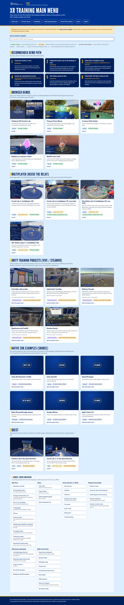
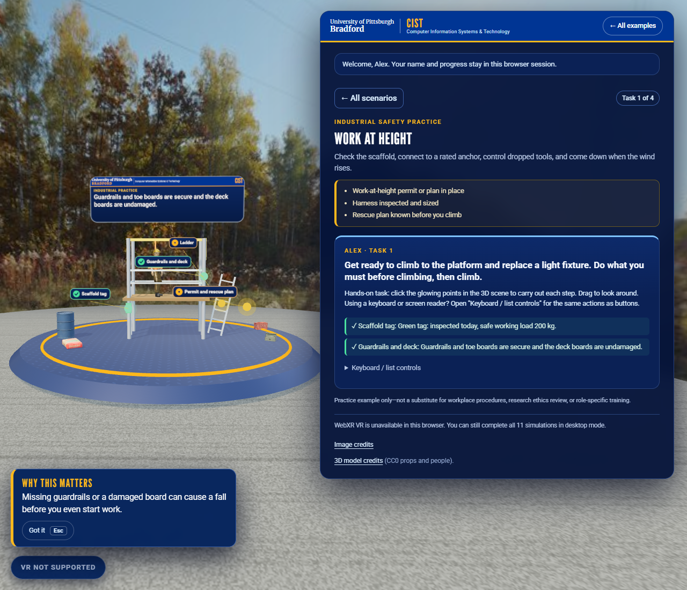

# VR, MR, and AR SDK Examples

Small, separate examples that highlight a distinctive capability of each technology in [SDK-list.md](SDK-list.md): ten SDK and framework demos, two multiplayer WebXR examples, and a hands-on training lab. Each example uses the named SDK or framework directly; a browser demo is not a substitute for a native SDK integration.


*A Practice Lab task in an emulated Meta Quest 3 session (not a physical headset; see [VR emulator captures](#vr-emulator-captures)).*

## Contents

- [Main menu](#main-menu)
- [Gallery](#gallery)
- [Examples](#examples)
- [Getting started](#getting-started)
- [Multiplayer examples](#multiplayer-examples)
- [Fieldwork XR Practice Lab](#fieldwork-xr-practice-lab)
- [VR emulator captures](#vr-emulator-captures)
- [Research background](#research-background)
- [Slide decks](#slide-decks)
- [Tools](#tools)
- [Platform notes](#platform-notes)

## Main menu

Start the demo server (`scripts\start-demo.cmd`, details in [docs/HOW-TO-RUN.md](docs/HOW-TO-RUN.md)) and the **main menu** opens: tiles for every browser demo, the multiplayer examples, the Unity training projects, the native SDK samples and the Quest pages, plus every guide, status page and slide deck. Guides open inside the menu, offline. The full documentation list is in [docs/README.md](docs/README.md).



## Gallery

Desktop captures of the browser examples running. Immersive XR sessions need a supported headset or an emulator; these show the desktop view.

### Browser SDK examples

| WebXR · Color Field | A-Frame · Orbit Garden |
|---|---|
| [](webxr/) | [](a-frame/) |

| Three.js · Prism Bloom | Babylon.js · Luminous Totem |
|---|---|
| [](threejs/) | [](babylonjs/) |

### Multiplayer WebXR

| Circuit Lab v1 (VR) | Site Safety Layout v1 (AR) |
|---|---|
| [](multi-player/vr/) | [](multi-player/ar/) |

| Circuit Lab v2 | Site Safety Lab v2 |
|---|---|
| [](multi-player/v2/) | [](multi-player/v2/?theme=safety) |

### Fieldwork XR Practice Lab

| Scenario catalog | Work at height | Electrical isolation |
|---|---|---|
| [](training-simulations/) | [](training-simulations/) | [](training-simulations/) |

The Unity, Android, and Apple examples need their native toolchains and devices, so they have no screenshots here.

## Examples

| Folder | Technology | Example |
|---|---|---|
| `openxr/` | OpenXR in Unity | OpenXR instance lifecycle callback |
| `meta-xr/` | Meta XR SDK | Quest passthrough camera preview |
| `steamvr/` | SteamVR Unity plugin | Action-driven color toggle |
| `webxr/` | WebXR Device API | Immersive color field with desktop fallback |
| `a-frame/` | A-Frame | Animated Orbit Garden |
| `threejs/` | Three.js | Prism Bloom with VR entry |
| `babylonjs/` | Babylon.js | Luminous Totem with XR entry |
| `arcore-android/` | Google ARCore | Plane detection and cube placement |
| `apple-spatial/` | ARKit / visionOS | SwiftUI spatial atlas |
| `unity-xri/` | Unity XR Interaction Toolkit | Grab selection color feedback |
| `multi-player/vr/` | Three.js + WebXR | Circuit Lab **v1**: build and power electrical circuits together (the original look; also `?theme=safety`) |
| `multi-player/ar/` | Three.js + WebXR | Site Safety Layout **v1**: shared AR layout with hit-test alignment |
| `multi-player/ar-circuit/` | Three.js + WebXR | AR Circuit Lab: the v2 circuit bench placed on a real surface in AR, sharing rooms with the Circuit Lab pages (desktop tested only) |
| `multi-player/v2/` | Three.js + WebXR | Circuit Lab and Site Safety Lab **v2**: the same rooms and rules with a lit workshop / safety bay, PBR parts and live effects (`?theme=safety` for the safety lab) |
| `vive-steamvr/` | Unity 6, OpenXR / SteamVR | Hub lobby and four training projects (hydrostatic test, refinery rounds, warehouse and forklift, resistor bench) on a shared kit; [what each project is and how they fit together](docs/UNITY-PROJECTS-GUIDE.md) |
| `training-simulations/` | Three.js + WebXR | Seventeen hands-on business, research, industrial safety and life-science (draft) practice scenarios |

Each folder has its own README with setup instructions, prerequisites, and platform limitations. Browser-based examples embed a screenshot of themselves running. Unity examples are Unity-ready source folders rather than full Unity projects: copy the scripts into a compatible Unity project and follow that example's setup instructions.

## Getting started

**New here? Start with [docs/HOW-TO-RUN.md](docs/HOW-TO-RUN.md)**: one page for running the demo, the Unity projects, the hub lobby, the headsets, the tests and the status dashboard.

For the browser demos, start a static server from the repository root with `python -m http.server 8000`, then open one of these pages:

- `http://localhost:8000/a-frame/`
- `http://localhost:8000/threejs/`
- `http://localhost:8000/babylonjs/`
- `http://localhost:8000/webxr/`
- `http://localhost:8000/training-simulations/`

Use `Ctrl+C` to stop the server. The libraries are bundled in `vendor/`, so the browser pages work offline; immersive XR additionally requires a compatible device/browser and a secure context.

| Example | Desktop interaction |
|---|---|
| A-Frame | Gaze-select a lantern to enlarge it and show its name. |
| Babylon.js | Cycle the totem's emissive color and watch orbiting beacons. |
| Three.js | Cycle the prism glow and explore orbiting satellites. |
| WebXR | Adjust the color-field animation speed in the preview and immersive session. |
| Circuit Lab | Join a room, see remote participants, and build a shared circuit that lights a bulb when the loop is closed. |
| Site Safety Layout | Calibrate a shared board origin using hit testing, then edit a shared safety layout with a live checklist. |
| Fieldwork XR Practice Lab | Enter a name, pick one of eleven scenarios, and carry out each task by selecting hotspots in a 3D work area. |

## GitHub Pages (WebXR on a headset browser)

The browser examples are published as a static site at `https://jpcst52.github.io/xr-training-lab/` (workflow `.github/workflows/pages.yml`; build with `npm run build:site`, check with `npm run check:site`). Type the address or scan the QR code in a Quest, HoloLens 2, Vive XR or phone browser. The relay-based multiplayer pages load but cannot join a room on Pages. Not yet live and not tested on any headset: see [docs/GITHUB-PAGES.md](docs/GITHUB-PAGES.md). Windows player builds of the Unity projects for the VR Stage PC: [docs/BUILDS.md](docs/BUILDS.md).

## Multiplayer examples

The two multiplayer WebXR examples share a small WebSocket relay. In a terminal, run:

```powershell
cd multi-player
npm install
npm test
npm start
```

Open `http://localhost:8443/multi-player/vr/` and `http://localhost:8443/multi-player/ar/`; clients who join the same room (and theme) see and edit shared parts. They do not work as static pages alone. Network-connected headsets and phones require HTTPS with a trusted certificate. See the [multiplayer setup guide](multi-player/README.md) for run steps, AR alignment, relay behavior, and limitations, and the [multiplayer screenshots](multi-player/screenshots/README.md).

## Fieldwork XR Practice Lab

The [Practice Lab](training-simulations/) has eleven hands-on scenarios in three groups: industrial safety (work at height, a refinery control room, refinery battery limits, skyscraper window cleaning, welding and hot work, electrical isolation), manufacturing quality (lighter-lot sampling, a heat-exchanger hydrostatic test, pipe-spool welding, resistor selection) and one draft life-science activity for faculty review. The earlier business and research scenarios were removed on 2026-11-08.

## VR emulator captures

The [Practice Lab](training-simulations/README.md#in-vr-emulated-headset) and the multiplayer [Circuit Lab](multi-player/vr/README.md#in-vr-emulated-headset) include screenshots from an emulated Meta Quest 3 session, made with [tools/vr-capture](tools/vr-capture/README.md). The pages really enter an immersive-vr session and a scripted controller points at objects and presses the trigger, so they show in-headset layout, scale, and controller interaction. They are not recordings from a physical headset (no stereo rendering, lens distortion, controller models, or performance data), and AR is not emulated.

| Scenario cards in VR | Selecting hotspots | Circuit Lab in VR |
|---|---|---|
|  |  |  |

## Research background

The examples are built on published work about immersive training, and the open questions are collected so they can grow into studies. For example, a meta-analysis found XR training performs about as well as conventional methods overall, with its value lying where danger or cost make traditional training impossible (Kaplan et al., 2021); hand-based manipulation is argued to be a distinctive educational strength of VR (Johnson-Glenberg, 2018); and more immersion can raise presence while lowering learning if it adds load (Makransky et al., 2019). See [docs/research](docs/research/README.md) for the annotated bibliography, evidence gaps, measurement instruments (SSQ, presence), and study ideas. A BibTeX file is included.

## Slide decks

- [Repository guide](Repository-Guide.pptx): a 25-slide tour of every folder in the repository.
- [Project overview](Project-Overview.pptx): what the project is, the five pathways, and how to explore it.
- [Run the XR examples](Run-the-XR-Examples.pptx): launch steps and what to look for in each of the thirteen examples.
- [Multiplayer WebXR examples](multi-player/Multiplayer-WebXR-Examples.pptx): Circuit Lab, Site Safety Layout, the relay protocol, and AR calibration.

The decks are generated from the READMEs and screenshots by [tools/decks](tools/decks/README.md), so they can be rebuilt when content changes.

## Tools

| Tool | Purpose |
|---|---|
| [tools/vr-capture](tools/vr-capture/README.md) | Screenshots of the browser examples in an emulated Quest 3 VR session. |
| [tools/decks](tools/decks/README.md) | Rebuilds the three PowerPoint decks. |
| [tools/status](tools/status/README.md) | Local live status dashboard (`npm run status`, the address it prints (a free port is chosen automatically)) fed by [docs/Task-Status.md](docs/Task-Status.md). |

## Platform notes

- WebXR immersive sessions require a compatible browser/device and a secure context; `localhost` is suitable for local development.
- Unity and mobile examples may require the relevant SDK packages, a supported runtime, and compatible hardware.
- The Apple example requires macOS and Xcode to build or test. It cannot be built from Windows.
- Do not commit private signing keys, access tokens, or app credentials. Check third-party SDK terms before publishing.

## Project status dashboard

A local, live page (`npm run status`, then open the address it prints) shows progress by section, what needs the owner, running and finished agents, test results, servers and uncommitted work, and an activity log. It reads [docs/Task-Status.md](docs/Task-Status.md). Details and the full guide: [tools/status/README.md](tools/status/README.md).


## Credits

Fonts, live weather (Open-Meteo), the Rocketbox people, Asset Store packs, 3D models and libraries are credited in [CREDITS.md](CREDITS.md).
