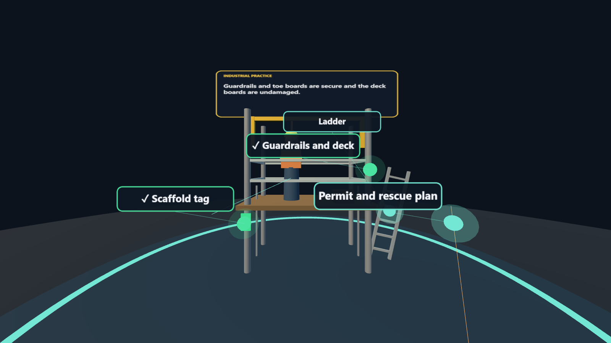
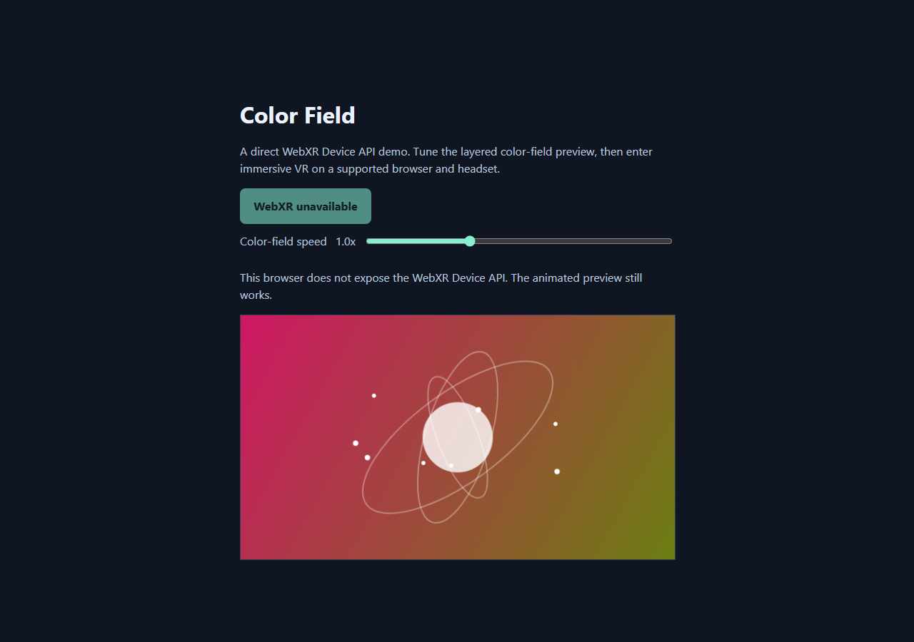
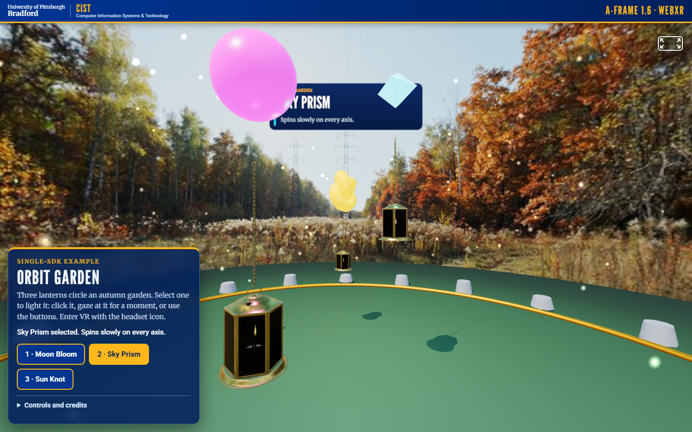
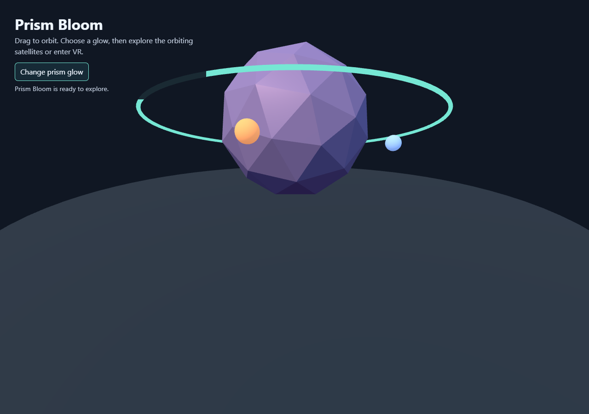
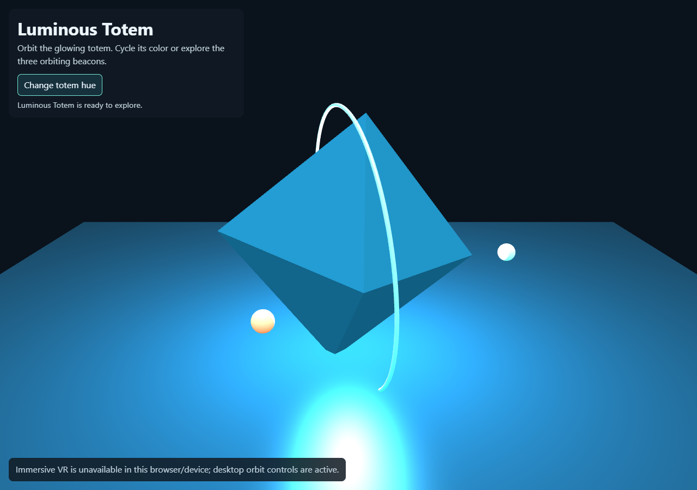
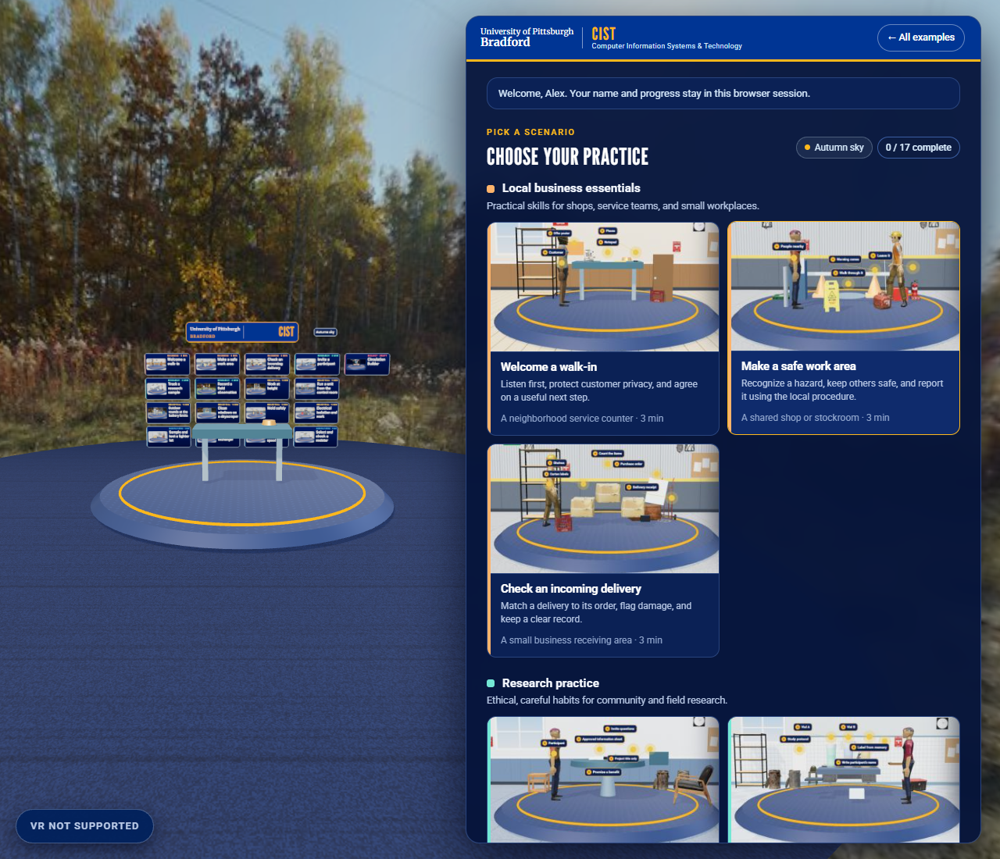
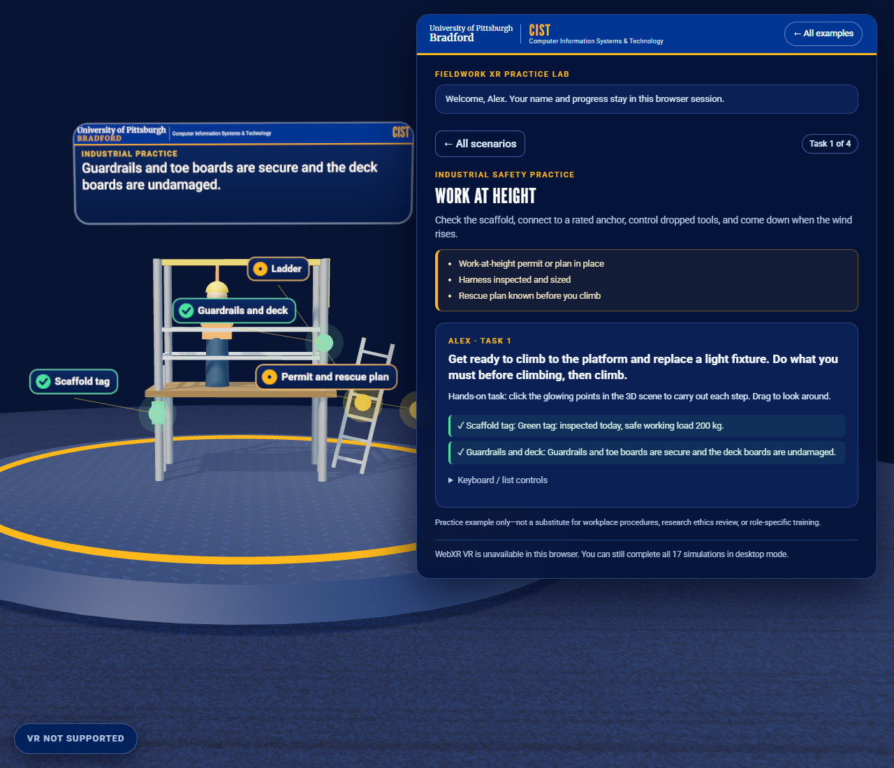
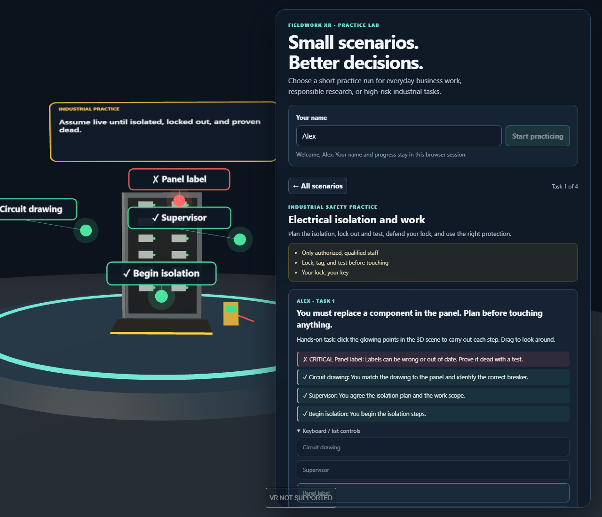
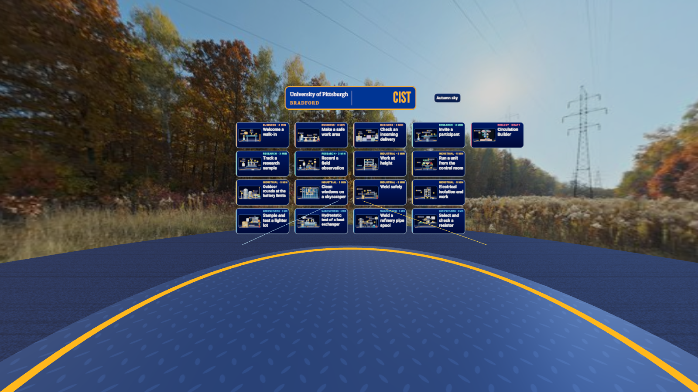
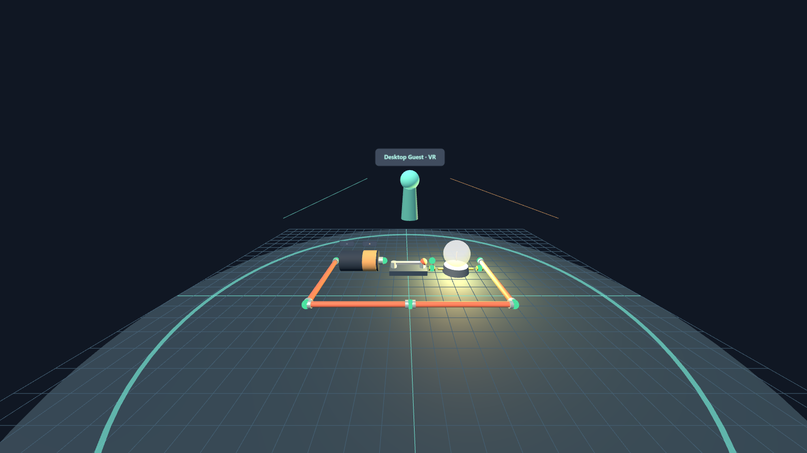

# VR, MR, and AR SDK Examples

Small, separate examples that highlight a distinctive capability of each technology in [SDK-list.md](SDK-list.md): ten SDK and framework demos, two multiplayer WebXR examples, and a hands-on training lab. Each example uses the named SDK or framework directly; a browser demo is not a substitute for a native SDK integration.



*A Practice Lab task in an emulated Meta Quest 3 session (not a physical headset; see [VR emulator captures](#vr-emulator-captures)).*

## Contents

- [Gallery](#gallery)
- [Examples](#examples)
- [Getting started](#getting-started)
- [Multiplayer examples](#multiplayer-examples)
- [Fieldwork XR Practice Lab](#fieldwork-xr-practice-lab)
- [VR emulator captures](#vr-emulator-captures)
- [Research background](#research-background)
- [Slide decks](#slide-decks)
- [Tools](#tools)
- [Platform notes](#platform-notes)

## Gallery

Desktop captures of the browser examples running. Immersive XR sessions need a supported headset or an emulator; these show the desktop view.

### Browser SDK examples

| WebXR · Color Field | A-Frame · Orbit Garden |
|---|---|
| [](webxr/) | [](a-frame/) |

| Three.js · Prism Bloom | Babylon.js · Luminous Totem |
|---|---|
| [](threejs/) | [](babylonjs/) |

### Multiplayer WebXR

| Circuit Lab (VR) | Site Safety Layout (AR) |
|---|---|
| [](multi-player/vr/) | [](multi-player/ar/) |

### Fieldwork XR Practice Lab

| Scenario catalog | Work at height | Electrical isolation |
|---|---|---|
| [](training-simulations/) | [](training-simulations/) | [](training-simulations/) |

The Unity, Android, and Apple examples need their native toolchains and devices, so they have no screenshots here.

## Examples

| Folder | Technology | Example |
|---|---|---|
| `openxr/` | OpenXR in Unity | OpenXR instance lifecycle callback |
| `meta-xr/` | Meta XR SDK | Quest passthrough camera preview |
| `steamvr/` | SteamVR Unity plugin | Action-driven color toggle |
| `webxr/` | WebXR Device API | Immersive color field with desktop fallback |
| `a-frame/` | A-Frame | Animated Orbit Garden |
| `threejs/` | Three.js | Prism Bloom with VR entry |
| `babylonjs/` | Babylon.js | Luminous Totem with XR entry |
| `arcore-android/` | Google ARCore | Plane detection and cube placement |
| `apple-spatial/` | ARKit / visionOS | SwiftUI spatial atlas |
| `unity-xri/` | Unity XR Interaction Toolkit | Grab selection color feedback |
| `multi-player/vr/` | Three.js + WebXR | Circuit Lab: build and power electrical circuits together |
| `multi-player/ar/` | Three.js + WebXR | Site Safety Layout: shared AR layout with hit-test alignment |
| `training-simulations/` | Three.js + WebXR | Seventeen hands-on business, research, industrial safety and life-science (draft) practice scenarios |

Each folder has its own README with setup instructions, prerequisites, and platform limitations. Browser-based examples embed a screenshot of themselves running. Unity examples are Unity-ready source folders rather than full Unity projects: copy the scripts into a compatible Unity project and follow that example's setup instructions.

## Getting started

**New here? Start with [docs/HOW-TO-RUN.md](docs/HOW-TO-RUN.md)**: one page for running the demo, the Unity projects, the hub lobby, the headsets, the tests and the status dashboard.

For the browser demos, start a static server from the repository root with `python -m http.server 8000`, then open one of these pages:

- `http://localhost:8000/a-frame/`
- `http://localhost:8000/threejs/`
- `http://localhost:8000/babylonjs/`
- `http://localhost:8000/webxr/`
- `http://localhost:8000/training-simulations/`

Use `Ctrl+C` to stop the server. The libraries are bundled in `vendor/`, so the browser pages work offline; immersive XR additionally requires a compatible device/browser and a secure context.

| Example | Desktop interaction |
|---|---|
| A-Frame | Gaze-select a lantern to enlarge it and show its name. |
| Babylon.js | Cycle the totem's emissive color and watch orbiting beacons. |
| Three.js | Cycle the prism glow and explore orbiting satellites. |
| WebXR | Adjust the color-field animation speed in the preview and immersive session. |
| Circuit Lab | Join a room, see remote participants, and build a shared circuit that lights a bulb when the loop is closed. |
| Site Safety Layout | Calibrate a shared board origin using hit testing, then edit a shared safety layout with a live checklist. |
| Fieldwork XR Practice Lab | Enter a name, pick one of seventeen scenarios, and carry out each task by selecting hotspots in a 3D work area. |

## Multiplayer examples

The two multiplayer WebXR examples share a small WebSocket relay. In a terminal, run:

```powershell
cd multi-player
npm install
npm test
npm start
```

Open `http://localhost:8443/multi-player/vr/` and `http://localhost:8443/multi-player/ar/`; clients who join the same room (and theme) see and edit shared parts. They do not work as static pages alone. Network-connected headsets and phones require HTTPS with a trusted certificate. See the [multiplayer setup guide](multi-player/README.md) for run steps, AR alignment, relay behavior, and limitations, and the [multiplayer screenshots](multi-player/screenshots/README.md).

## Fieldwork XR Practice Lab

The [Practice Lab](training-simulations/) has seventeen scenarios in five groups: local-business, research-practice, industrial safety (work at height, a refinery control room, refinery battery limits, skyscraper window cleaning, welding, and electrical work), manufacturing quality, and a draft life-science scenario (circulation) for faculty review. In every scenario you carry out the tasks yourself by selecting hotspots in a 3D work area. Wrong actions show consequences, some steps must be done in order, and dangerous mistakes are flagged as critical. Start it with `python -m http.server 8000` and open `http://localhost:8000/training-simulations/`; its README explains name handling, scoring, and WebXR limitations. It is a non-certified learning prototype and does not replace workplace procedures or professional training.

## VR emulator captures

The [Practice Lab](training-simulations/README.md#in-vr-emulated-headset) and the multiplayer [Circuit Lab](multi-player/vr/README.md#in-vr-emulated-headset) include screenshots from an emulated Meta Quest 3 session, made with [tools/vr-capture](tools/vr-capture/README.md). The pages really enter an immersive-vr session and a scripted controller points at objects and presses the trigger, so they show in-headset layout, scale, and controller interaction. They are not recordings from a physical headset (no stereo rendering, lens distortion, controller models, or performance data), and AR is not emulated.

| Scenario cards in VR | Selecting hotspots | Circuit Lab in VR |
|---|---|---|
|  |  |  |

## Research background

The examples are built on published work about immersive training, and the open questions are collected so they can grow into studies. For example, a meta-analysis found XR training performs about as well as conventional methods overall, with the strongest case where real practice is hazardous (Kaplan et al., 2021); hand-based manipulation is argued to be a distinctive educational strength of VR (Johnson-Glenberg, 2018); and more immersion can raise presence while lowering learning if it adds load (Makransky et al., 2019). See [docs/research](docs/research/README.md) for the annotated bibliography, evidence gaps, measurement instruments (SSQ, presence), and study ideas. A BibTeX file is included.

## Slide decks

- [Project overview](Project-Overview.pptx): what the project is, the five pathways, and how to explore it.
- [Run the XR examples](Run-the-XR-Examples.pptx): launch steps and what to look for in each of the thirteen examples.
- [Multiplayer WebXR examples](multi-player/Multiplayer-WebXR-Examples.pptx): Circuit Lab, Site Safety Layout, the relay protocol, and AR calibration.

The decks are generated from the READMEs and screenshots by [tools/decks](tools/decks/README.md), so they can be rebuilt when content changes.

## Tools

| Tool | Purpose |
|---|---|
| [tools/vr-capture](tools/vr-capture/README.md) | Screenshots of the browser examples in an emulated Quest 3 VR session. |
| [tools/decks](tools/decks/README.md) | Rebuilds the three PowerPoint decks. |
| [tools/status](tools/status/README.md) | Local live status dashboard (`npm run status`, the address it prints (a free port is chosen automatically)) fed by [docs/Task-Status.md](docs/Task-Status.md). |

## Platform notes

- WebXR immersive sessions require a compatible browser/device and a secure context; `localhost` is suitable for local development.
- Unity and mobile examples may require the relevant SDK packages, a supported runtime, and compatible hardware.
- The Apple example requires macOS and Xcode to build or test. It cannot be built from Windows.
- Do not commit private signing keys, access tokens, or app credentials. Check third-party SDK terms before publishing.

## Project status dashboard

A local, live page (`npm run status`, then open the address it prints) shows progress by section, what needs the owner, running and finished agents, test results, servers and uncommitted work, and an activity log. It reads [docs/Task-Status.md](docs/Task-Status.md). Details and the full guide: [tools/status/README.md](tools/status/README.md).


