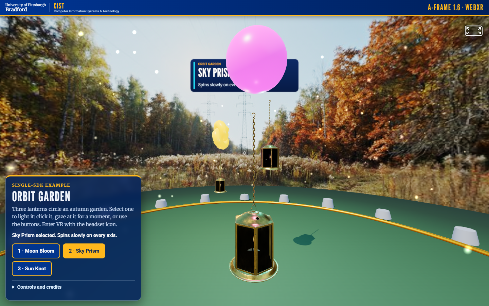
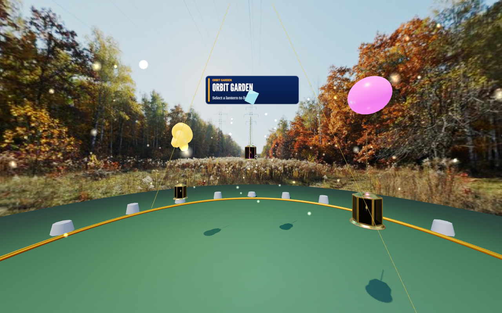

# A-Frame Orbit Garden

An A-Frame 1.6 scene: three hanging brass lanterns, each with a glowing shape and a coloured light, circle a lawn ringed by stones under an autumn sky photo. Select a lantern by mouse click, touch, gaze (fuse cursor), keyboard or VR controller ray. The demo keeps A-Frame's distinctive parts: declarative entities, custom components, the fuse/gaze cursor and `laser-controls`.

## What changed in this version

- **Look:** autumn photo sky as the background and as the environment map for the PBR lantern glass and brass, a shadow-casting sun with soft shadows, point lights that colour the lawn, a soft round lawn, a brass rim, a ring of stones, drifting fireflies, ACES tone mapping.
- **Model:** the CC0 Poly Haven "Brass Diya Lantern" glTF (12.7k triangles, three copies, about 38k in the scene); a plain cylinder replaces it if the model fails to load.
- **Components written for this demo:** `garden-floor`, `stone-ring`, `fireflies`, `lantern`, `info-panel` (a canvas-texture panel in the world so the selected lantern name is readable in VR).
- **HUD:** the shared brand bar and panel, three lantern buttons (with `aria-pressed`), a live status line, collapsible controls and credits.
- **Access:** click, tap, 1-second gaze, keys `1` `2` `3`, WASD/arrow-key walking, drag to look; `prefers-reduced-motion` stops the lantern and firefly motion.
- **VR:** laser controllers (without downloaded controller models, so it stays offline) can point at and select lanterns. Unverified on hardware.

## Prerequisites

- A modern browser with WebGL.
- For headset VR, a WebXR browser, runtime and headset.

## Launch

These pages load libraries, fonts and sky photos from elsewhere in the repository (`../vendor`, `../brand-kit`, `../assets`), so serve the **repository root**, not this folder. No internet is needed.

```
python -m http.server 8000                     # from the repository root
node tools/vr-capture/static-server.mjs 8000   # alternative that copes with many parallel requests
```

Open <http://localhost:8000/a-frame/>. WebXR needs a secure context: `localhost` qualifies; another device needs HTTPS with a certificate it trusts.

Click or gaze at a lantern to select it; use the headset icon A-Frame adds (top right) to enter VR where supported.

## Checks that were run

- `node tools/vr-capture/demos-check.mjs` (all four demos, desktop and 390 px phone, every non-local request blocked): no console or page errors, no failed requests, no horizontal scroll, buttons at least 40 px tall, brand bar present, every loaded asset exists and is credited, assets under 8 MB, glTF triangles under 100k.
- `node tools/vr-capture/demos-xr-check.mjs`: enters an **emulated** Meta Quest 3 immersive session (Meta's IWER runtime inside desktop Chrome), pulls the emulated trigger and checks for errors. This shows the code path runs. **It is not a headset test; nothing here has been run on a real Quest or Vive Pro 2.**

## Limitations

- A-Frame 1.6.0 bundles Three.js r164 and its legacy lighting model, so a Three.js deprecation warning (`useLegacyLights`) appears in the console.
- No controller models are shown in VR (they would be downloaded from A-Frame's CDN); the rays are drawn instead.
- The sky is a regional-style stand-in photo, not a photo of Bradford.

## Credits

See [../CREDITS-web-demos.md](../CREDITS-web-demos.md): sky photo `assets/skies/autumn-2k.jpg` (Poly Haven, CC0); model `brass_diya_lantern` by Bhargav Kubal (Poly Haven, CC0). A-Frame is MIT.

## Upstream

- [A-Frame documentation](https://aframe.io/docs/1.6.0/introduction/)
- [WebXR Device API](https://developer.mozilla.org/docs/Web/API/WebXR_Device_API)

## Screenshots



Desktop browser (Chrome, software GL) after selecting "Sky Prism". Phone-width view: [../screenshots/phone/](../screenshots/phone/a-frame-orbit-garden.png). The image below is from an **emulated** Quest 3 session (IWER), not a real headset.


