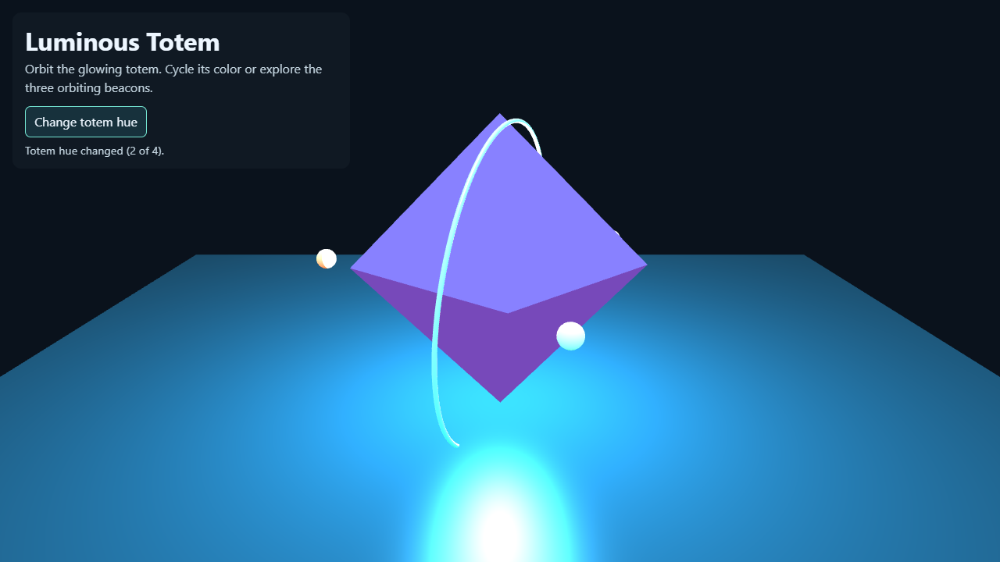
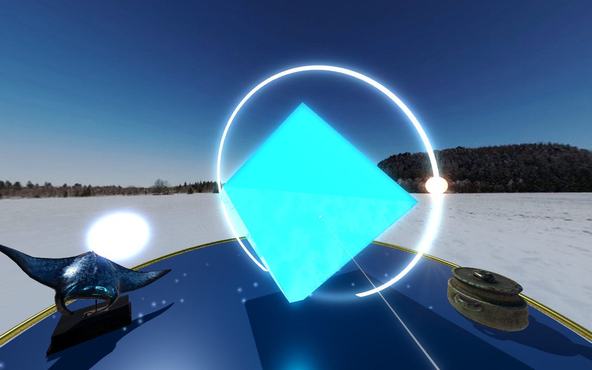

# Babylon.js Luminous Totem

A Babylon.js 7.42 scene: a faceted PBR crystal with clear coat and iridescence floats over a brass-ringed pedestal in a snowy field, with a glow layer, soft shadows, a particle system, and Babylon's default WebXR experience (`createDefaultXRExperienceAsync`) for VR entry, teleport and pointer selection.

## What changed in this version

- **Look:** PBR materials, image-based lighting and a photo dome from the winter sky photo, ACES tone mapping, a directional light with PCF shadows, a glow layer on the emissive parts, a particle system of sparkles, a soft-edged ground, a glossy pedestal with a brass rim.
- **Models:** two CC0 Poly Haven props, "Bronze Ray Statue" (1.8k triangles) and "Ceramic Pot" (3.6k), loaded with Babylon's glTF loader (`lib/babylonjs.loaders.min.js`, the official 7.42.0 npm build, Apache-2.0); a primitive replaces either one on failure.
- **HUD:** the shared brand bar and panel, buttons (Change totem hue, Pause motion, Reset view), live status, collapsible controls and credits; a readout panel in the world shows the current hue (also in VR).
- **Access:** keyboard (`C` hue, `Space` pause, `R` reset, arrow keys orbit), mouse, touch (drag, pinch), click the totem to change hue, screen-reader status line; `prefers-reduced-motion` starts paused.
- **VR:** the exhibit moves 2.8 m in front of a standing player; pointing a controller at the totem and pressing the trigger changes the hue. Hand tracking and controller models are switched off so the page never needs the network.

## Prerequisites

- A current WebGL2-capable browser.
- For immersive VR, a WebXR browser, runtime and headset.

## Launch

These pages load libraries, fonts and sky photos from elsewhere in the repository (`../vendor`, `../brand-kit`, `../assets`), so serve the **repository root**, not this folder. No internet is needed.

```
python -m http.server 8000                     # from the repository root
node tools/vr-capture/static-server.mjs 8000   # alternative that copes with many parallel requests
```

Open <http://localhost:8000/babylonjs/>. WebXR needs a secure context: `localhost` qualifies; another device needs HTTPS with a certificate it trusts.

Orbit with mouse or touch, change the hue with **C** or the button, and use Babylon's headset button (top right) where available.

## Checks that were run

- `node tools/vr-capture/demos-check.mjs` (all four demos, desktop and 390 px phone, every non-local request blocked): no console or page errors, no failed requests, no horizontal scroll, buttons at least 40 px tall, brand bar present, every loaded asset exists and is credited, assets under 8 MB, glTF triangles under 100k.
- `node tools/vr-capture/demos-xr-check.mjs`: enters an **emulated** Meta Quest 3 immersive session (Meta's IWER runtime inside desktop Chrome), pulls the emulated trigger and checks for errors. This shows the code path runs.

## Limitations

- Immersive VR support depends on browser, OS, runtime and headset; the desktop scene remains usable without it.
- No controller models are shown in VR (they would come from controllers.babylonjs.com); rays and the teleport marker are drawn instead.
- The glow layer and shadows cost GPU time; a standalone headset may need them reduced.
- The sky is a regional-style stand-in photo, not a photo of Bradford.

## Credits

See [../CREDITS-web-demos.md](../CREDITS-web-demos.md): sky photo `assets/skies/winter-2k.jpg` (Poly Haven, CC0); models `bronze_ray_statue` (Tina) and `ceramic_pot` (Aron Łyczek), Poly Haven, CC0. Babylon.js and its loaders are Apache-2.0.

## Upstream

- [Babylon.js documentation](https://doc.babylonjs.com/)
- [Babylon.js WebXR documentation](https://doc.babylonjs.com/features/featuresDeepDive/webXR/)

## Screenshots



Desktop browser (Chrome, software GL) after pressing **C**. Phone-width view: [../screenshots/phone/](../screenshots/phone/babylonjs-luminous-totem.png). The image below is from an **emulated** Quest 3 session (IWER), not a real headset.



## Session setup review

Checked with an emulated Quest 3 (`node tools/vr-capture/demos-sdk-check.mjs`): `createDefaultXRExperienceAsync` requests `immersive-vr` with nothing required and `local-floor` optional; the exhibit moves in front of the player when the state becomes `IN_XR` and back at `NOT_IN_XR`; the engine resizes with the window; Babylon.js restores its own context after a loss. If the browser has no WebXR the status line now says so. The distinctive Babylon.js parts are the default XR experience (pointer selection and floor-mesh teleportation), `PBRMaterial` with clear coat and iridescence, `GlowLayer` and the particle system.
