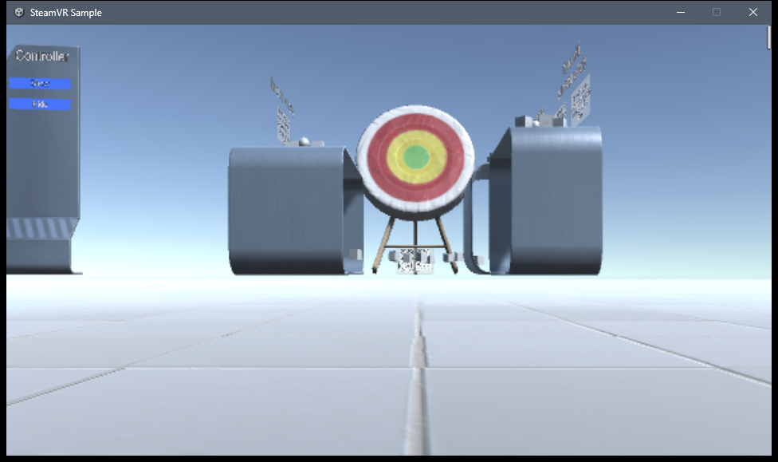

# Testing the Vive builds without a headset: SteamVR's simulated headset

When nobody is at the Vive (for example the development PC is remote), the five SteamVR builds (the hub and projects 01 to 04) can still be started and looked at, using SteamVR's built-in **simulated headset** (the "null" driver). The web examples that run in the Quest Browser are tested differently; see the end of this page. General safety-awareness practice only; nothing here replaces a test on the real Vive.

## What the simulated headset can and cannot do

| It can | It cannot |
|---|---|
| Give an app a connected headset, so the build starts and SteamVR accepts it | Simulate **controllers**: no tracked hands, no trigger, grip, trackpad or thumbstick |
| Show what the app renders (a desktop window shows the view) at a chosen standing height | Move or turn the head (it sits still) |
| Catch crashes, exceptions, missing shaders, a black or pink scene, text and layout problems | Say anything about comfort, frame rate on the Vive Pro 2, or how grabbing and teleporting feel |

So it checks "does the build start and draw correctly in SteamVR". It does **not** check "can a person use it with Vive wands".

**Update (2026-11-08, later).** The Vive projects are being moved to Valve's SteamVR plugin ([STEAMVR-REBUILD.md](STEAMVR-REBUILD.md)). Project 01 is migrated and runs here: the rig, Teleporting and Throwable are created, no exceptions, view at 1.6 m. The other projects and the hub were still the old OpenXR builds when this page was written. With no controller tracked, a migrated build switches to a keyboard and mouse mode after 3 s (WASD, mouse look, left click = trigger, E = grip, Esc frees the mouse); the log confirms it starts. `-Run` passes `-pbHeadOffset 1.6` because the simulated headset reports height 0. **Open problem:** the simulator window picture looks stretched horizontally; a 756 x 850 window did not fix it and the cause is unconfirmed. Trackpad teleport, grabbing and haptics remain untestable here.

## Use it (this PC, PowerShell, from the repository root)

```
scripts\steamvr-simulator.ps1 -Enable                  simulated headset on (headset 1.6 m above the floor); restarts SteamVR
scripts\steamvr-simulator.ps1 -Run builds\vive\01-hydrostatic-test\HydrostaticTest.exe -Shot out.png -Seconds 35
scripts\steamvr-simulator.ps1 -Status
scripts\steamvr-simulator.ps1 -Disable                 puts SteamVR's settings back and stops SteamVR
```

`-Run` starts the build, waits, saves a picture of its window, stops it, and reports whether it was still running, how many exceptions are in its log, and which headset SteamVR connected it to ("null : Null Model Number"). It edits SteamVR's settings for the whole PC (backed up first), so **turn it off on a PC that is also used with a real headset**.

Two things that cost time on 2026-11-08, so they are written down:
- The simulated headset sits at the tracking origin, i.e. on the floor, unless the floor offset is set. The script writes SteamVR's `chaperone_info.vrchap` with a **positive** floor translation (`+1.6` lifts the headset 1.6 m above the floor). The first attempt used the wrong sign, which put the camera under the floor: every lit surface looked black and only the sky, text and ceiling showed. That looked exactly like "the builds are broken". They were not.
- SteamVR opens its room-setup wizard ("Establish tracking") when it starts with this headset. It waits for real controllers and cannot finish; the script closes it. If it appears, just close it.

## What it showed on 2026-11-08

All five existing builds start in the simulated headset, connect to it, and draw their scenes correctly at standing height: the Hydrostatic Test Bay, the Refinery Rounds gate, the Warehouse with the forklift and PPE station, the Resistor Bench, and the hub lobby with four portals, with signs, the VR hint ("Push a thumbstick forward and let go to teleport"), and controller models.



*Valve's sample in the simulated headset (a capture of the desktop window, not a headset; the simulator has no controllers, so no hands are shown).*

Two real defects were found and one is fixed:
- **Fixed:** the Resistor Bench build threw an exception and drew a pink strip, because a shader the kit creates at run time was stripped from that build. The kit now keeps its shaders before every build (`KeepShadersOnBuild.cs`), as the hub already did for its sky.
- **Not fixed:** in the hub lobby, the blurb text under each portal title overlaps the title ("Hydrostatic Test Bay" with "Pressure-test a heat exchanger" on top of it).

**Correction.** Earlier on 2026-11-08 an intermediate note said the old builds render black in SteamVR. That was the floor-offset mistake above, not a bug in the builds; with the headset at the right height they render. It also means the reason the old builds "did not work" on the real Vive is still **unknown**, and is most likely about the controllers (input and interaction), which this simulator cannot test. The SteamVR plugin sample ([STEAMVR-SAMPLE.md](STEAMVR-SAMPLE.md)) is the way to find out on the Vive.

## The web examples (Quest Browser)

The web examples are tested with Meta's emulated Quest 3 (IWER) in desktop Chrome, which is already built into the repository's checks (`tools/vr-capture`): `toolbox-check.mjs` (Circuit Lab and Site Safety Lab toolbox), `lab-vr-check.mjs` (Practice Lab Back and Main menu cards), `v2-check.mjs`, `demos-xr-check.mjs`, and the screenshot tools. IWER drives a real WebXR session with scripted controllers, so it exercises the same code paths as the Quest Browser; it does not tell you how it feels or looks on the headset. The Meta XR Simulator (installed on this PC) is a native OpenXR runtime for native apps; it is not needed for the browser examples and was not used here.

Related: [STEAMVR-SAMPLE.md](STEAMVR-SAMPLE.md) · [VR-STAGE-QUICKSTART.md](VR-STAGE-QUICKSTART.md) · [BUILDS.md](BUILDS.md)
