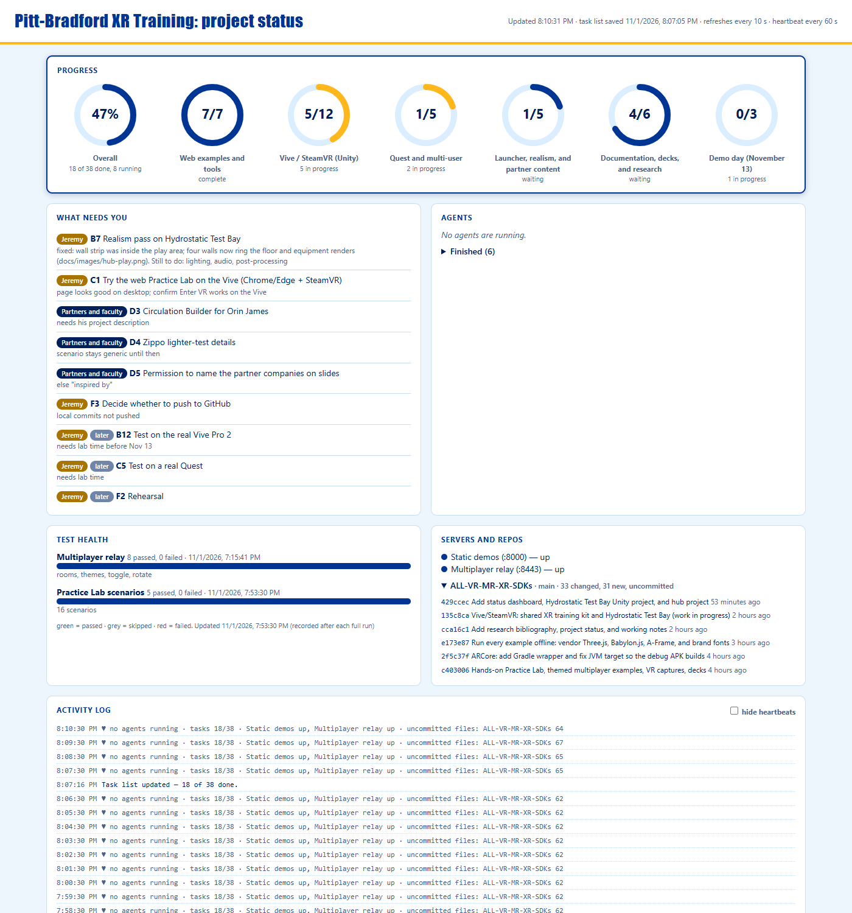
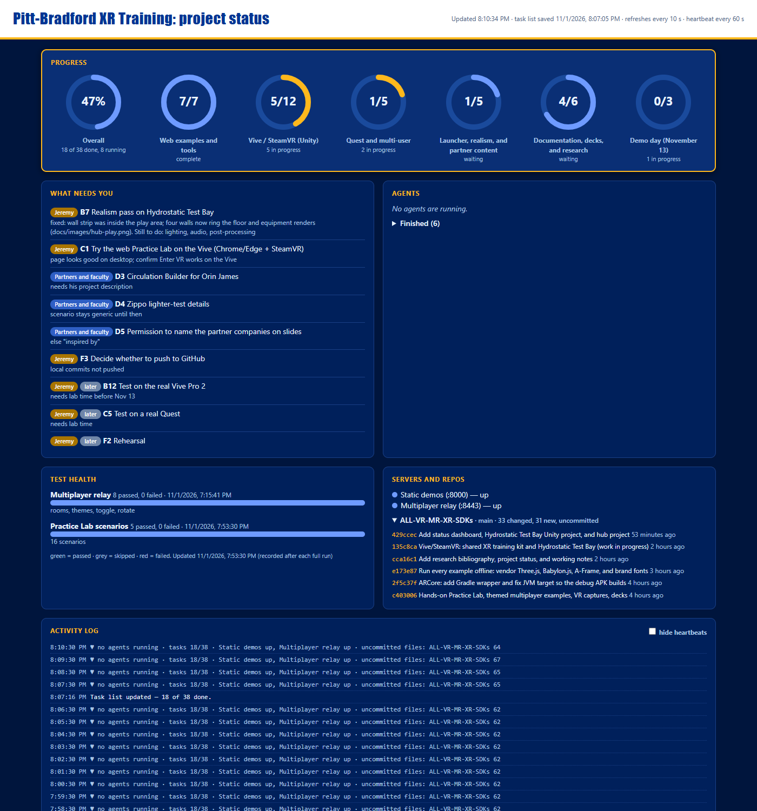

# Status dashboard — how it works and how to reuse it on any project

A small **local, live status page** for work that is done by several people and AI agents at once. It answers "where are we?" without anyone having to ask. It was first built for another project (EVE Residential, Nov 2026) and is designed to be copied into future projects.

- **No installs** (Node.js only), **no cloud** (runs on your PC, binds to 127.0.0.1), **no database** (a few small files).
- Lives in `/tools/status/`. The port is chosen automatically (see section 1), so several projects can run their own dashboards on one machine at the same time.

## 1. Quick start
1. In the project folder run `npm run status` (or double-click `tools\status\start-status.cmd`, or `node tools/status/server.cjs`).
2. Open the address the server prints, for example `Status dashboard: http://localhost:5285`. `start-status.cmd` opens it for you. The address is also saved in `tools/status/.dashboard-url` (git-ignored, removed when the server stops). The page refreshes every 10 seconds on its own.
3. Stop it with Ctrl+C (or kill the node process). Restart it after editing `server.cjs` or `status.config.json`.

### Dynamic ports
More than one project on a machine can run this dashboard at once without any setup. Each project hashes its own folder path to a preferred port, falls forward to the next free port if that one is busy, and writes the final address to `.dashboard-url`. Scripts and agents that need the address (screenshot tools, launchers) should read that file rather than hard-code a port. Use `STATUS_PORT=5300` only if you want a specific port.

## 2. What you see





| Panel | What it shows | Where the data comes from |
|---|---|---|
| **Progress** | An overall ring plus one ring per section (done / total, blue while something in it is running) | The task list markdown |
| **What needs you** | Items waiting on the owner (Jeremy) and on the customer (the name set by `customerName` in the config); items blocked behind earlier work are tagged *later* | Status icons 👤 and ❓ in the task list |
| **Agents** | Each running agent: name, minutes running, **last activity**, a yellow warning if it has been quiet 10+ minutes; finished agents are folded away | `agents.json` + the files each agent writes |
| **Test health** | Bars per suite: passed / skipped / failed and when it was recorded | `test-results.json` |
| **Servers and repos** | Green/red lights for each URL; per repo: branch, uncommitted files, last six commits | `status.config.json` + live `git` |
| **Activity log** | A **heartbeat line every minute** (agents, tasks, servers, uncommitted files) and an **event line** whenever something changes; tick *hide heartbeats* to see only events | `activity-log.jsonl` (written by the server) |
| **All tasks** | The full task table, collapsible by section | The task list markdown |

### The activity log
- Every `heartbeatSeconds` (default 60) the server appends a line such as `♥ 5 agents running (most recent activity 3s ago) · tasks 10/28 · Practice API up, Practice screens up · uncommitted files: Frontend 8, API 0`. A missing heartbeat means the dashboard itself stopped; a heartbeat showing an agent with old activity means that agent is stuck or in a long test run.
- Events are written when they happen (checked every 15 s): *new commit* (repo, hash, subject), *agent started / finished / quiet for 10+ min / active again*, *server went UP/DOWN*, *task list updated (n of m done)*, *test results recorded*, *dashboard started*.
- The log file survives restarts (last 3000 entries kept). It is git-ignored.

## 3. The three files that feed it
### 3.1 Task list (markdown) — the main one
Any markdown file with `##` headings that start with a letter and a dot, followed by a table. Example (`tools/status/Task-Status.template.md` is a copy-paste starter):

```markdown
## A. Code and tests
| # | Task | Status | Notes |
|---|---|---|---|
| A1 | Build the thing | ✅ | merged |
| A2 | Run the end-to-end tests | 🔄 | 74 of 119 so far |
| A3 | Deploy to UAT | ⏳ 👤 | after A2 |
| D1 | Customer confirms the rule | ❓ | |
```
Status icons (put them in the *Status* cell; text after them is fine):

| Icon | Meaning | Counted as |
|---|---|---|
| ✅ | done | done |
| 🔄 | in progress | in progress (ring turns blue) |
| ⏳ | waiting for something earlier | not done; with 👤 it is shown as *later* |
| 👤 | needs the project owner | listed under "What needs you" |
| ❓ | needs the customer | listed under "What needs you" |

Rules: the first cell is the id, the second the task, the third the status, the fourth (optional) notes. Sections with no table rows are ignored. **Edit this file whenever work moves** (the dashboard notices the save and logs "Task list updated").

### 3.2 `agents.json` — who is working
```json
{ "outputDir": "<folder where the agent output files live>",
  "agents": [ { "id": "a1b2", "name": "Final pass: User guide", "task": "what it does", "state": "running",
                "started": "2026-11-01T19:00:00", "watch": ["../../docs/guide-images/user", "../../docs/user-guide-user.md"] } ] }
```
Manage it with the helper instead of editing by hand:
```
node tools/status/agent.cjs start <agentId> "<name>" "<what it does>" [watchPath ...]
node tools/status/agent.cjs done  <agentId> "<one-line result>"
```
`watch` = files or folders the agent writes (relative to `status.config.json`). The newest modified time among them is its **last activity**. (An agent's own output file stays empty until it finishes, so it cannot be used for liveness; if your tool does stream output to `outputDir/<id>.output`, a non-empty file also counts.)

### 3.3 `test-results.json` — test health
```
node tools/status/record-results.cjs "<suite name>" <passed> <failed> <skipped> ["<note>"]
```
Run it after each full test run. Re-running with the same suite name replaces its line.

## 4. Configuration (`tools/status/status.config.json`)
| Key | Meaning |
|---|---|
| `title` | Page heading and browser tab |
| `port` | `"auto"` (default) or a number. Auto derives a stable preferred port (5200 to 5299) from the project folder's path, so a project normally gets the same port every time. A number is used as the preferred port. `STATUS_PORT` overrides both. Either way, if the preferred port is taken the server tries the next ports (up to 50), then lets the OS pick any free one |
| `heartbeatSeconds` | Heartbeat interval (default 60) |
| `quietAgentSeconds` | Seconds without activity before an agent is flagged (default 600) |
| `ownerName`, `customerName` | Labels for 👤 and ❓ items |
| `taskFile` | Path to the task list markdown, relative to the config file; `STATUS_TASKS` env var overrides |
| `repos` | `[{ "name", "path" }]` — each repo shows branch, uncommitted count and recent commits |
| `servers` | `[{ "name", "url" }]` — green when the URL answers with a status below 500 |
| `excludeFromDirty` | Path fragments ignored when counting uncommitted files (e.g. generated screenshots) |

## 5. Reusing it on another project (10 minutes)
1. Copy the folder `tools/status/` into the new repo (same relative place is easiest). Do **not** copy `activity-log.jsonl`, `agents.json` or `test-results.json` contents: start from the empty versions below.
   - `agents.json`: `{ "outputDir": "", "agents": [] }`  ·  `test-results.json`: `{ "updated": null, "suites": [] }`
2. Add a script to `package.json`: `"status": "node tools/status/server.cjs"` (use the `.cjs` extension so it also works in `"type": "module"` projects). Non-Node projects can run `node tools/status/server.cjs` directly.
3. Create the task list from `Task-Status.template.md` (anywhere; point `taskFile` at it). Keep the sections A, B, C… and the icons.
4. Edit `status.config.json`: title, port, repos, URLs to watch, names.
5. `git`-ignore `tools/status/activity-log.jsonl`.
6. Start it, and make *updating the three files* part of how you work (section 6).

## 6. Instructions for Claude (put this in the project's notes so every session keeps it current)
- When you **launch an agent**: `node tools/status/agent.cjs start <id> "<name>" "<task>" <watch paths>`. When it **finishes**: `... done <id> "<result>"`.
- When a task **starts, finishes or becomes blocked**: edit the task list row (✅ 🔄 ⏳ 👤 ❓) the same turn.
- After **each full test run**: `node tools/status/record-results.cjs "<suite>" <passed> <failed> <skipped>`.
- Keep the *Notes* cell short and factual ("74 of 119 so far", "needs review dates").
- At milestones still summarize in chat, but the owner should not need to ask for routine status: the dashboard is the source.
- Never put secrets in the task list, agents file or log (they are plain files).

## 7. Troubleshooting
| Symptom | Cause / fix |
|---|---|
| "Cannot reach the status server" on the page | The node process stopped; start it again |
| Page shows old numbers after you changed the server code or config | The old process is still running: stop all `node` processes whose command line contains `status\server` (PowerShell: `Get-CimInstance Win32_Process -Filter "Name='node.exe'" \| ? { $_.CommandLine -match 'status[\\/]server' } \| % { Stop-Process -Id $_.ProcessId -Force }`) and start again |
| Not sure which port | Read the line the server printed, or `tools/status/.dashboard-url`. Ports are automatic, so never assume 5200 |
| Two dashboards for one project | You started it twice; the second took the next free port. Stop one (Ctrl+C, or end the node process) |
| Agent shows "last activity —" | It has no `watch` paths (or they do not exist); pass them to `agent.cjs start` |
| Everything shows "no agents running" although agents are working | `agents.json` was not updated when they were launched |
| Task rings are all 0 | The task file path is wrong, or headings are not like `## A. Title`, or rows are not in the 4-column table form |
| Dates/emoji look garbled when editing the task list | Save the markdown as UTF-8 |

## 8. Design notes (why it is built this way)
- **Local and file-based** so it works offline, costs nothing, exposes nothing, and survives between sessions; the markdown task list doubles as project documentation in git.
- **Zero dependencies** (Node's `http`, `fs`, `child_process`) so there is nothing to install or patch.
- **Live where it can be** (git, servers, file activity), **recorded where it cannot** (test results, agent list, task list).
- **Heartbeat + events** give a timeline you can read after the fact ("when did the API go down?", "when did that agent last do anything?").

## 9. Ideas for later
Per-agent progress bars (percent from a counter file), a "blocked" status, a notification when an agent has been quiet or a test fails (the server already writes the warning to the log), a weekly archive of the log into the update folder, a published read-only copy for a customer.
