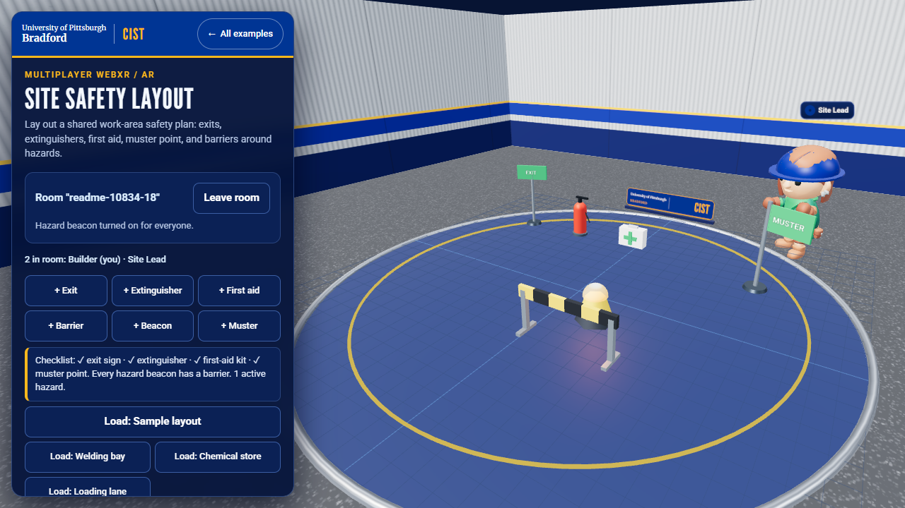
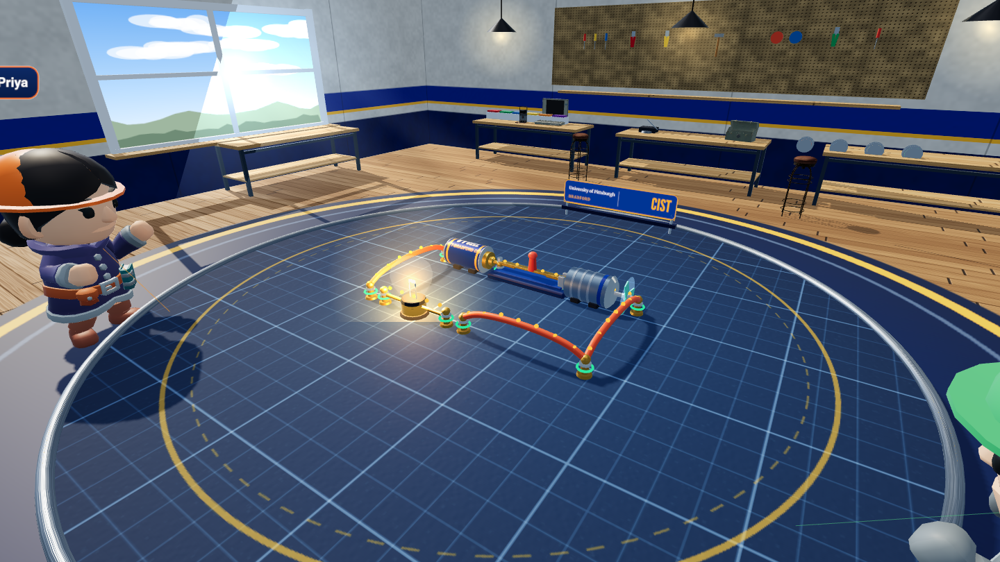
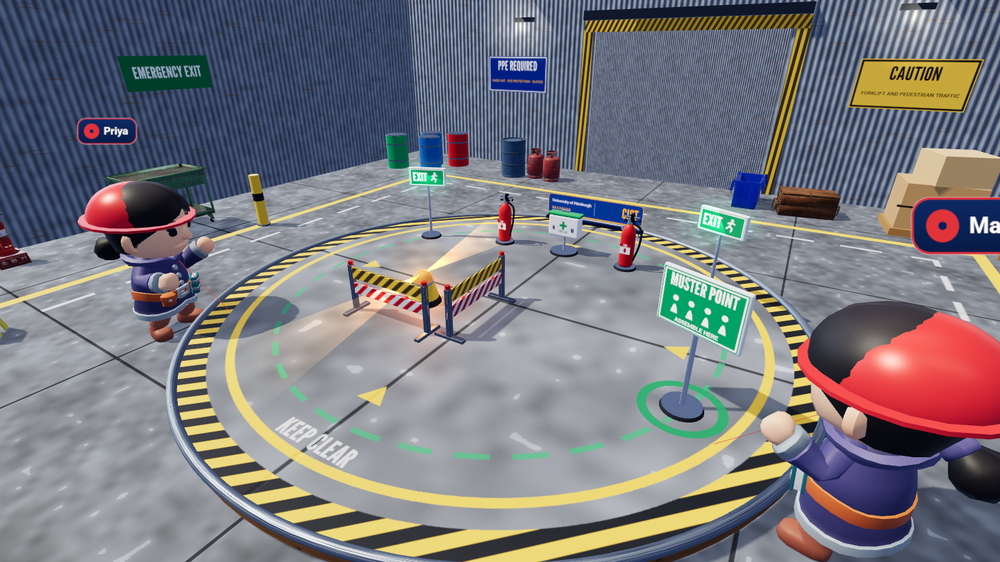
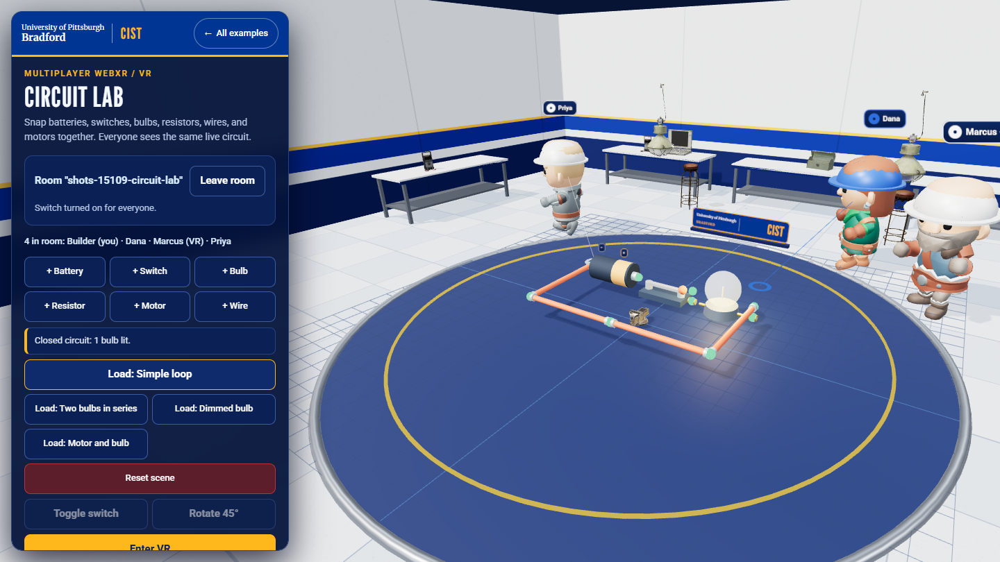

# Multiplayer WebXR examples

Two browser-first examples share one lightweight WebSocket relay:

- [`vr/`](./vr/): **Circuit Lab**, a collaborative electronics bench where participants snap together batteries, switches, bulbs, resistors, motors, and wires and see a live circuit result, with a desktop fallback.
- [`ar/`](./ar/): **Site Safety Layout**, a shared work-area safety planner (exits, extinguishers, first aid, muster point, hazard beacons, barriers) in immersive AR, with hit-test placement, a calibrated local reference frame, and a live checklist.

The [combined slide deck](./Multiplayer-WebXR-Examples.pptx) explains how to run both examples and what they demonstrate. The [screenshot index](./screenshots/README.md) includes captures of the VR and AR desktop fallbacks.




Participants join a named room, see the same shared parts and other participants, and only one person can hold a part at a time. Both pages use the same relay and protocol, but each example is a *theme* with its own part catalog. Rooms are namespaced by theme, so a room called `lab` in Circuit Lab is separate from a room called `lab` in Site Safety Layout. Both pages accept `?theme=circuits` or `?theme=safety`, so a headset or phone can join either theme alongside laptop/desktop browser builders.

The shared parts are generated from Three.js primitives. The room around the board (lab, yard or test bay) is built from CC0 glTF props, and other participants appear as characters in hard hats (see [Rooms, props and people](#rooms-props-and-people)). Room state is relayed by this project's server, and this is not a production-hosted multiplayer service.

## Lab v2: Circuit Lab and Safety Lab with a new look (v1 is unchanged)





- **Pages:** `http://localhost:8443/multi-player/v2/` (Circuit Lab) and `http://localhost:8443/multi-player/v2/?theme=safety` (Safety Lab). The v1 pages (`vr/`, `ar/`, `vr/?theme=safety`) are untouched and still work; each v2 page has "Circuit Lab / Safety Lab / Open the v1 look" links. v1 and v2 use the same relay protocol and the same theme ids, so **a v1 page and a v2 page in the same room see the same parts**.
- **Same behaviour:** rooms, parts, the four examples per lab, the headset toolbox, Y / B / X or A, Reset (press twice), glove hands, avatars and grab ownership all behave as in v1. `v2/app.js` is a fork of `shared/app.js` (the protocol client was copied, not rewritten); the rules come from the shared modules (`circuit-eval.mjs`, `safety-eval.mjs`, `examples.mjs`, `toolbox.js`, `avatars.js`). The only edit to a shared file is that `circuit-eval.mjs` now also exports `terminalPoints` and `CONTACT_DISTANCE` (no behaviour change).
- **What is new** (all generated in code: no downloaded textures or models; the few glTF props are the CC0 ones already in `assets/models-mp`, desktop only):
  - *Materials:* MeshStandardMaterial everywhere, with canvas-baked colour, roughness and normal maps (wood planks with grain, painted plaster with the Pitt band, corrugated steel, concrete, pegboard, brushed steel, rubber work mat) and an environment map made once with PMREMGenerator from a small generated "room" (window, ceiling strips). Soft shadows from a window-direction sun on the desktop.
  - *Rooms:* a workshop (wood floor, benches with parts bins, a pegboard with tools, a window with light shafts, shelves, pendant lamps, a brand roundel under the board) and a safety bay (concrete floor with painted lanes, corrugated walls, roller door, bollards, drums, pallets, PPE / CAUTION / EMERGENCY EXIT signs). The board is a wooden platform with a steel rim, the printed work mat (Circuit Lab) or a hazard-striped, marked bay floor (Safety Lab), and the Pitt-Bradford plaque.
  - *Circuit parts:* a metal-cased battery with a printed label and brass terminals, a bakelite switch with a brass blade and red handle that eases open and closed, a glass bulb with a filament that heats from dark to white and a halo glow that really lights nearby objects, a resistor with colour bands, a motor with ribs, shaft, fan and a speed blur, and wire in rounded, sagging segments. Brass posts mark each terminal, and a green ring appears where two terminals touch. **When the circuit is closed, gold dots flow along the parts in the direction of conventional current** (pure logic in `v2/flow.mjs`, unit tested).
  - *Safety parts:* an EXIT sign with a glowing face, a lathe-built extinguisher with a label and hose, a first-aid case, a barrier with yellow/black and red/white reflective stripes, a muster sign with a painted ring, and a hazard beacon whose dome pulses, with a rotating light bar, two light beams and a floor glow.
  - *Lighting that stays cheap:* the "bloom" is additive glow sprites (no post-processing pass at all, so it is identical on desktop and in a headset). Bulbs and beacons light the scene through a **fixed pool of four point lights** handed to the brightest emitters each frame, so adding or removing bulbs never recompiles shaders. Contact-shadow blobs stand in for the shadow map in a headset and in lite mode. Materials are shared between parts and parts are merged per material.
  - *In VR:* the room is kept (v1 hides it), drawn at floor level around the table-top model, without glTF props or a shadow map. In AR the room is hidden as before.
  - *Brand:* Pitt Royal, Gold, Medium Blue and New Sky on the page, signs, mat and plaque; League Gothic, Merriweather and Roboto from `vendor/fonts` (via brand-kit). No CDN: `node tools/vr-capture/offline-check.mjs` now includes both v2 pages.
- **Render cost** (`renderer.info`, from `node multi-player/tools/v2-shots.mjs`; counts are for one full frame, and the in-session figures are for **both eyes**, so per eye is about half):

| Scene | Draw calls | Triangles | Notes |
|---|---|---|---|
| Circuit Lab v2, desktop, shadows on, glTF props, 2 other participants | 162 | 85k | includes the shadow-map pass |
| Safety Lab v2, desktop, same | 199 | 91k | |
| Circuit Lab v2, emulated Quest 3 session, Simple loop | 158 (about 79 per eye) | 58k (about 29k per eye) | no shadow map, no glTF props, no other participants |
| Safety Lab v2, emulated Quest 3 session, Sample layout | 164 (about 82 per eye) | 35k (about 18k per eye) | same |

  **Not measured: frame rate on a real Quest.** These are counts only (SwiftShader frame times mean nothing). The design target is 72 fps, with about 80 draw calls and under 30k triangles per eye and one normal-mapped lighting model with five lights; whether a Quest 3 holds 72 fps (and what a Quest 2 does) has to be measured on the headset, for example with the OVR Metrics Tool. If it is short, the first things to drop are the pendant lamps and light shafts, then normal maps.
- **Verified** (all in desktop Chrome, an **emulated Quest 3**, never a real headset): `node tools/vr-capture/v2-check.mjs` runs 56 checks (join, toolbox add / examples / reset, Y / B / X, glove hands, frames drawn, environment map and PBR materials present, the light count constant, current dots follow the switch, terminal rings, a lit bulb or beacon gets a real light, draw-call and triangle budget); `npm test` adds `test/v2-flow.test.mjs` (current direction through every example) and `test/v2-assets.test.mjs` (imports resolve, vendored three, no CDN, the relay serves v2 and still serves v1). `node tools/vr-capture/toolbox-check.mjs` (v1, 41 checks) and all earlier tests still pass.
- **Not verified:** a real Quest (look, comfort, frame rate, controller feel), a Vive, a phone, AR for v2 (there is no `v2/ar/` page yet; the code keeps the AR branch but it was not run), and how bright or dark the rooms look on a headset display.
- **Capture:** `node multi-player/tools/v2-shots.mjs` writes `screenshots/v2-*.png` ([circuit desktop](./screenshots/v2-circuit-lab-desktop.png), [close-up](./screenshots/v2-circuit-lab-closeup.png), [bulb](./screenshots/v2-circuit-lab-bulb.png), [safety desktop](./screenshots/v2-safety-lab-desktop.png), [safety close-up](./screenshots/v2-safety-lab-closeup.png), and the emulated Quest 3 views [circuit](./screenshots/v2-circuit-lab-quest.png) and [safety](./screenshots/v2-safety-lab-quest.png)). The other participants in the desktop shots are scripted relay clients.
- **Found while building it:** the existing glTF prop `bench_vice_01` has its mesh about 5 m off its origin, so in v1's full (non-lite) mode a vice appears in the middle of the board. v1 was left as it is; v2 leaves that prop out, and `v2-shots.mjs` checks that every prop it loads sits near where it was placed.

## Hydrostatic Test Rig (third theme)

- Page: `http://localhost:8443/multi-player/hydrotest/` (theme `hydrotest`; `?theme=hydrotest` also works on the other pages). Rooms are separate from the Circuit Lab and Site Safety rooms.
- A shared builder for a hydrostatic test rig on a shell-and-tube heat exchanger: tank, pump, valve and vent valve (both toggle open/closed with T), gauge, exchanger, blind flange, pipe. Touch the grey port dots to connect parts; put a gold blind flange over each top nozzle. One holder per part, and a live checklist (`shared/hydro-eval.mjs`, pure and unit-tested) ends in "Ready to fill" or names the next problem (for example "Vent is closed: air will be trapped"). **Load demo rig** builds a complete rig.
- It is the web counterpart of the Unity Hydrostatic Test Bay. General safety awareness practice, not a test procedure or certification; inspired by heat-exchanger and filter-housing makers, with generic parts.
- VR here is emulator and desktop only; it has not been tried on a real headset.
- Screenshots: [empty room](./screenshots/hydrotest-empty.png), [completed rig](./screenshots/hydrotest-rig.png), [second client](./screenshots/hydrotest-rig-client2.png).

## In a headset: toolbox, buttons, examples

In VR (and in AR once aligned) a **toolbox** floats at your left: a button for every part, four ready-made examples, Open/Close, Rotate, Delete and **Reset scene** (press twice to confirm). It also shows the live summary and which part is selected, because the page panel is not visible inside a headset. Point a controller at a button and press the trigger. Squeeze both grips to bring the toolbox back in front of you.

| Control | Does |
|---|---|
| Trigger on a part | Grab and move it (selects it) |
| **Y** (left) | Open the switch under the ray, or the selected one (Safety Lab: beacon off; Hydro rig: close valve) |
| **B** (right) | Close the switch (beacon on; open valve) |
| X or A | Rotate the selected part 45° |
| Squeeze both grips | Move the toolbox in front of you |

Each lab has four examples (Circuit Lab: Simple loop, Two bulbs in series, Dimmed bulb, Motor and bulb; Safety Lab: Sample layout, Welding bay, Chemical store, Loading lane). Loading one replaces the scene for everyone in the room. The same buttons are on the page for desktop users. Each controller shows a blue glove hand (bare hands show tracked joints when the headset supports it).

**Verified:** `node tools/vr-capture/toolbox-check.mjs` runs 41 checks in desktop Chrome with an **emulated Quest 3**: toolbox presses, all examples, Y/B/X, reset, gloves present. **Not tested on a real headset**; the button numbers (4 and 5) are the Quest standard mapping. The examples are checked by `test/examples.test.mjs` (each circuit closes and powers its load; each safety layout passes its checklist).

## Joining, leaving and keyboard use

- **Join flow:** before joining, the panel shows three numbered steps. After joining, the name and room fields collapse into one line ("Room lab") with a **Leave room** button. The status line is colored when something needs attention (amber for a retry, red for an error).
- **Errors say what to do:** a relay that is not running reads "Could not reach the room relay at host:port. Start it with npm start in the multi-player folder"; a full room says so and suggests another name. If an established connection drops, the page retries by itself up to 5 times (1, 2, 4, 8, 8 seconds) and says "Reconnected" on success. The relay keeps rooms only in memory, so after a relay restart the page tells you "The room was empty, so earlier parts are gone."
- **Adding parts:** a part button adds one part at once and "arms" that part: click the board to add more, and press Esc to stop. Clicking an empty board with nothing armed adds nothing (it used to add a part by accident).
- **Keyboard:** Tab to the board, then `[` and `]` choose the previous or next part, arrow keys move it 10 cm (Shift: 40 cm), R rotates, T toggles, Delete removes, Esc deselects. Every choice is announced in the status line. Touch: all panel buttons are at least 44 px tall.
- **Who is in VR:** every browser joins as a plain browser page. A headset or phone AR session sends a one-time "mode" message when the session starts and ends, so only people really in a session carry a VR or AR chip on their name tag and in the roster. Before this fix, every visitor of the VR page was listed as VR.
- **Avatars:** desktop participants who point at the same spot are spread along the board edge (at least about 1.3 m apart) instead of standing inside each other.
- **Reduced motion:** with the operating-system setting on, the selection ring stops pulsing, camera damping is off and CSS transitions are removed.

## Look and branding

The three pages share the Pitt palette, bundled fonts and the Pitt-Bradford + **CIST** brand bar from [brand-kit](../brand-kit/README.md) (logo when the git-ignored `branding/logo.png` is present, text wordmark otherwise). In the scene, name tags and part labels are backed pills, and a Pitt-Bradford + CIST plaque stands at the back edge of the shared board. On a phone the panel becomes a bottom sheet below the board. Checked with `node tools/vr-capture/ui-check.mjs` (desktop browser at 1440 x 900 and 390 x 844; no headset or real phone).

## Rooms, props and people



Each example now stands in a room instead of on a bare disc: a tiled electronics lab (Circuit Lab), a corrugated-wall site yard (Site Safety Layout), and a concrete test bay (Hydrostatic Test Rig). Walls carry the Pitt Royal and Gold band. Floors, walls and benches are generated in code (no downloaded textures), lit by a key light with soft shadows plus a small generated image-based light, so metal and plastic read as metal and plastic.

- **Props:** 21 CC0 glTF models from Poly Haven (a multimeter, laptop, toolbox, tool cart, fire extinguisher, fire alarm, barrels, propane tanks, crates, a portable generator, pipe runs, hanging lamps and more), simplified to roughly 0.2k to 6k triangles each (most under 2.5k) and merged to one mesh per material. Where they stand is plain data in [`shared/layouts.mjs`](./shared/layouts.mjs). The room is hidden when you enter AR (the real room shows instead) and when you enter VR (the board becomes a table-top model on a small floor stage).
- **People:** every other participant is a stylised character (CC0 KayKit adventurers, about 4k triangles, with idle, walk and reach animations) wearing a hard hat. The character and the hat color come from a hash of the participant id, so every client shows the same person the same way (4 characters x 8 hat colors). The name tag is the brand-kit pill with the hat color as its accent.
  - *Headset and phone participants* send their head position, facing and two hand positions about 15 times a second. The character stands under the head and floating gloves follow the controllers. There is no inverse kinematics: when hand data is present the character's own arms are hidden.
  - *Desktop participants* have no pose, so their character stands at the board edge nearest their cursor, walks when the cursor moves, faces the board when still, and reaches while holding a part. A colored ring and a thin line show what they point at.
- **Honest look:** the characters are cartoon-like. No CC0 realistic people were found that fit a Quest triangle budget, so these are friendly stand-ins, not photo-real staff. [CREDITS.md](./CREDITS.md) lists every model with author, source page and license.
- **Fallbacks:** if a model cannot be loaded, the prop becomes a plain box or cylinder and the person becomes a primitive figure with a hard hat, and the page keeps working ([fallback screenshot](./screenshots/fallback-no-models.png)). Only the first 8 participants get the character model; later arrivals get the primitive figure to stay inside the triangle budget.
- **Lite mode:** on a software renderer (no GPU) the page defaults to lite, and says so in a note with a **Show the full scene** link (it adds `?lite=0`): no shadows and no glTF props, just the room and the people. Force it with `?lite=1` (or `?lite=0`); `?shadows=0|1` and `?props=0|1` override the two parts. Shadows are never drawn inside a headset.
- **Protocol:** two optional messages. A client may send `{ "type": "mode", "mode": "web"|"vr"|"ar" }` when a headset or phone AR session starts or ends; the relay broadcasts `peer-mode` (leaving XR clears the stored pose). The second message: A client may send `{ "type": "pose", "head": [x,y,z], "yaw": r, "hands": [[x,y,z]|null, [x,y,z]|null] }` in board coordinates. The relay validates it, limits it to one per 30 ms and broadcasts `peer-pose`. A peer's profile gains an optional `pose` field only after that peer has sent one, so old clients and pages are unaffected. Tests cover the relay, validation, late joiners and the unchanged four-field profile.

Screenshots: [Site Safety Layout](./screenshots/site-safety-avatars.png), [Test bay](./screenshots/test-bay-avatars.png), and an [emulated Quest 3](./screenshots/vr/02-quest-peer-seen-by-desktop.png) participant seen by a desktop user (the Quest view itself is in [01-circuit-lab-in-vr.png](./screenshots/vr/01-circuit-lab-in-vr.png)). The Quest captures come from the IWER emulator, not a real headset.

### Budgets (measured)

Measured with [`tools/shots.mjs`](./tools/shots.mjs) in desktop Chrome on a software renderer (SwiftShader) with the demo build loaded, two other participants shown as models, and no shadow pass (what a headset would draw). Triangle counts do not depend on the renderer; frame rate on this renderer says nothing about a Quest.

| Scene | Triangles | Draw calls | Room props loaded |
|---|---|---|---|
| Circuit Lab | 62k | 173 | 14 of 14 |
| Site Safety Layout | 37k | 86 | 18 of 18 |
| Hydrostatic Test Rig | 79k | 218 | 13 of 13 |
| Circuit Lab with every model blocked (fallback) | 8.6k | 74 | 0 of 14 (14 primitives) |

Each further character adds about 4.7k triangles (body plus hat), so eight model participants on the heaviest scene stay near 107k, under the 120k target (`SCENE_TRIANGLE_BUDGET` in [`shared/avatar-logic.mjs`](./shared/avatar-logic.mjs); the tests check the model files against it). Most draw calls come from the shared parts and name labels; the room itself costs about 40 to 60. Inside a headset the room is hidden, so the scene is smaller still. **Not verified:** frame rate on a Quest or any real GPU.

## Requirements

- Node.js 20 or newer and npm.
- A modern WebGL browser. No internet is needed: Three.js 0.169.0 and its loaders are vendored in `vendor/three/`, the fonts in `vendor/fonts/`, and the 3D models in `assets/models-mp/`.
- To enter immersive VR: a compatible headset, browser, and active runtime that support WebXR `immersive-vr`.
- To enter immersive AR: a compatible mobile device and browser that support WebXR `immersive-ar` and hit testing.
- Every collaborator must be able to reach the same server origin and use the same room name.

## Start the relay and web server

From this directory:

```powershell
npm install
npm test
npm start
```

By default, the service listens on port `8443` over plain HTTP. Open the example pages and enter the same room name:

- `http://localhost:8443/multi-player/vr/`
- `http://localhost:8443/multi-player/ar/`

For two desktop browsers on the same development machine, use two tabs and select the same room, such as `lab`. A room name is case-insensitive, 1-24 characters, and may contain letters, numbers, and hyphens. The example uses in-memory room state: it remains while at least one client stays connected and is cleared when the final participant leaves.

### Connect a headset or another computer

WebXR secure-context rules permit `localhost` for local work; a headset or another LAN device generally needs HTTPS with a certificate it trusts. A simple development setup uses [mkcert](https://github.com/FiloSottile/mkcert) to create a certificate for the server's LAN hostname:

```powershell
mkcert -install
mkcert -key-file localhost-key.pem -cert-file localhost.pem localhost 127.0.0.1 <server-lan-hostname>
$env:TLS_KEY = (Resolve-Path .\localhost-key.pem).Path
$env:TLS_CERT = (Resolve-Path .\localhost.pem).Path
npm start
```

Open `https://<server-lan-hostname>:8443/multi-player/vr/` or `/multi-player/ar/` from each device. Install/trust the development certificate on the test device as required by its browser. The room relay is served at `/ws` from the same HTTPS origin. Do not expose this unauthenticated development relay to the public internet.

The room field accepts an optional `?room=lab` query parameter. There are no accounts or private room credentials; use non-sensitive room names.

## Try a collaborative session

1. Start the server once. Keep its terminal open while anyone is using the room.
2. Open the VR page on a headset or desktop and the AR page on a supported phone, or open either example in two desktop browser tabs.
3. Join the same room from each page. The roster should show each connected participant and whether they joined from VR, AR, or the web.
4. Add a battery, switch, bulb, or wire (or load the demo) from either participant. The part should appear on all clients. Later joiners receive the existing room snapshot.
5. Drag a part in the desktop view, or aim/select with an XR controller. Another participant's grab is denied while the part is held. Switch and beacon toggles, rotation, and deletion are also shared.
6. To place the AR board in a real shared space, follow the two-point alignment step on each AR device before building. Keep both devices at the same site and use the same physical alignment markers.

## What this illustrates

- **A shared room, not just shared discovery:** a small WebSocket relay accepts connections, broadcasts updates, and stores the latest room snapshot in memory for late joiners.
- **Multimodal browser clients:** the VR and AR pages use the same part IDs and room protocol; desktop web clients can join either room.
- **Presence:** names, connection counts, and remote participant positions/modes are visible to everyone.
- **Ownership:** the server grants a single grab owner, rejects competing grabs, accepts transforms only from the current owner, and releases a part if its owner disconnects.
- **Shared state:** part placement, transforms, rotation, toggle state (switches and hazard beacons), and removal are broadcast across clients. The circuit result and safety checklist are computed locally from that shared state, so every client agrees.
- **Themes:** the relay validates part names per theme and keeps each theme's rooms separate; client-side theme modules decide how parts look and what the room-level summary says.
- **XR-specific setup:** VR requests an `immersive-vr` session; AR requests `immersive-ar` and hit testing.

This is a teaching sample, not a production networking stack. It has no login, moderation, persistence (a reconnecting page rejoins and receives the current room, but a restarted relay has no rooms), voice chat, lag compensation, or deployment automation. Anyone who can reach the server can join a room. Rooms and objects are kept in process memory and reset when everyone leaves or the server restarts.

## AR alignment limitation

WebXR provides each device with its own local tracking space. The web standard does not automatically make two devices share one real-world spatial anchor. Therefore, the AR example calibrates a *shared virtual board frame* separately on each device: tap the same physical origin marker, then tap a second marker along the agreed +Z direction. The relay synchronizes the board coordinates; each device maps that board to its locally detected floor.

This requires both devices to agree on the same physical points and remain in the same location. It is not persistent cloud-anchor sharing or automatic room scanning. If the calibration points differ, users still share edits, but the virtual board will not line up in the same physical place.

## Tests

`npm test` runs 64 tests (the first 42 are listed here; later work and v2 added the rest, v2 adds 8): the relay (mixed VR/AR clients, snapshots and isolation, theme separation, toggle and rotate rules, exclusive object ownership, disconnect cleanup, invalid input, HTTP routes and path traversal), TLS certificates, the hydrostatic checklist, the participant mode message and avatar spreading, optional avatar poses (validation, relay, late joiners, old-client profile unchanged), and the asset checks: every model in `shared/models.json` exists as a GLB and has a CC0 entry and source link in `CREDITS.md`, no model is shipped unlisted, every prop used by a room layout and every avatar character is in the manifest, per-model and per-scene triangle budgets, deterministic avatar looks, and the fallback logic (a failing load gives the primitive, every layout prop maps to a primitive stand-in). The browser-side fallback is exercised by `ONLY=fallback node multi-player/tools/shots.mjs` (all model requests blocked). The headset session and AR camera/hit-test itself still need supported physical hardware for end-to-end testing.

The AR screenshot is explicitly a desktop fallback capture of the live AR page's scene. It is not a recording of camera passthrough or a physical AR session.

## Project layout

```text
multi-player/
  server.mjs          static HTTPS/HTTP host and room WebSocket relay
  package.json        Node.js start and test commands
  CREDITS.md          every 3D model: author, source page, license (CC0)
  test/
    server.test.mjs   room, ownership, snapshot, and validation tests
    pose.test.mjs     optional avatar pose message
    avatars-assets.test.mjs  credits, manifest, budgets, fallback logic
  tools/              shots.mjs (screenshots and budgets), prepare-*.mjs and make-manifest.mjs (how the models were made), preview-models.html
  shared/
    app.js            collaborative 3D scene, room protocol client, VR and AR
    world.js          room, lighting, generated floor and walls, glTF props with primitive fallbacks
    layouts.mjs       where the props go in each example (data)
    avatars.js        character avatars, hard hats, gloves, name tags
    avatar-logic.mjs  pure avatar helpers (looks, animation choice, pose validation, fallback loader)
    models.json       manifest of the shipped models and their licenses
    themes.js         Circuit Lab, Site Safety Layout and Hydrostatic Test Rig parts, models, and live summaries
    style.css         browser panel and responsive layout
  v2/                   Lab v2 (new look): index.html, app.js (fork of shared/app.js), themes2.js, parts2.js, world2.js, fx.js, tex.js, flow.mjs, v2.css
  vr/
    index.html        WebXR immersive-vr entry point
    README.md         VR-specific prerequisites, controls, and run notes
  ar/
    index.html        WebXR immersive-ar hit-test entry point
    README.md         AR calibration, device, and hit-test guidance
  screenshots/
    README.md           screenshot index and capture notes
    multiplayer-vr.png  Circuit Lab desktop fallback
    multiplayer-ar.png  Site Safety Layout desktop fallback
  Multiplayer-WebXR-Examples.pptx combined run and learning-objective deck
```

## References

- - [WebXR Device API](https://developer.mozilla.org/docs/Web/API/WebXR_Device_API)
- [Three.js WebXR manual](https://threejs.org/manual/#en/webxr-basics)
