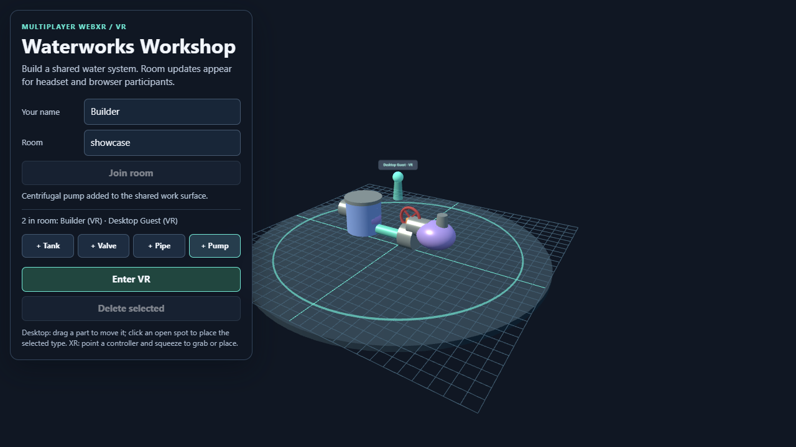

# Multiplayer WebXR examples

Two browser-first examples share one lightweight WebSocket relay:

- [`vr/`](./vr/): a collaborative VR waterworks builder with a desktop fallback.
- [`ar/`](./ar/): the same shared waterworks layout in immersive AR, with hit-test placement and a calibrated local reference frame.

The [combined slide deck](./Multiplayer-WebXR-Examples.pptx) explains how to run both examples and what they demonstrate. The [screenshot index](./screenshots/README.md) includes captures of the VR and AR desktop fallbacks.




The examples follow the interaction pattern in [Week-08-WebXR-WaterWorks](https://github.com/jcallinan/CIST1423-Fall2026-Examples/tree/master/Week-08-WebXR-WaterWorks): participants join a named room, see the same shared parts and other participants, and only one person can hold a part at a time. Both clients use the same room and server, so a VR builder and an AR builder can collaborate with laptop/desktop browser builders at the same time.

This repository implements a new, compact demonstration rather than copying the referenced project or its assets. Parts are generated from Three.js primitives, room state is relayed by this project's server, and this is not a production-hosted multiplayer service.

## Requirements

- Node.js 20 or newer and npm.
- A modern WebGL browser with network access for the pinned Three.js 0.169.0 CDN modules.
- To enter immersive VR: a compatible headset, browser, and active runtime that support WebXR `immersive-vr`.
- To enter immersive AR: a compatible mobile device and browser that support WebXR `immersive-ar` and hit testing.
- Every collaborator must be able to reach the same server origin and use the same room name.

## Start the relay and web server

From this directory:

```powershell
npm install
npm test
npm start
```

By default, the service listens on port `8443` over plain HTTP. Open the example pages and enter the same room name:

- `http://localhost:8443/multi-player/vr/`
- `http://localhost:8443/multi-player/ar/`

For two desktop browsers on the same development machine, use two tabs and select the same room, such as `lab`. A room name is case-insensitive, 1-24 characters, and may contain letters, numbers, and hyphens. The example uses in-memory room state: it remains while at least one client stays connected and is cleared when the final participant leaves.

### Connect a headset or another computer

WebXR secure-context rules permit `localhost` for local work; a headset or another LAN device generally needs HTTPS with a certificate it trusts. A simple development setup uses [mkcert](https://github.com/FiloSottile/mkcert) to create a certificate for the server's LAN hostname:

```powershell
mkcert -install
mkcert -key-file localhost-key.pem -cert-file localhost.pem localhost 127.0.0.1 <server-lan-hostname>
$env:TLS_KEY = (Resolve-Path .\localhost-key.pem).Path
$env:TLS_CERT = (Resolve-Path .\localhost.pem).Path
npm start
```

Open `https://<server-lan-hostname>:8443/multi-player/vr/` or `/multi-player/ar/` from each device. Install/trust the development certificate on the test device as required by its browser. The room relay is served at `/ws` from the same HTTPS origin. Do not expose this unauthenticated development relay to the public internet.

The room field accepts an optional `?room=lab` query parameter. There are no accounts or private room credentials; use non-sensitive room names.

## Try a collaborative session

1. Start the server once. Keep its terminal open while anyone is using the room.
2. Open the VR page on a headset or desktop and the AR page on a supported phone, or open either example in two desktop browser tabs.
3. Join the same room from each page. The roster should show each connected participant and whether they joined from VR, AR, or the web.
4. Add a valve, tank, pipe, or pump from either participant. The part should appear on all clients. Later joiners receive the existing room snapshot.
5. Drag a part in the desktop view, or aim/select with an XR controller. Another participant's grab is denied while the part is held. Valve changes and deletion are also shared.
6. To place the AR board in a real shared space, follow the two-point alignment step on each AR device before building. Keep both devices at the same site and use the same physical alignment markers.

## What this illustrates

- **A shared room, not just shared discovery:** a small WebSocket relay accepts connections, broadcasts updates, and stores the latest room snapshot in memory for late joiners.
- **Multimodal browser clients:** the VR and AR pages use the same part IDs and room protocol; desktop web clients can join either room.
- **Presence:** names, connection counts, and remote participant positions/modes are visible to everyone.
- **Ownership:** the server grants a single grab owner, rejects competing grabs, accepts transforms only from the current owner, and releases a part if its owner disconnects.
- **Shared state:** part placement, transforms, valve state, and removal are broadcast across clients.
- **XR-specific setup:** VR requests an `immersive-vr` session; AR requests `immersive-ar` and hit testing.

This is a teaching sample, not a production networking stack. It has no login, moderation, persistence, reconnecting snapshot client, voice chat, lag compensation, or deployment automation. Anyone who can reach the server can join a room. Rooms and objects are kept in process memory and reset when everyone leaves or the server restarts.

## AR alignment limitation

WebXR provides each device with its own local tracking space. The web standard does not automatically make two devices share one real-world spatial anchor. Therefore, the AR example calibrates a *shared virtual board frame* separately on each device: tap the same physical origin marker, then tap a second marker along the agreed +Z direction. The relay synchronizes the board coordinates; each device maps that board to its locally detected floor.

This requires both devices to agree on the same physical points and remain in the same location. It is not persistent cloud-anchor sharing or automatic room scanning. If the calibration points differ, users still share edits, but the virtual board will not line up in the same physical place.

## Tests

`npm test` runs six tests covering mixed VR/AR WebSocket clients, room snapshots and isolation, exclusive object ownership, disconnect cleanup, invalid room rejection/transforms, and the HTTP example routes/path traversal guard. The headset session and AR camera/hit-test itself still need supported physical hardware for end-to-end testing.

The AR screenshot is explicitly a desktop fallback capture of the live AR page's scene. It is not a recording of camera passthrough or a physical AR session.

## Project layout

```text
multi-player/
  server.mjs          static HTTPS/HTTP host and room WebSocket relay
  package.json        Node.js start and test commands
  test/
    server.test.mjs   room, ownership, snapshot, and validation tests
  shared/
    app.js            collaborative 3D scene, room protocol client, VR and AR
    style.css         browser panel and responsive layout
  vr/
    index.html        WebXR immersive-vr entry point
    README.md         VR-specific prerequisites, controls, and run notes
  ar/
    index.html        WebXR immersive-ar hit-test entry point
    README.md         AR calibration, device, and hit-test guidance
  screenshots/
    README.md           screenshot index and capture notes
    multiplayer-vr.png  VR example desktop fallback
    multiplayer-ar.png AR example desktop fallback preview
  Multiplayer-WebXR-Examples.pptx combined run and learning-objective deck
```

## References

- [Reference WaterWorks multiplayer example](https://github.com/jcallinan/CIST1423-Fall2026-Examples/tree/master/Week-08-WebXR-WaterWorks)
- [WebXR Device API](https://developer.mozilla.org/docs/Web/API/WebXR_Device_API)
- [Three.js WebXR manual](https://threejs.org/manual/#en/webxr-basics)
