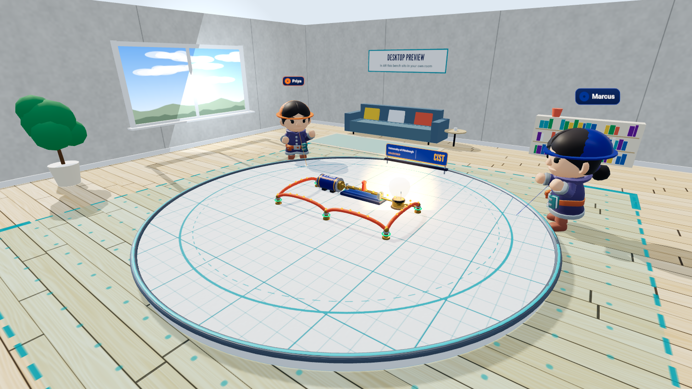

# Multiplayer AR — Circuit Lab

The shared Circuit Lab bench, placed in the real room. People standing around the same table or patch of floor each open this page on a phone or headset, place the bench on the same two markers, and build one circuit together: batteries, switches, bulbs, resistors, motors and wires that connect where their gold ends touch. When someone closes the switch, the bulb lights for everyone. A desktop browser can join the same room and sees the bench in the virtual workshop.

This page is the [Circuit Lab v2](../v2/) app running in its AR mode. It uses the same parts, the same circuit rules (`shared/circuit-eval.mjs`), the same relay protocol and the same rooms, so **this page, the v2 page and the v1 page in one room all show the same circuit**. A presenter can run the v2 page on the projector while people in the room place parts in AR.

It is a WebXR/WebSocket teaching example, not a native ARCore or ARKit app.

## Status: what was tested and what was not

- **Tested (November 9, 2026):** desktop Chrome only. Two browser windows joined one room through the relay. Loading the sample circuit, adding and deleting a part, and opening and closing the switch in one window showed up in the other, with the same circuit result ("Closed circuit: 1 bulb lit" / "Open circuit") and no console errors.
- **Not tested: every AR part of this page.** No phone, no Quest, no HoloLens and no emulator has run it. That covers starting the `immersive-ar` session, the hit-test ring, the two-point alignment, the bench size setting, placing and carrying parts in AR, and whether two devices that tap the same markers really see the bench in the same place. The alignment and hit-test code is the same approach as the [Site Safety Layout AR page](../ar/), which has also not been run on a physical device.
- Before the demo, try it on the real devices in the real room and keep the desktop page ready as the fallback.

## Run it

From `multi-player/`:

```powershell
npm install
npm start
```

Open `http://localhost:8443/multi-player/ar-circuit/`, enter a name, and join the same room as the others. A phone or headset on the network needs HTTPS with a certificate it trusts; `scripts/start-demo.cmd` and the [parent README](../README.md#connect-a-headset-or-another-computer) cover that. The relay's QR page (`/multi-player/qr.html`) lists this page for phones.

## Build a circuit together

1. Join a room and press **Load: Simple loop**, or add parts with the part buttons.
2. Drag parts so their gold ends touch. The rings at the ends turn green when two parts connect.
3. Select the switch and press **Toggle switch** (or **T**). When the loop through the battery is complete, the bulb lights and dots show the current.
4. One person holds a part at a time; another person's grab is refused until they let go.

## Place the bench in the real room

WebXR gives each device its own coordinate system, so every device has to be told where the bench is. The page does that with two taps on two real markers.

1. Put two markers (tape crosses or coins) on a flat table or floor: one where the **middle of the bench** should be, and one at least 25 cm away toward the **front of the bench**.
2. Everyone picks the same **Bench size in AR**. The default draws the bench 1.75 m across with parts about 20 cm long. Use "Table: about 1 m across" for a normal table.
3. Press **Place the bench & enter AR**. Move the device until the ring sits on the first marker, and tap. Aim at the second marker, and tap again. The bench appears.
4. Phone: aim the ring at the bench and tap to add the last-chosen part. Touch and hold a part to pick it up, aim to carry it, and lift your finger to put it down. The page panel stays on screen for the part buttons and the switch.
5. Headset with controllers: aim your head at each marker for the two alignment taps (the ring follows your view), then point a controller at the bench and use the trigger. Y opens and B closes a switch, X or A rotates the selected part. The floating toolbox adds parts and loads examples.

If people tap different points, pick different sizes, or swap the two markers, the circuit still stays in step for everyone, but the bench will sit in a different place or at a different size on each device. Leave AR and enter again to redo the alignment.

Add `?scale=0.15` (or `0.25`, `0.5`, `1`) to the address to preselect the size, and `?room=name` to prefill the room.

## What it demonstrates

- A real `immersive-ar` session request with WebXR hit testing and a placement ring.
- A two-point alignment that maps shared bench coordinates into each device's own AR space, with a shared scale so the bench fits a table.
- One circuit model evaluated on every client from the shared part positions, so no circuit state is sent over the network apart from each switch.
- The same room, presence and part-ownership rules as the VR and desktop pages, with a desktop fallback.

## Limitations

- `immersive-ar` with hit testing needs a compatible browser and device and an HTTPS origin the device trusts (or `localhost`). iPhone Safari does not support WebXR.
- The alignment is not a cloud anchor or a platform shared anchor. It lasts for one AR session, and its accuracy depends on how carefully each person taps the markers.
- The bench size is chosen on each device and is not sent to the room.
- In AR, other AR participants have no avatar (they are real people in the room). Desktop participants appear as small figures at the edge of the bench.
- No occlusion by real objects, no room scan, no saved circuits, no accounts. The relay is an unauthenticated development server; do not expose it to the internet.
- The circuit model is simplified for teaching (see the parent README); it is not a circuit simulator.
- On GitHub Pages there is no relay, so the page loads and says so but cannot join a room.

See the parent [README](../README.md) for the relay, the room model, tests and secure hosting.

## Screenshot



Desktop preview in desktop Chrome (the room is a stand-in; the other two participants are scripted relay clients). It is not camera passthrough and not an AR session.
