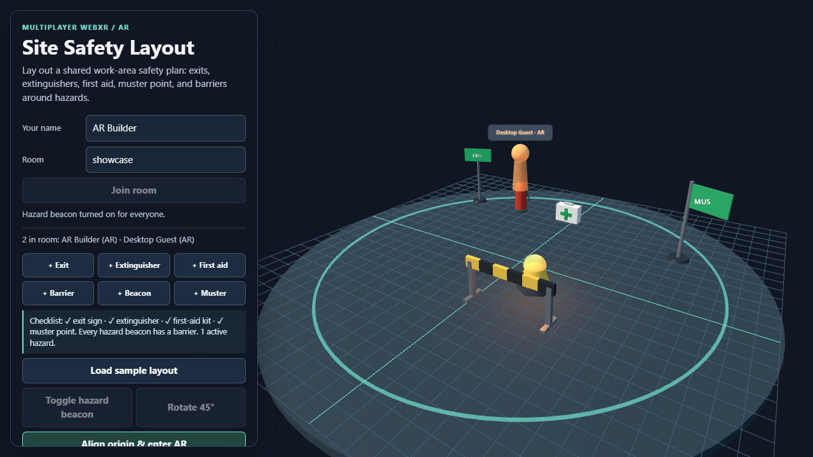

# Multiplayer AR — Site Safety Layout

A browser-based, collaborative WebXR augmented-reality planner. AR participants place a shared virtual board relative to real surfaces, then lay out a work-area safety plan together: exit signs, fire extinguishers, first-aid kits, a muster point, hazard beacons, and barriers. A live checklist tells the whole room what is still missing. Desktop browser participants can join the same room and edit the same layout.

This is a WebXR/WebSocket teaching example, not a native ARCore or ARKit app. It pairs with the Industrial safety scenarios in the [Fieldwork XR Practice Lab](../../training-simulations/).

## Run it

From `multi-player/`, run:

```powershell
npm install
npm test
npm start
```

Open `http://localhost:8443/multi-player/ar/`, enter a name, and join the same room as collaborators. To let a WebXR-capable mobile device join over the network, configure HTTPS and a certificate trusted by the device; follow the [parent server instructions](../README.md#connect-a-headset-or-another-computer). Rooms are separated by theme, so this page shares rooms with other Site Safety Layout clients but not with the [VR Circuit Lab](../vr/) (add `?theme=circuits` to use the circuit parts in AR).

## Plan a layout

1. Join a room and press **Load sample layout**, or add parts yourself.
2. Drag parts around the board and rotate them with **R** (or **Rotate 45°**). Select a hazard beacon and press **T** to mark an active hazard; it flashes amber for everyone.
3. Watch the checklist: it shows which of the exit sign, extinguisher, first-aid kit, and muster point are present, and warns about any hazard beacon with no barrier within about a meter.
4. Fix the warnings together. Another participant's grab is denied while you hold a part.

## Calibrate a shared physical board

WebXR hit testing places the board against real surfaces, but individual devices do not automatically share one world origin. For participants in the same physical location:

1. Set two visible markers on a horizontal floor or tabletop: a shared origin point and a second point that defines the board's +Z direction.
2. Each AR participant enters the same room and selects **Align origin & enter AR**.
3. Point at and tap the same physical origin marker, then point at and tap the second marker.
4. When alignment completes, the shared virtual board is mapped to that device's local tracking space.
5. Add or manipulate parts. Other AR clients that performed the same alignment should see the board in the same physical area; desktop clients see the same layout on the virtual board.

Use clearly visible markers and keep devices at the same site. If participants tap different points or reverse the +Z direction, objects still synchronize but may be in different physical positions or orientations.

## What it demonstrates

- A real `immersive-ar` session request with WebXR hit testing and a visible placement reticle.
- A two-point local calibration that maps server-shared board coordinates to each device's own AR space.
- The same server room protocol, presence, and object ownership rules used by the VR sibling example, with a different part catalog and a shared checklist computed on every client.
- Cross-device shared transforms and toggle state with a desktop editing fallback.

## Limitations

WebXR `immersive-ar` and hit testing require a compatible mobile browser, device, and HTTPS secure context (except `localhost`). The local coordinate calibration is not a persistent cloud anchor or platform-shared spatial anchor; it needs the same two physical reference points at each session. There is no automatic room scan, collision detection, occlusion mesh, saved layout, account system, or production service authentication. The checklist is a teaching aid, not a code-compliant safety plan.

See the parent [README](../README.md) for the server, room model, test coverage, secure hosting, and project references.

## Screenshot



Captured from two desktop browser clients in the same room after loading the sample layout and switching the beacon on. It is the desktop fallback, not camera passthrough or a physical AR session.
