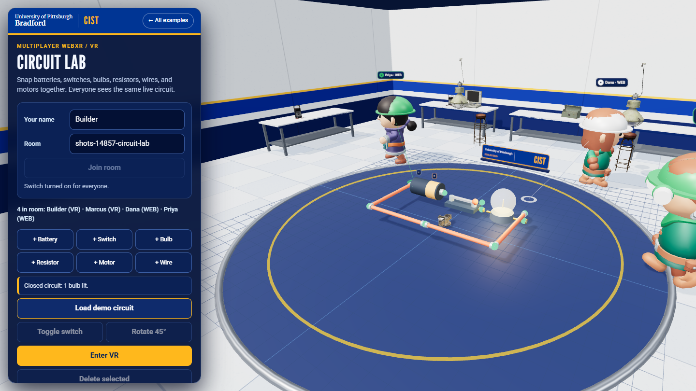
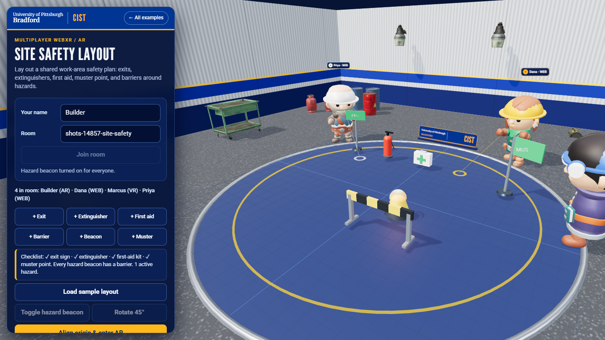
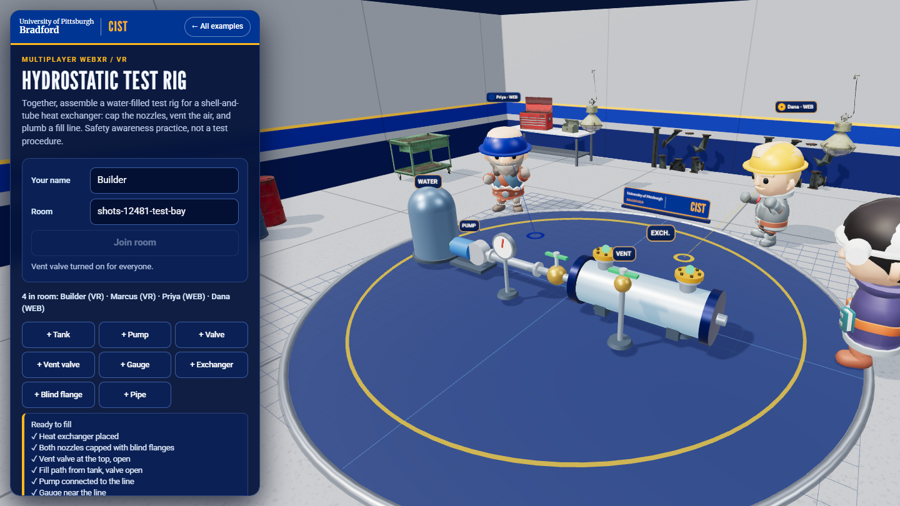

# Multiplayer WebXR screenshots

These captures show the running examples in desktop browser fallback mode, re-shot on November 1, 2026 after the professional-look pass (`node tools/vr-capture/readme-shots.mjs mp`; the git-ignored logo is blocked, so the brand bar and the board plaque show the text wordmark). They document the browser experience and the shared Circuit Lab and Site Safety Layout scenes; neither image is a headset recording.

| Example | Capture | Notes |
|---|---|---|
| Multiplayer VR | [multiplayer-vr.png](./multiplayer-vr.png) | Circuit Lab with two participants and a closed loop (battery, switch, bulb, wires) with the bulb lit. |
| Multiplayer AR | [multiplayer-ar.png](./multiplayer-ar.png) | Site Safety Layout with two participants, the sample layout, and a passing checklist. Physical camera passthrough is not shown. |

For actual immersive sessions, use a supported WebXR device and a trusted HTTPS origin. The AR example additionally requires both participants to calibrate the same physical origin and +Z direction; see the [AR guide](../ar/README.md#calibrate-a-shared-physical-board).

## November 3, 2026: rooms, props and people

Re-shot after the realism upgrade (see [Rooms, props and people](../README.md#rooms-props-and-people) and [CREDITS.md](../CREDITS.md)). Produced by `node multi-player/tools/shots.mjs` (full-detail page: shadows and glTF props on) in desktop Chrome on a software renderer. The other participants are scripted relay clients, so their positions are staged: one walks to its cursor, one stands still, one sends a head and hand pose the way a headset does. **Nothing here is a real headset or a real two-device session.** The Quest captures are an **emulated Meta Quest 3** (IWER).

| Capture | What it shows |
|---|---|
| [circuit-lab-avatars.png](./circuit-lab-avatars.png) | Circuit Lab in the lab room with three other participants in hard hats (also copied to multiplayer-vr.png). |
| [site-safety-avatars.png](./site-safety-avatars.png) | Site Safety Layout in the site yard (also copied to multiplayer-ar.png). Desktop fallback of the AR page, no camera passthrough. |
| [test-bay-avatars.png](./test-bay-avatars.png) | Hydrostatic Test Rig in the test bay, completed rig (also copied to hydrotest-rig.png). |
| [fallback-no-models.png](./fallback-no-models.png) | Every model request blocked: props become boxes and cylinders, the person becomes a primitive figure, the page still works. |
| [vr/01-circuit-lab-in-vr.png](./vr/01-circuit-lab-in-vr.png) | Emulated Quest 3 inside the VR session: table-top board on a floor stage, other participants as small characters. |
| [vr/02-quest-peer-seen-by-desktop.png](./vr/02-quest-peer-seen-by-desktop.png) | What a desktop user sees of the emulated Quest participant: character under the head, gloves at the controllers. |

