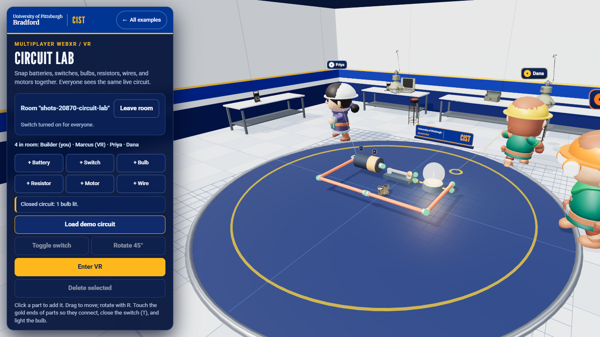
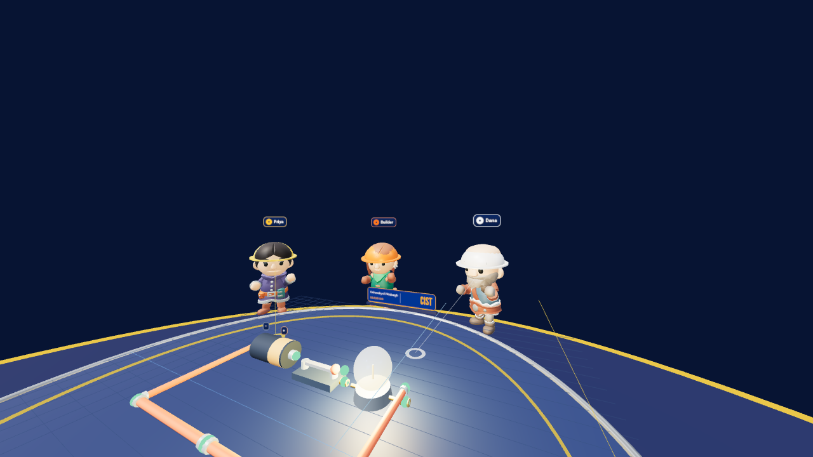

# Multiplayer VR — Circuit Lab

A browser-based shared electronics bench for joining one room from a VR headset, an ordinary desktop browser, or both. Place batteries, switches, bulbs, resistors, motors, and wires on a shared board and build a circuit together. Everyone in the room sees the same parts, switch positions, roster, and live circuit result.

This is a WebXR/WebSocket teaching example, not a native SteamVR or vendor-specific headset app.

## Run it

From `multi-player/`, install dependencies and start the shared HTTP/WebSocket server:

```powershell
npm install
npm test
npm start
```

Open `http://localhost:8443/multi-player/vr/` and join the same room on each client. Set the client name before joining. Rooms are separated by theme, so VR Circuit Lab rooms are shared with other Circuit Lab clients (for example, the AR page opened with `?theme=circuits`) but not with the [AR Site Safety Layout](../ar/).

For a headset or LAN device, WebXR requires HTTPS with a certificate trusted by the headset. See the [multiplayer setup guide](../README.md#connect-a-headset-or-another-computer) for an `mkcert` development configuration and LAN URL.

## Build a circuit

1. Join a room and press **Load demo circuit** for a battery, switch, bulb, and four wires already arranged in a loop, or add parts yourself.
2. Parts conduct when their gold terminal ends touch; touching terminals turn green. Drag parts to line up their ends, and press **R** (or **Rotate 45°**) to turn the selected part.
3. Select the switch and press **T** (or **Toggle switch**) to close it. A closed loop through the battery lights the bulb and spins the motor; the status line under the parts explains what is happening.
4. Add a resistor to dim the bulb and slow the motor. Join a wire straight across the battery to see a short-circuit warning.

The circuit model is a simplified teaching model: it checks whether the battery is on a closed loop and counts resistors, rather than solving full electrical networks. It is computed identically on every client from the shared part positions and switch states.

## What it demonstrates

- WebXR immersive VR entry with a normal browser view as a fallback.
- Joining a named multiplayer room through a WebSocket relay, with a server-held snapshot so late joiners see existing parts.
- Peer roster and remote presence.
- Procedurally generated battery, switch, bulb, resistor, motor, and wire parts with a shared, live circuit result.
- Shared part placement, drag/rotate updates, switch state, and deletion.
- Server-enforced single-person grab ownership. A competing grab is denied; an owner disconnect releases their part.

## Controls

- Click a part button to spawn that part; click an empty place on the board to place the selected type.
- On desktop, click a part to select it and drag it to move. **R** rotates, **T** toggles a switch, **Delete** removes it. From the keyboard: Tab to the board, `[` and `]` choose a part, arrow keys move it, Esc deselects.
- On a headset, select a part with the controller trigger to grab it. Select an empty board location to add the current part.
- Use **Enter VR** while the page is in a user gesture and the headset/runtime is ready.
- Join another browser in the same room to observe updates and presence.

## Limitations

WebXR availability depends on the browser, headset, runtime, operating system, and secure context. Desktop fallback mode allows interaction testing but is not a VR session. This example does not implement voice, accounts, durable storage, networking authentication, prediction, or public deployment protections. Room state is in memory only.

See the parent [README](../README.md) for the shared relay protocol, room behavior, tests, security scope, and references.

## Screenshots



Captured from two desktop browser clients joined to the same room after loading the demo circuit and closing its switch. This is the desktop fallback; it is not a headset recording.

### In VR (emulated headset)



Captured from an emulated Meta Quest 3 (see [tools/vr-capture](../../tools/vr-capture/README.md)), not a physical headset. When you enter VR the board becomes a table-height model in front of you, scaled to about 40%, so you reach across it instead of standing inside a floor-sized board.
