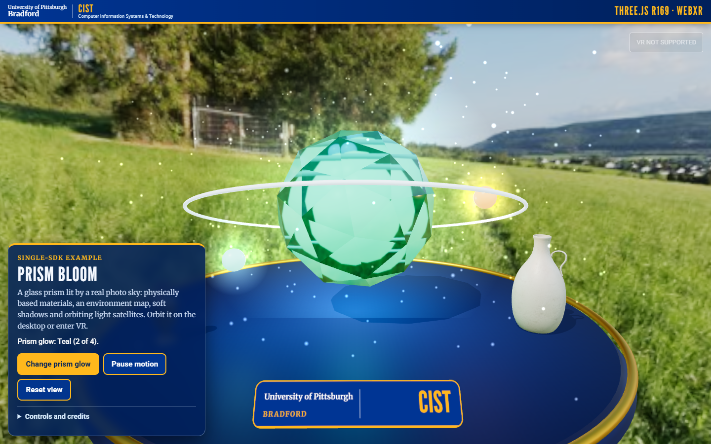
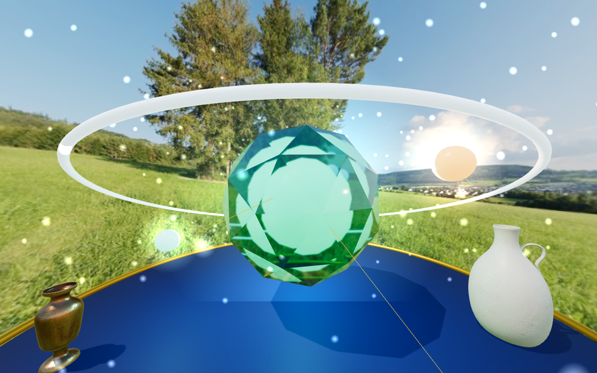

# Three.js Prism Bloom

A glass prism lit by a real photo sky, built with Three.js r169 and its WebXR support: physically based materials (transmission, iridescence, clear coat), image-based lighting from an equirectangular sky, soft shadows, light satellites, and the Three.js `VRButton` for immersive VR.

## What changed in this version

- **Look:** the flat-shaded prism is now a transmissive, iridescent glass gem around a glowing core, on a brass-rimmed platform. The scene is lit by the summer sky photo (as background and as a PMREM environment map), a shadow-casting sun with soft PCF shadows, ACES tone mapping, additive glow sprites and drifting sparkles.
- **Models:** two CC0 Poly Haven vases (brass and ceramic, about 11.6k triangles in total, counted from the glTF files) stand on the platform; a primitive vase replaces either one if the glTF fails to load.
- **HUD:** the shared brand bar and panel (`demo-ui/hud.css`, `brand-kit`) with large buttons (Change glow, Pause motion, Reset view), a live status line, and collapsible controls and credits. The brand plate and a help panel are in the 3D scene (via `brand-kit/panels.js`); the help panel shows in VR.
- **Access:** keyboard (`C` glow, `Space` pause, `R` reset, arrow keys orbit), mouse, touch (drag, pinch), screen-reader status line; `prefers-reduced-motion` starts paused.
- **VR:** the exhibit is placed 2.6 m in front of a standing player; the controller trigger changes the glow; controller rays are drawn.

## Prerequisites

- A modern browser with WebGL2 and JavaScript modules.
- For immersive VR, a WebXR browser, runtime and headset.

## Launch

These pages load libraries, fonts and sky photos from elsewhere in the repository (`../vendor`, `../brand-kit`, `../assets`), so serve the **repository root**, not this folder. No internet is needed.

```
python -m http.server 8000                     # from the repository root
node tools/vr-capture/static-server.mjs 8000   # alternative that copes with many parallel requests
```

Open <http://localhost:8000/threejs/>. WebXR needs a secure context: `localhost` qualifies; another device needs HTTPS with a certificate it trusts.

Drag to orbit, press **C** (or the button) to cycle the glow, and select **ENTER VR** (top right) where the browser supports it.

## Checks that were run

- `node tools/vr-capture/demos-check.mjs` (all four demos, desktop and 390 px phone, every non-local request blocked): no console or page errors, no failed requests, no horizontal scroll, buttons at least 40 px tall, brand bar present, every loaded asset exists and is credited, assets under 8 MB, glTF triangles under 100k.
- `node tools/vr-capture/demos-xr-check.mjs`: enters an **emulated** Meta Quest 3 immersive session (Meta's IWER runtime inside desktop Chrome), pulls the emulated trigger and checks for errors. This shows the code path runs.

## Limitations

- The VR button and session depend on browser, OS, runtime and headset support. Without them you get the desktop scene.
- The transmissive glass is the most expensive material here; a standalone headset may need a lower pixel ratio.
- The sky is a regional-style stand-in photo, not a photo of Bradford.

## Credits

See [../CREDITS-web-demos.md](../CREDITS-web-demos.md): sky photo `assets/skies/summer-2k.jpg` (Poly Haven, CC0); models `brass_vase_03` (Rico Cilliers) and `ceramic_vase_04` (James Ray Cock), Poly Haven, CC0. Three.js is MIT.

## Upstream

- [Three.js documentation](https://threejs.org/docs/)
- [Three.js WebXR guide](https://threejs.org/manual/#en/webxr-basics)

## Screenshots



Desktop browser (Chrome, software GL) after pressing **C**. The "VR not supported" button is the real desktop state, not a headset recording. A phone-width view is in [../screenshots/phone/](../screenshots/phone/threejs-prism-bloom.png). The image below is from an **emulated** Quest 3 session (IWER); it is not a real headset.



## Session setup review

Checked in desktop Chrome with an emulated Quest 3 (`node tools/vr-capture/demos-sdk-check.mjs`): `VRButton` requests `immersive-vr` with nothing required and `local-floor`, `bounded-floor` and `layers` optional; the exhibit moves in front of the player on `sessionstart` and back on `sessionend`; the canvas follows a resize; Three.js restores its own context after a loss. Known gap: Three.js asks for the `local-floor` reference space without a fallback, so a runtime that refuses it would fail to start the session (Quest and SteamVR support it). The distinctive Three.js parts here are `MeshPhysicalMaterial` transmission and iridescence with an image-based light built by `PMREMGenerator`.
