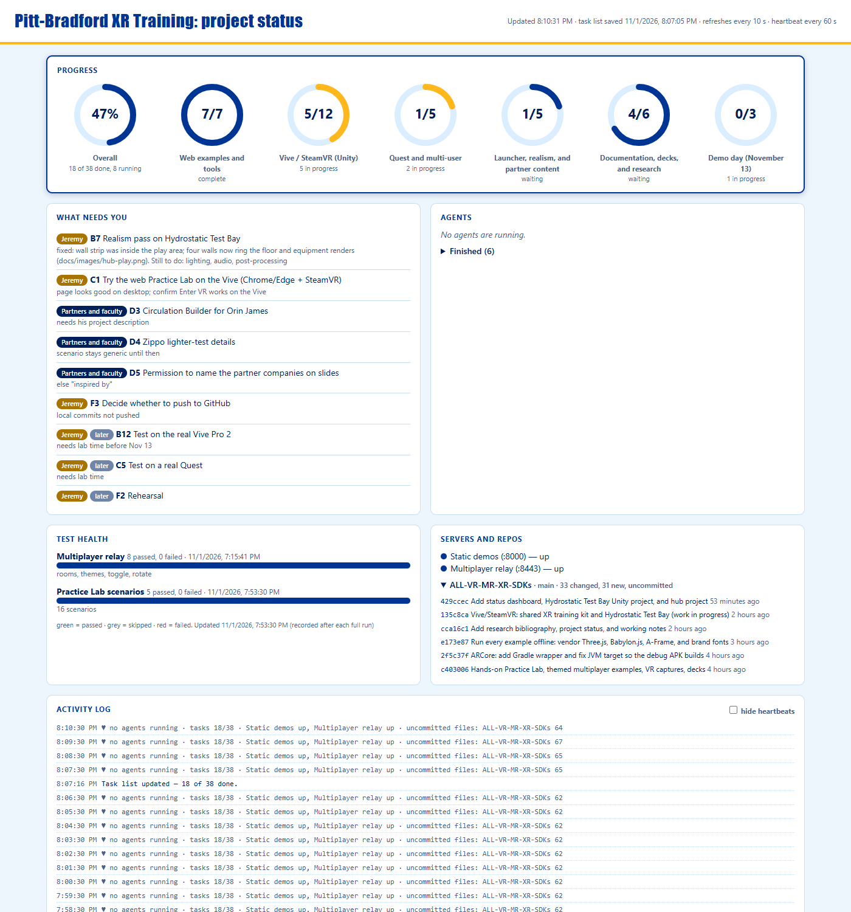
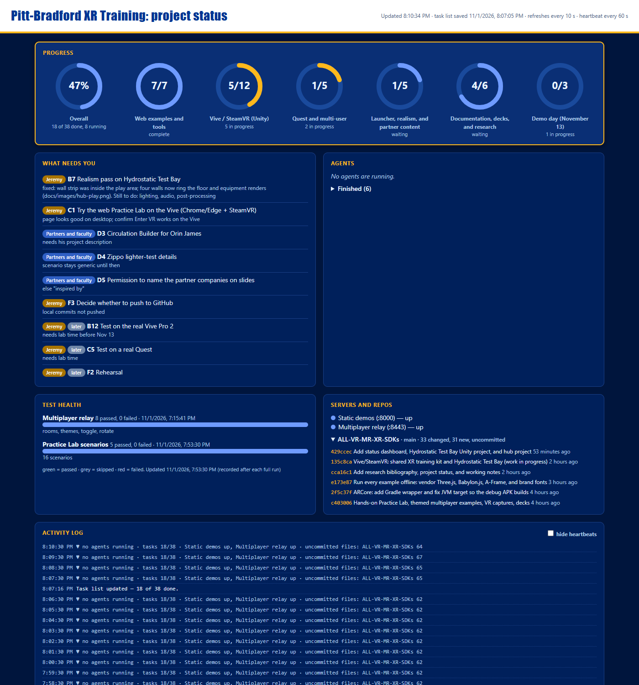

# Status dashboard

A local, live status page for work done by several people and AI agents at once. No installs (Node.js only), no cloud (binds to 127.0.0.1), no database.

- **Start:** `npm run status` from the repository root, or double-click `start-status.cmd`, then open the address it prints (a free port is chosen automatically). It refreshes every 10 seconds.
- **Task list it reads:** [docs/Task-Status.md](../../docs/Task-Status.md). Edit that file whenever work moves.
- **Configuration:** `status.config.json` (title, port, repos, servers to watch, owner and customer names).
- **Full guide** (file formats, configuration, troubleshooting, instructions for Claude): [docs/status-dashboard-guide.md](../../docs/status-dashboard-guide.md).





## What is on the page

| Panel | What it shows |
|---|---|
| **Progress** | A ring for the whole project and one per section of the task list (done / total). Blue is done; gold means something in that section is in progress. |
| **What needs you** | Tasks waiting on the owner (gold pill) or on partners and faculty (blue pill), with their notes. |
| **Agents** | Sub-agents that are running, with how long and when they last did something, and a collapsed list of finished ones with their results. |
| **Test health** | The last recorded result of each test suite (passed, failed, skipped). |
| **Servers and repos** | Whether the demo servers answer, plus uncommitted file counts and recent commits for each repository. |
| **Activity log** | A heartbeat every minute and an event whenever something changes (new commit, agent started or finished, test run recorded, task list edited). |

The colors are the University of Pittsburgh palette (Royal blue, Gold, Medium Blue, New Sky) with League Gothic and Roboto from `vendor/fonts`; it switches to a dark version with the system theme. The port is chosen automatically, so several projects can run their own dashboard on one machine. Screenshots are made with `node tools/vr-capture/status-shot.mjs <out.png> [light|dark]`.

Helpers:

```
node tools/status/agent.cjs start <agentId> "<name>" "<what it does>" [watchPath ...]
node tools/status/agent.cjs done  <agentId> "<one-line result>"
node tools/status/record-results.cjs "<suite name>" <passed> <failed> <skipped> ["<note>"]
```

This folder is a copy of the tool built for the EVE Residential review package. To use it on another project, copy `tools/status/` and follow section 5 of the guide.
