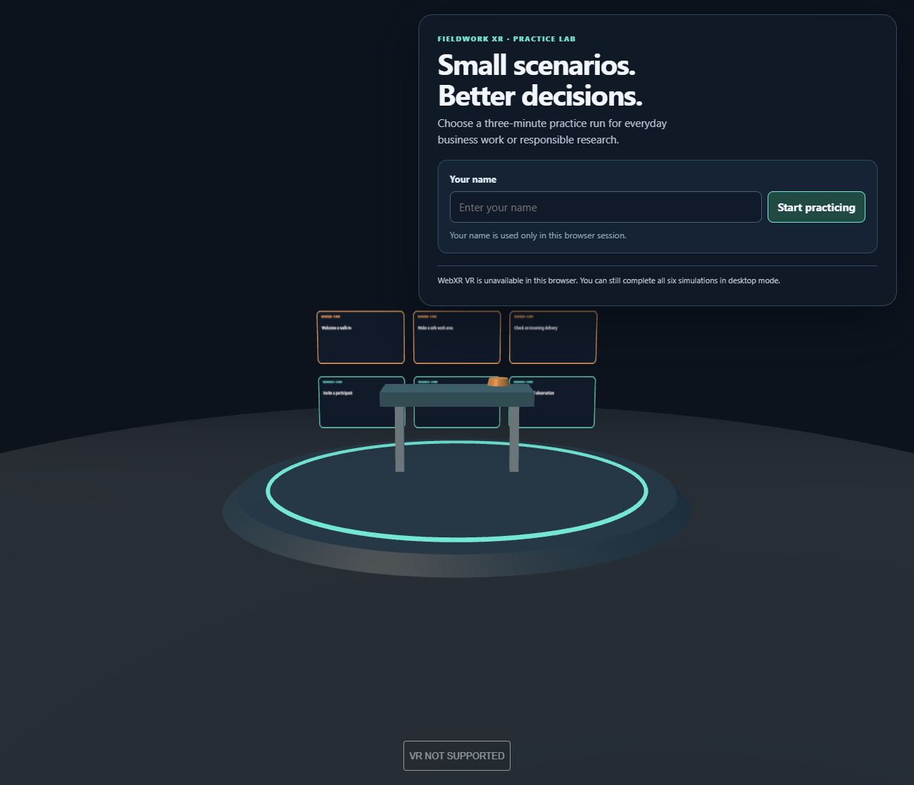
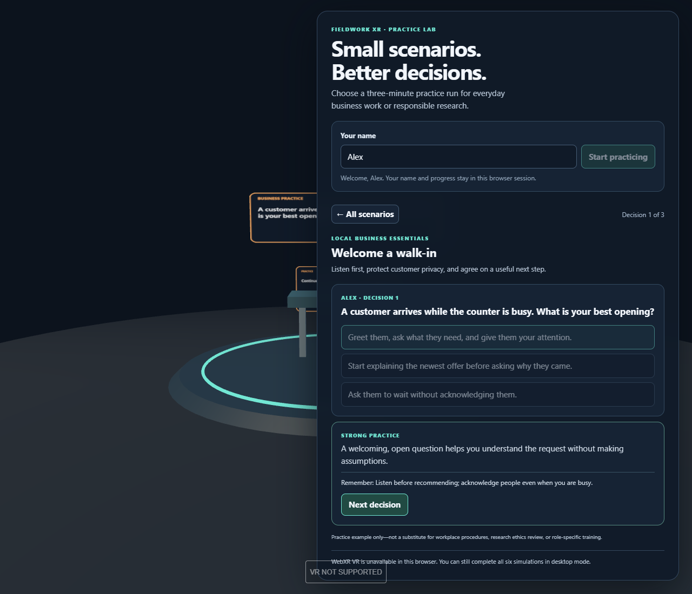
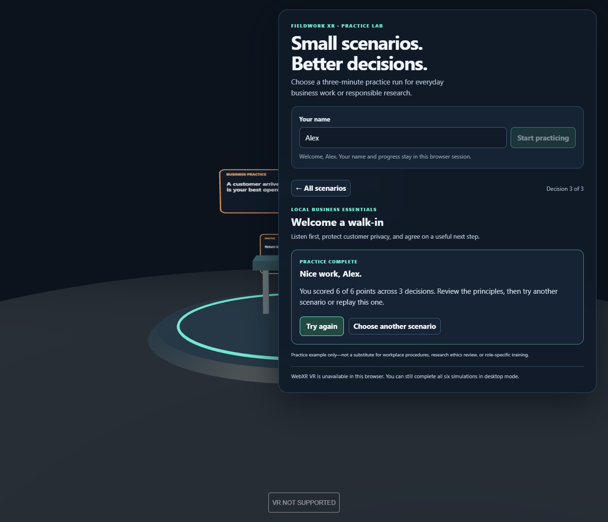
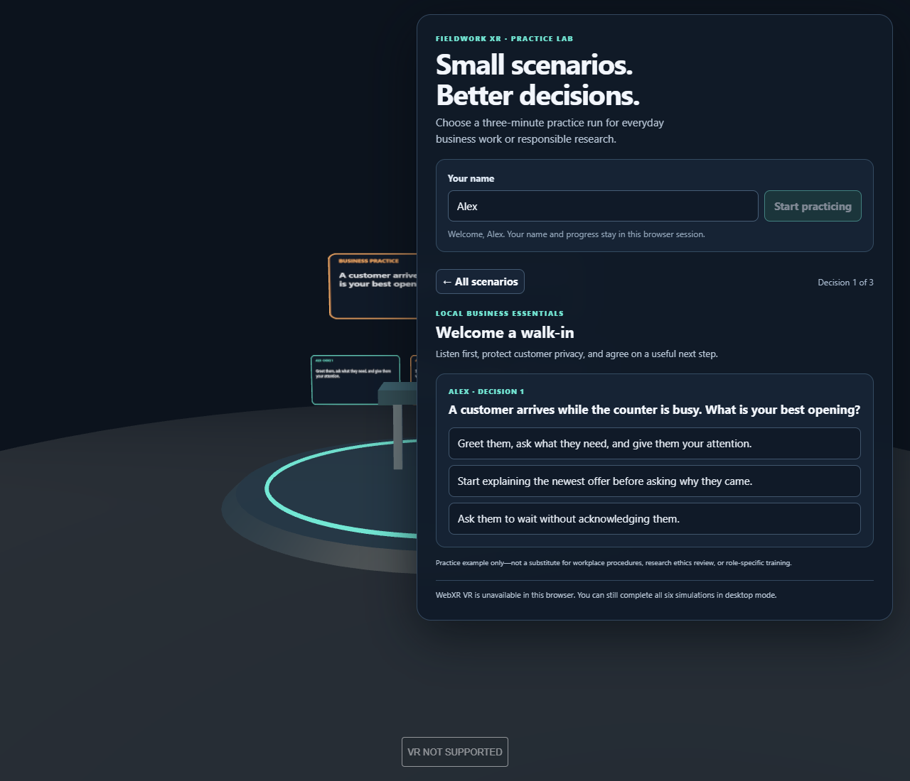
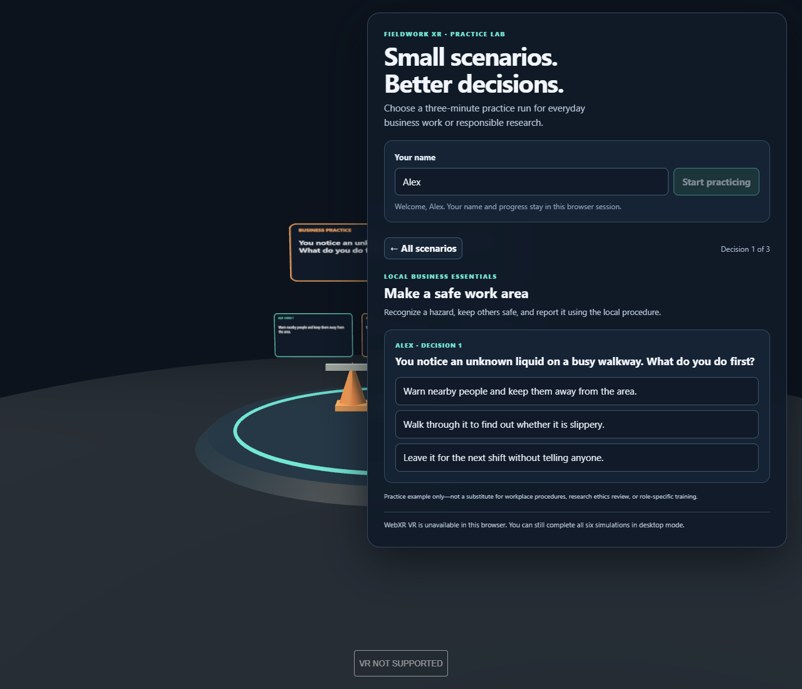
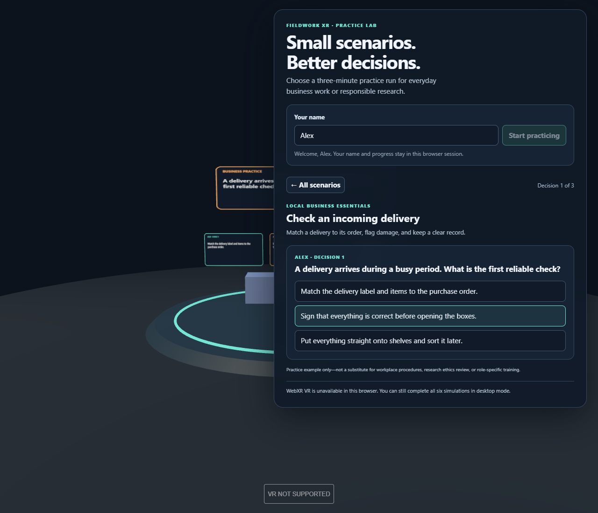
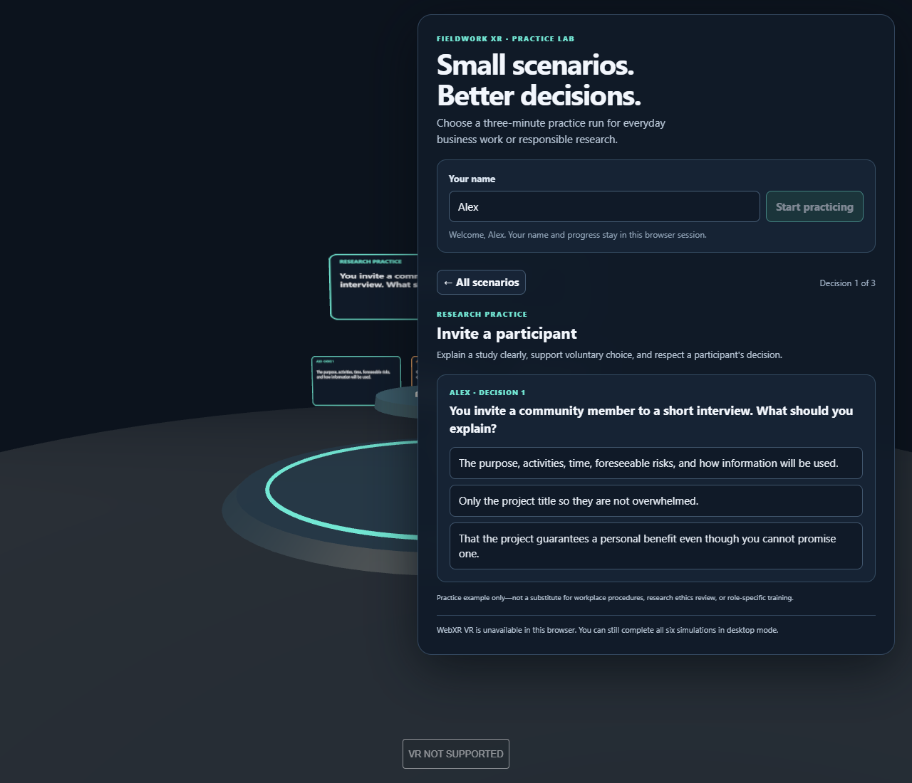
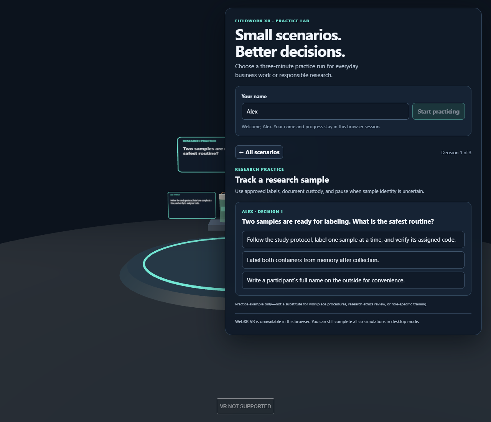
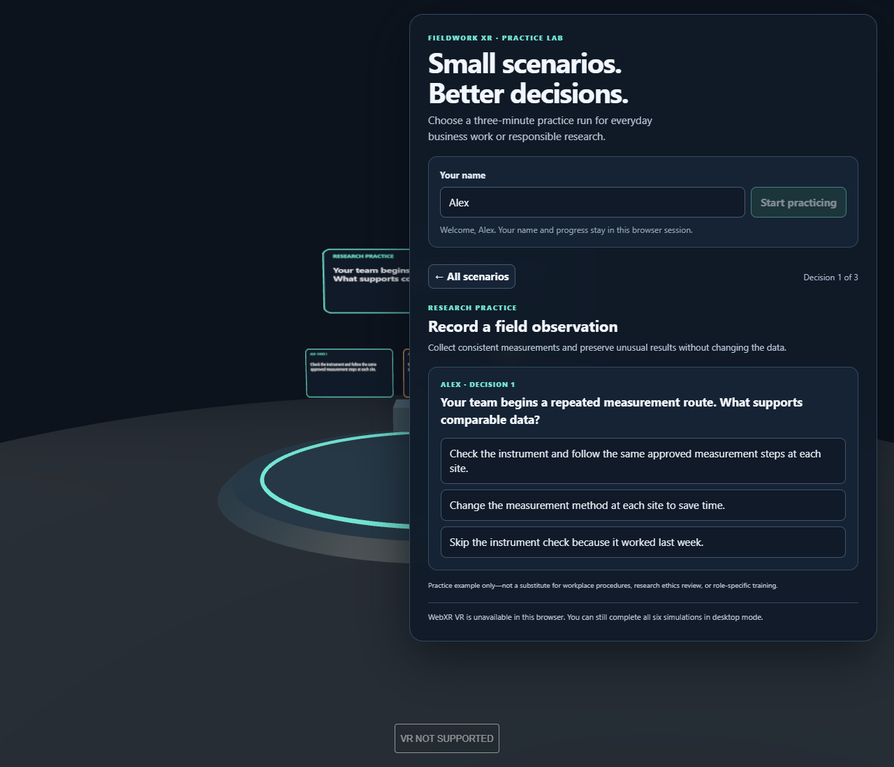

# Fieldwork XR Practice Lab

A browser-based XR training example with a learner name field and six short, choice-driven practice scenarios. Three address common small-business work; three model responsible community and field research. Every activity has three decisions, immediate feedback, a takeaway principle, and a simple session score.

The business scenarios are broadly useful to neighborhood shops, service teams, and small workplaces: welcoming a customer while protecting privacy, responding safely to an unknown spill, and checking an incoming delivery. Research scenarios cover voluntary informed consent, sample identity and custody, and consistent field observations. They are intentionally general rather than tied to one assumed town, employer, or research institution.

## Run it

From this directory, start a local static server:

```powershell
python -m http.server 8003
```

Open <http://localhost:8003>. The app uses Three.js 0.169.0 from a pinned CDN, so the browser needs internet access to load the 3D scene.

## Try a session

1. Enter a display name. It is held in page memory for the current browser session and is not sent to a server or saved to local storage.
2. Select one of the three business or three research simulations.
3. Read the short situation and choose one of three responses for each of its three decisions.
4. Review the immediate feedback and principle, then continue to the next decision.
5. View the score, retry the scenario, or choose another. Completion marks and scores remain in memory until the page is closed or refreshed.

The simulation selection is available in the page UI. If the browser supports immersive WebXR VR, the **ENTER VR** control appears after the learner enters a name. In VR, point a controller at a floating choice card and use its select/trigger action. You can also use the desktop UI before or during a session.

## Tests

From this directory, run the scenario-catalog checks with:

```powershell
node --test .\test\scenarios.test.mjs
```

The tests verify that there are exactly three scenarios in each category and that each scenario has three complete decisions with scored choices and feedback. Browser interaction was also checked in desktop mode; physical headset behavior still requires compatible WebXR hardware.

## What it demonstrates

- A complete, six-scenario browser learning flow with lightweight name entry and session-only progress.
- Local small-business decisions around customer service and privacy, basic hazard response, and inventory receiving.
- Research habits around informed consent, confidentiality, traceable sample handling, and faithful data recording.
- Immediate, consequence-based feedback, a principle recap at each step, and a short score without collecting or transmitting learner data.
- One scenario catalog and scene presented in desktop mode and in a WebXR immersive VR view where supported.

## Scope and limitations

This is a non-certified learning prototype—not an employer's safety policy, professional qualification, research-ethics approval, laboratory procedure, or substitute for an approved study protocol. Employers and research teams should review and adapt examples to their jurisdiction, workplace, institution, and current procedures. The research examples teach process habits; they do not collect real participants' data or handle real samples.

The application has no login, analytics, backend, persistence, or export. Names and scores are kept in page memory only. Only a compatible WebXR browser, secure context, VR runtime, and headset can start immersive VR; headset testing has not been performed as part of this example.

## Screenshots

All captures are from the running example in a desktop browser at the default (non-headset) view. WebXR VR was unavailable in the capture environment, so the page shows **VR NOT SUPPORTED**; these are not headset recordings.

| Step | Capture |
|---|---|
| Welcome and name entry |  |
| Scenario catalog |  |
| Decision feedback |  |
| Scenario complete |  |

### The six scenarios

| Scenario | Capture |
|---|---|
| Welcome a walk-in |  |
| Make a safe work area |  |
| Check an incoming delivery |  |
| Invite a participant |  |
| Track a research sample |  |
| Record a field observation |  |
