# Fieldwork XR Practice Lab

A browser-based XR training example with a learner name field and twelve short, decision-driven practice scenarios in three groups: everyday small-business work, responsible community and field research, and six high-risk industrial tasks. Every activity has immediate feedback, a takeaway principle, and a session score. All twelve scenarios are **hands-on**: the six industrial scenarios have four tasks each and the six business and research scenarios have three, and in every one that you carry out yourself by selecting labelled hotspots on an animated 3D work area (inspect the scaffold tag, clip your lanyard to an anchor, apply your lock and tag, close a cylinder valve), rather than choosing from a list of answers. Wrong actions show their consequence, steps have to be done in a safe order, and dangerous mistakes are flagged as **critical safety misses**.

The business scenarios are broadly useful to neighborhood shops, service teams, and small workplaces: welcoming a customer while protecting privacy, responding safely to an unknown spill, and checking an incoming delivery. Research scenarios cover voluntary informed consent, sample identity and custody, and consistent field observations. The industrial scenarios cover work at height, running a refinery unit from a control room, outdoor rounds at refinery battery limits (the edge of a process unit), window cleaning from a suspended platform on a skyscraper, welding and hot work, and electrical isolation. They are general awareness practice built around widely taught controls (permits, fall arrest, lockout/tag/test, gas alarms, fire watch) and do not replace site procedures. All scenarios are intentionally general rather than tied to one assumed town, employer, or research institution.

## Run it

From this directory, start a local static server:

```powershell
python -m http.server 8003
```

Open <http://localhost:8003>. The app uses Three.js 0.169.0 from a pinned CDN, so the browser needs internet access to load the 3D scene.

## Try a session

1. Enter a display name. It is held in page memory for the current browser session and is not sent to a server or saved to local storage.
2. Select one of the twelve simulations.
3. Read the short situation and choose one of three responses for each decision. Industrial scenarios show a pre-task checklist first, then four hands-on tasks (see below).
4. Review the immediate feedback and principle, then continue to the next decision.
5. View the score, retry the scenario, or choose another. Completion marks and scores remain in memory until the page is closed or refreshed.

The simulation selection is available in the page UI. If the browser supports immersive WebXR VR, the **ENTER VR** control appears after the learner enters a name. In VR, point a controller at a floating choice card and use its select/trigger action. You can also use the desktop UI before or during a session.

## Hands-on tasks

In every scenario, each task puts glowing hotspots on the 3D work area. Use the mouse (click a hotspot; drag to look around) or a VR controller trigger to carry the task out. The **Keyboard / list controls** disclosure under the task offers the same actions as buttons.

- **Required actions** must all be completed. Some have prerequisites (you cannot lock out a breaker you have not switched off, or strike an arc before the permit and fire watch are in place); doing one too early is a mistake.
- **Wrong actions** (such as clipping to a handrail, tightening a leaking flange, or letting a coworker re-energize a circuit) turn red and explain the consequence. Critical ones flash the scene.
- **The scene responds:** your lanyard connects to the anchor you picked, a lock and tag appear on the breaker, barricades and a fire watch appear, the platform sways in wind, a gas monitor alarms, and a pedestrian walks toward the exclusion zone.
- **Scoring:** a task earns 2 points with no mistakes, 1 with a single non-critical mistake, and 0 otherwise. A critical mistake always scores 0 for that task and is called out in the result along with the principles to review.

Business and research tasks work the same way (greet the customer, move to a quiet room, label vials against the protocol, record an outlier as measured). In those, a critical mistake means a serious breach such as promising a benefit, writing a participant's name on a sample, or deleting an inconvenient reading.

## Tests

From this directory, run the scenario-catalog checks with:

```powershell
node --test .\test\scenarios.test.mjs
```

The tests verify the catalog (three business, three research, six industrial), that every task in every scenario is completable: unique hotspot ids, positions and results, valid prerequisites, at least two required actions, and a critical mistake. Hands-on interactions were also exercised in a desktop browser (hotspot clicks on the canvas, the list controls, out-of-order and critical mistakes, scoring); VR controller selection uses the same code path but needs a headset to confirm. Browser interaction was also checked in desktop mode; physical headset behavior still requires compatible WebXR hardware.

## What it demonstrates

- A complete, twelve-scenario browser learning flow with lightweight name entry and session-only progress.
- Local small-business decisions around customer service and privacy, basic hazard response, and inventory receiving.
- Research habits around informed consent, confidentiality, traceable sample handling, and faithful data recording.
- Immediate, consequence-based feedback, a principle recap at each step, and a short score without collecting or transmitting learner data.
- High-risk industrial practice with animated 3D work areas (scaffold, control room, outdoor process unit, suspended platform, welding bay, electrical panel) and critical-miss feedback.
- One scenario catalog and scene presented in desktop mode and in a WebXR immersive VR view where supported.

## Research background

The hands-on design follows the argument that hand-based manipulation is a distinctive educational strength of VR (Johnson-Glenberg, 2018), and the consequence-driven feedback targets what Slater (2009) calls plausibility, the sense that events respond to you. The industrial scenarios address hazard-recognition training, where an immersive condition outperformed 2D training in one construction study (Sacks et al., 2013). A caution applies to realism: immersion can raise presence while lowering learning if it adds cognitive load (Makransky et al., 2019), so visual detail should be tested, not assumed to help. Full references, evidence gaps, and study ideas are in [docs/research](../docs/research/README.md).

## Scope and limitations

This is a non-certified learning prototype—not an employer's safety policy, a permit, a competence assessment, professional qualification, research-ethics approval, laboratory procedure, or substitute for an approved study protocol. Employers and research teams should review and adapt examples to their jurisdiction, workplace, institution, and current procedures. The research examples teach process habits; they do not collect real participants' data or handle real samples.

The application has no login, analytics, backend, persistence, or export. Names and scores are kept in page memory only. Only a compatible WebXR browser, secure context, VR runtime, and headset can start immersive VR; headset testing has not been performed as part of this example.

## Screenshots

All captures are from the running example in a desktop browser at the default (non-headset) view. WebXR VR was unavailable in the capture environment, so the page shows **VR NOT SUPPORTED**; these are not headset recordings.

| Step | Capture |
|---|---|
| Welcome and name entry |  |
| Scenario catalog |  |
| Task feedback |  |
| Scenario complete |  |

### The twelve scenarios

| Scenario | Capture |
|---|---|
| Welcome a walk-in |  |
| Make a safe work area |  |
| Check an incoming delivery |  |
| Invite a participant |  |
| Track a research sample |  |
| Record a field observation |  |
| Work at height (mid-task) |  |
| Run a unit from the control room | 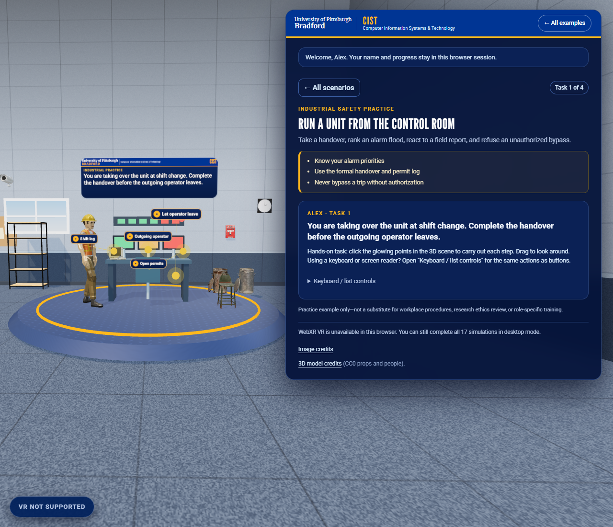 |
| Outdoor rounds at the battery limits | 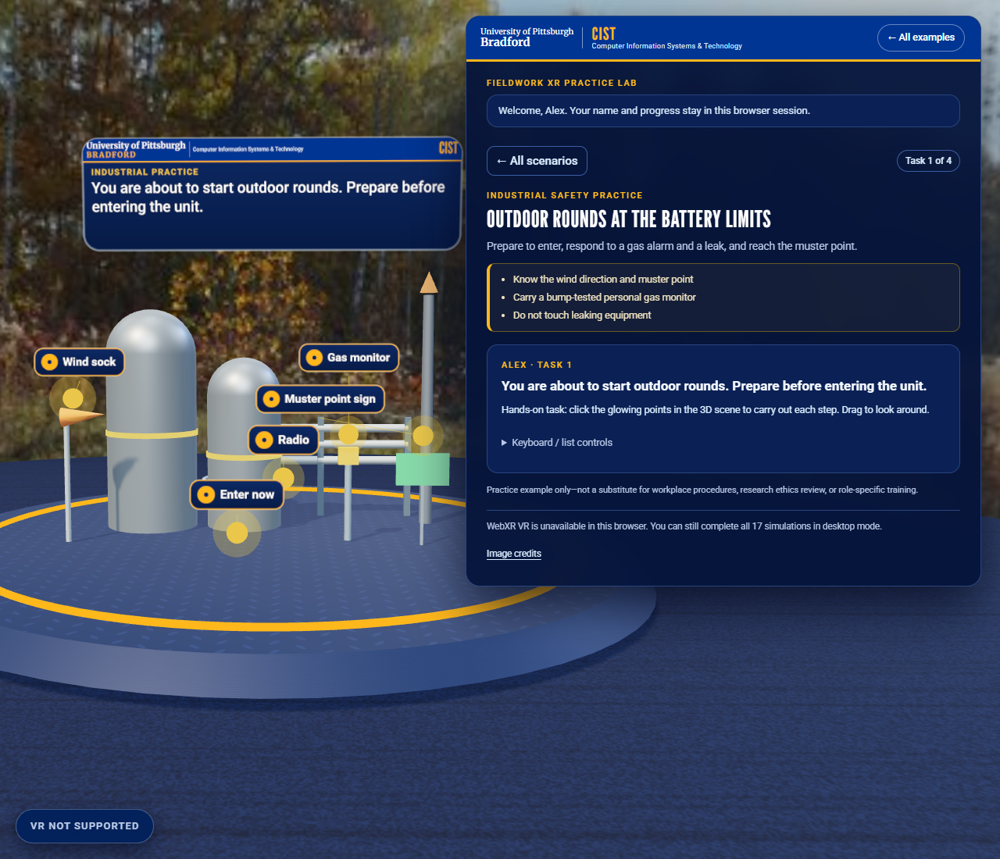 |
| Clean windows on a skyscraper | 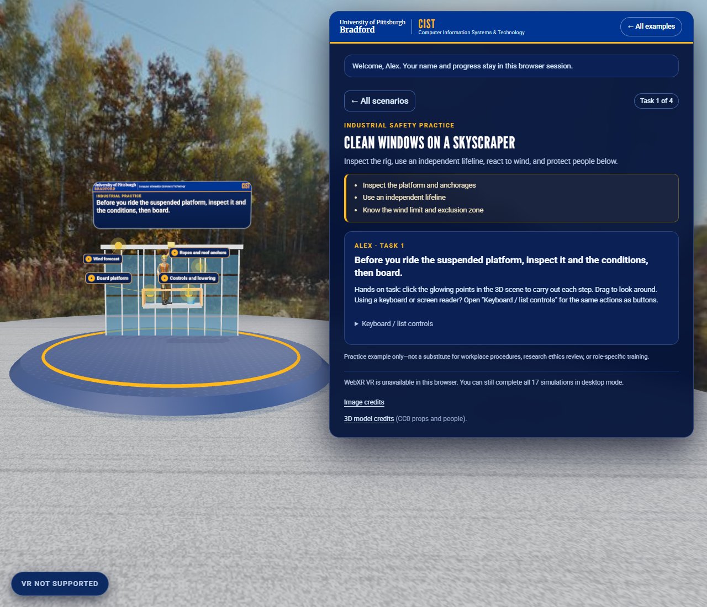 |
| Weld safely | 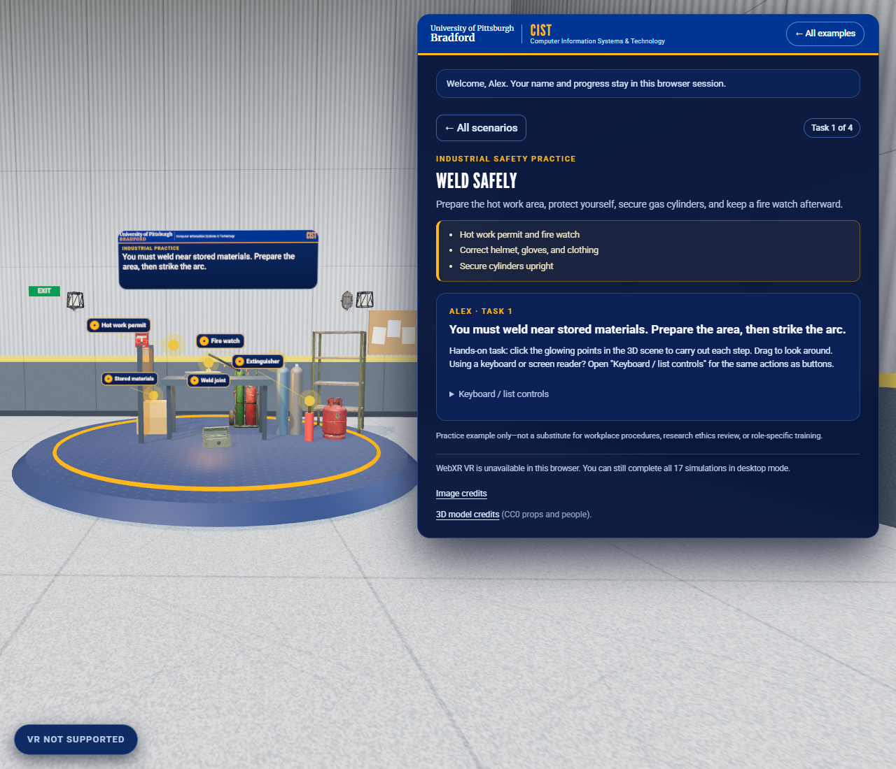 |
| Electrical isolation and work | 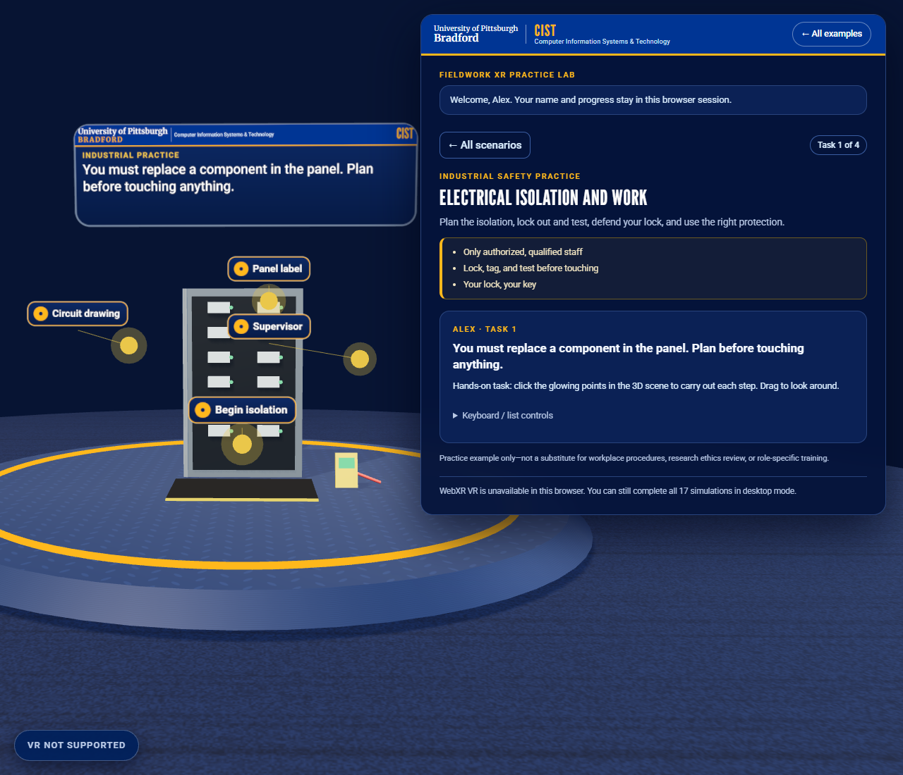 |
| Critical safety miss |  |
| Industrial result and review list | 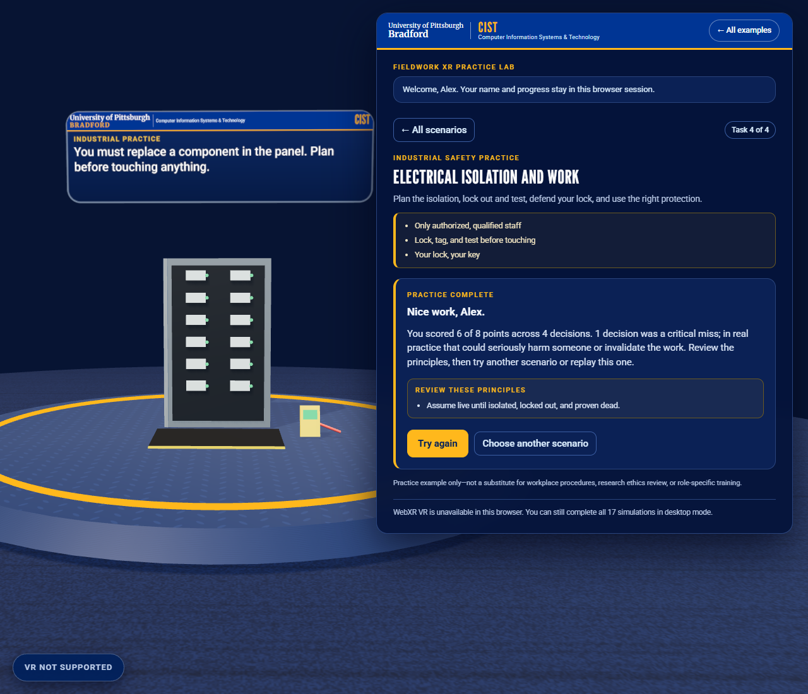 |

## In VR (emulated headset)

These captures come from an **emulated Meta Quest 3** (Meta's IWER runtime in Chrome), using the page's real WebXR session and a scripted controller. They show layout, scale, and interaction in a headset-style view; they are not recordings from a physical headset. The controller appears as its pointer ray. See [tools/vr-capture](../tools/vr-capture/README.md) for how they are made and what the emulation does not cover.

In VR the training world is placed about 2.4 m in front of you and scaled up slightly. The scenario cards float above the platform; point a controller at a card and pull the trigger to start. In a task, point at a glowing hotspot and pull the trigger to carry out that step; the floating sign above the scene shows each result, and a "continue" card appears when the task is done.

| Step | Capture |
|---|---|
| Scenario catalog |  |
| Pointing at a scenario | 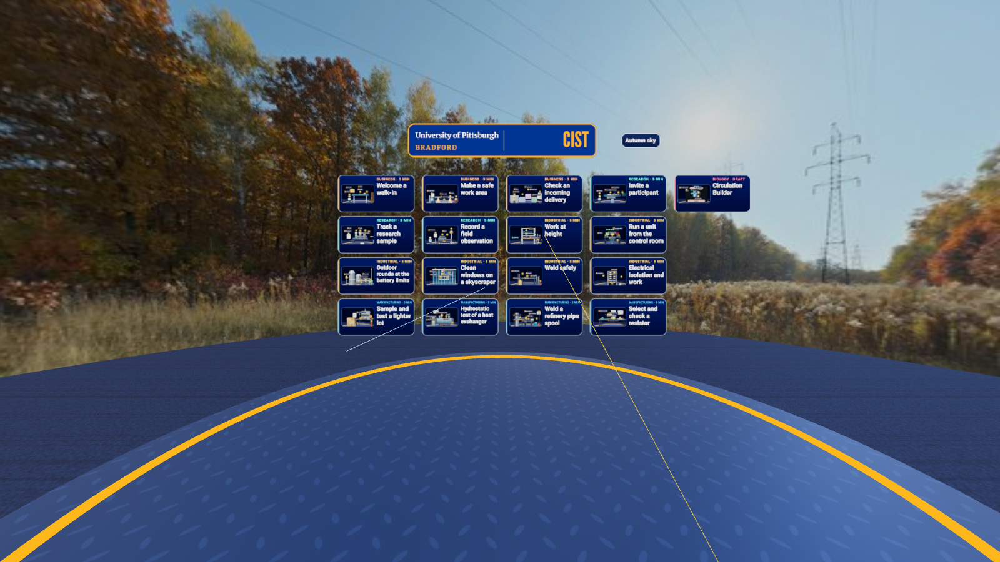 |
| Hands-on task | 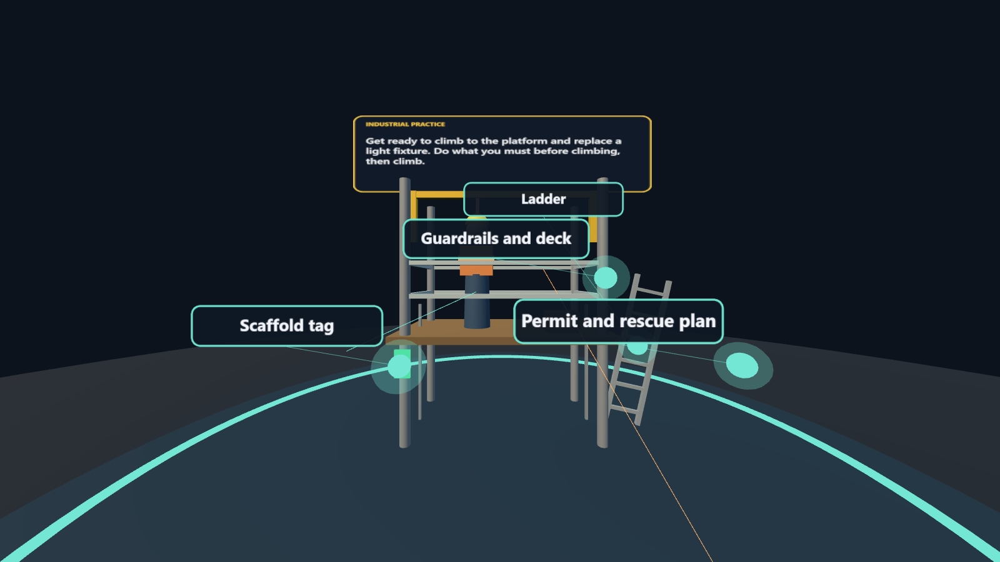 |
| Selecting hotspots |  |
| Task complete | 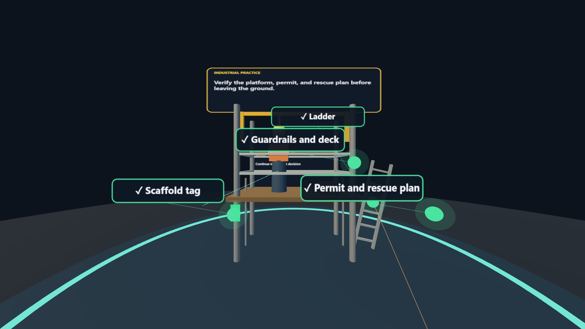 |
| A wrong action | 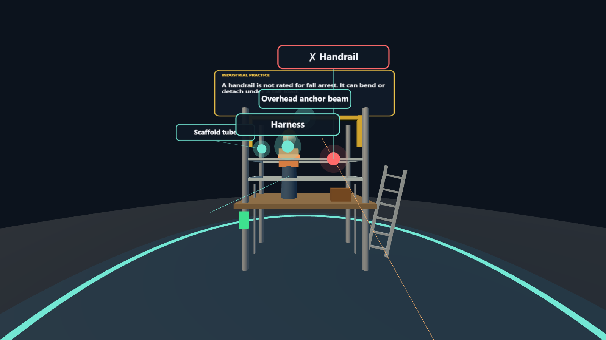 |
| Electrical lockout | 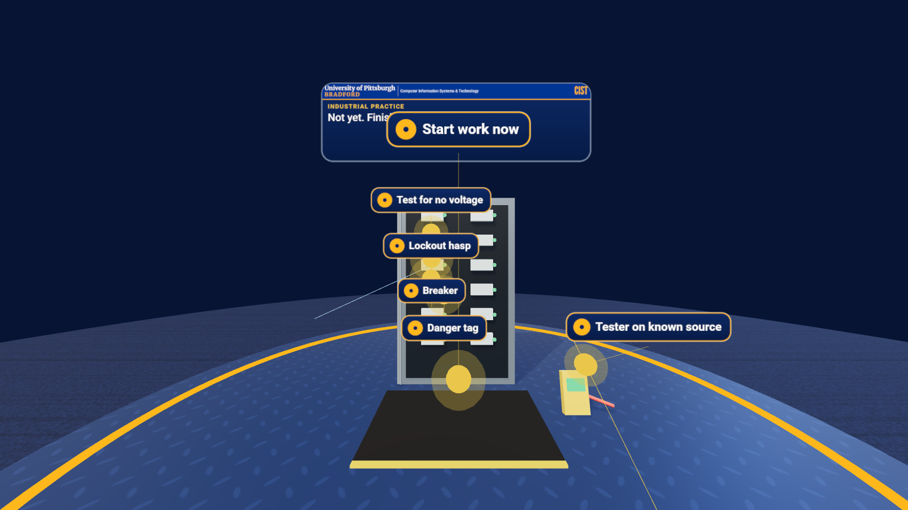 |
