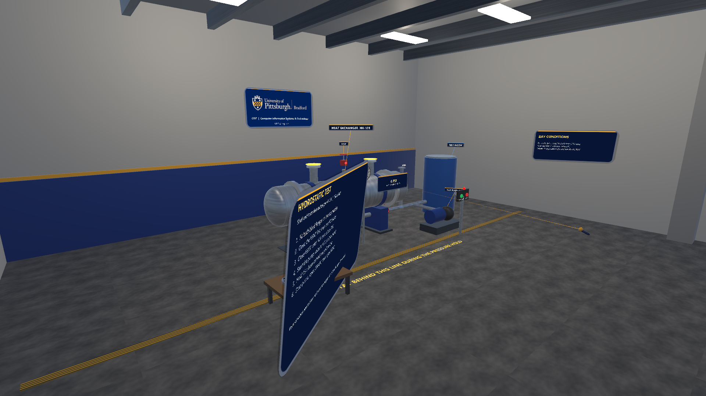
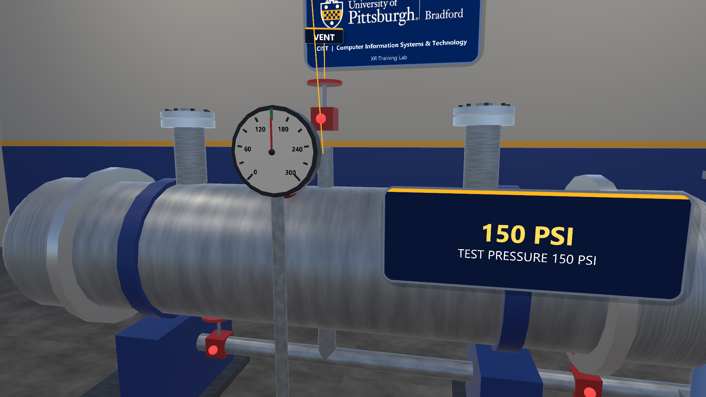
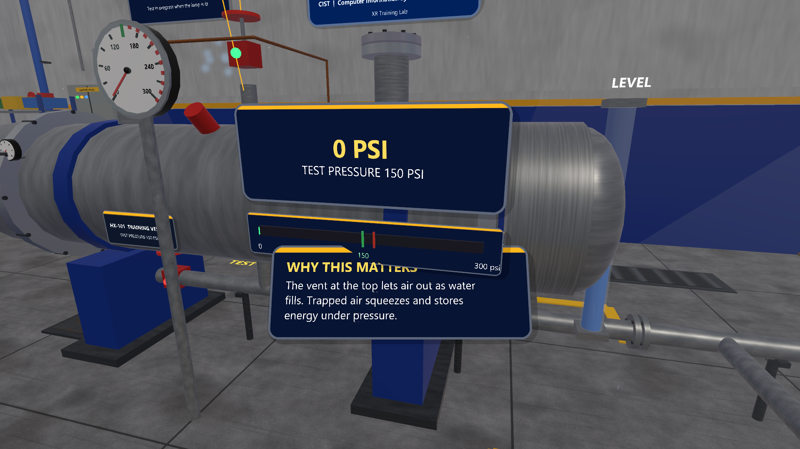
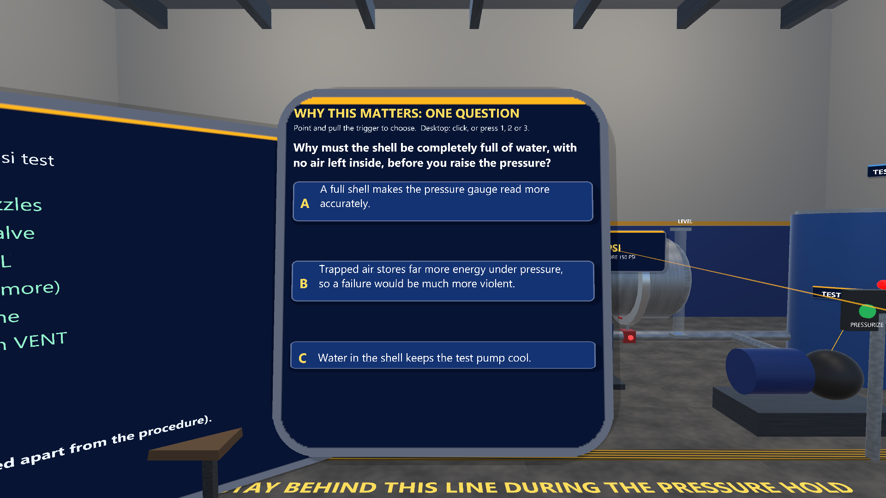
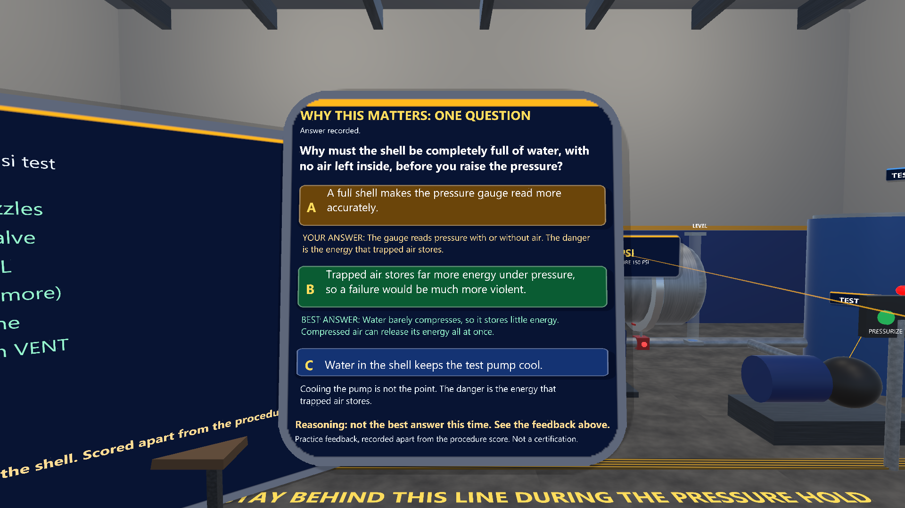
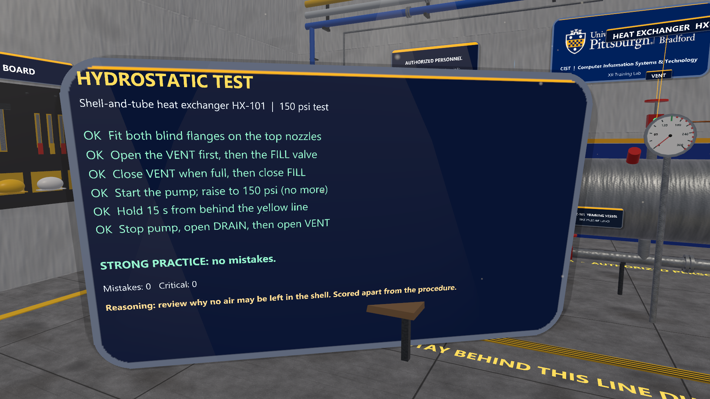

# Hydrostatic Test Bay (Vive Pro 2 / SteamVR, Unity)

Hands-on practice for a hydrostatic (150 psi) test of a shell-and-tube heat exchanger, in VR on a Vive Pro 2 or at the desktop with mouse and keyboard. The scenario is inspired by the web example in `training-simulations/` and the multi-user rig in `multi-player/hydrotest/`.

**Status:** runs in the Unity editor in desktop mode (the owner played it before the "why this matters" update). It has **not** been tested on a Vive Pro 2 or any headset. Ten screenshots were rendered from the Unity editor in desktop mode (not a headset) by the built-in capture driver; the hub project has a dressed version (see [../hub/README.md](../hub/README.md)).

**"Why this matters" update (November 1, 2026):** compiles in Unity 6000.3.20f1; the scripted capture run goes through all six steps with the real rules, opens the rationale question and answers it, with no errors from the scenario or kit scripts. The new panels have **not** been played by hand yet (mouse click, keys 1-3, or the VR pointer and trigger on the answer buttons), and not on a headset.

The other screenshots are in [screenshots/](screenshots/); the four "why" views are below.

This is general safety-awareness practice, not a site procedure, a test permit, or a certification. It does not replace training by your employer.

## What you do

1. Fit both blind flanges on the top nozzles.
2. Open the VENT first, then the FILL valve.
3. Close VENT when the vessel is full, then close FILL.
4. Start the pump and raise to 150 psi (no more).
5. Hold 15 seconds from behind the yellow line.
6. Stop the pump, open DRAIN, then open VENT.

A task board shows the steps, mistakes, and critical misses (for example, pressurizing with the vent closed or standing over the vessel during the hold).

## Why this matters, and one reasoning question

A Penn State study (Wang & Messner, 2026; see [../../docs/research/UNIVERSITY-VR-AR-LANDSCAPE.md](../../docs/research/UNIVERSITY-VR-AR-LANDSCAPE.md)) found that VR beat video on procedure and spatial scores, but neither conveyed *why* the steps mattered. So, as in the other scenarios that use this design:

- **After each step** a panel headed **WHY THIS MATTERS** shows one plain-language sentence for about seven seconds, a little below your line of sight, and follows your view gently. For example, after "Open the VENT first, then the FILL valve": *"The vent at the top lets air out as water fills. Trapped air squeezes and stores energy under pressure."*
- **After the last step** one multiple-choice question appears (three options, one best answer): *Why must the shell be completely full of water, with no air left inside, before you raise the pressure?* Point at an option and pull the trigger (VR), or click it or press 1, 2 or 3 (desktop). Every option then shows a line of feedback, and the best answer is marked in green.
- **The result is kept apart from the procedure score.** The task board shows the usual summary (for example "STRONG PRACTICE: no mistakes.") and, on its own line, "Reasoning: best answer ..." or "Reasoning: review ...". It is practice feedback, not pass/fail and not a certification.

The reasons are general safety awareness written for this example. They are not taken from a standard or a site procedure and have not been reviewed by a partner yet.

| | |
|---|---|
|  |  |
| 07 Why this matters (after step 2) | 08 Rationale question |
|  |  |
| 09 Feedback on every option (staged with a not-best answer) | 10 Summary with the separate Reasoning line |

Desktop editor renders (November 1, 2026), not headset captures. In 08 to 10 the steps were completed by the capture script through the scenario's own rules, and the answer was chosen by the script.

## Controls

| Action | Vive wands | Desktop |
|---|---|---|
| Move | Left trackpad/stick | W A S D |
| Look / turn | Head; right stick snap-turn | Hold right mouse and move |
| Press (valves, pump buttons) | Point + trigger | Crosshair + left click |
| Grab (blind flanges) | Grip near the object | Look at the object and press E |
| Answer the reasoning question | Point + trigger | Crosshair + left click, or keys 1, 2, 3 |

## Setup

1. Open `vive-steamvr/01-hydrostatic-test` in Unity Hub with Unity **6000.3.20f1**. The project uses the shared kit in `../packages/com.pittbradford.xrtraining` by a `file:` path.
2. Run the menu **Pitt-Bradford > Set up project**. It configures OpenXR and the Input System and builds `Assets/Scenes/HydrostaticTest.unity`.
3. For a headset: set SteamVR as the active OpenXR runtime, start SteamVR, then press Play.
4. Optional: **Pitt-Bradford > Build Windows player** builds to `Builds/HydrostaticTest/`.

## Baked scenes

The bay (walls, exchanger, valves, pump skid, gauge, sight glass, table, blind flanges, lights, signs; 216 objects) is *baked* into `Assets/Scenes/HydrostaticTest.unity`, so it shows in the Hierarchy and Scene view and can be selected and edited. Generated materials and textures are saved in `Assets/Baked/HydrostaticTest/` (commit it with the scene). `Start()` in `HydroTest.cs` still runs at Play and *adopts* the saved objects (matched by parent, name and call order) instead of building new ones, then re-attaches the valve and button handlers, the snap zones, the script's fields and the runtime font. How it works, the rules and the recipe: [the kit README](../packages/com.pittbradford.xrtraining/README.md#baked-scenes-bake-and-adopt).

- **Edits are kept** for objects the script only builds (position, scale, material, light settings). The script still moves the gauge needle, valve wheels, sight-glass water and the blind flanges while it runs. Lighting (ambient, fog) is set by `Start()`; change it in the script.
- **Do not rename, re-parent or reorder** baked objects; the script would build a new copy beside them. To hide one, untick it instead of deleting it (a deleted one comes back at Play).
- **Still created at runtime (on purpose):** the XR rig and cameras, the task board, the "why this matters" panels and the reasoning question.
- **Re-bake** after changing the script: **Pitt-Bradford > Bake scene (play mode)**, or headless `Unity.exe -projectPath <this folder> -executeMethod PittBradford.XR.EditorTools.SceneBaker.BakeAndExit -logFile <log>` (no `-batchmode`). **Unbake** (build everything at Start again): **Pitt-Bradford > Unbake scene**. **Set up project** (step 2 above) does not replace a baked scene.
- The hub's version of this bay (`HydroTest` with `ExternalShell`) is a separate scene; this bake does not affect it.

**Verified (November 2, 2026, desktop editor only, not a headset):** the ten capture shots were rendered unbaked and baked (with `-pbOfflineWeather`) and compared pixel by pixel. Two unbaked runs already differ by up to 16% of pixels by a few levels (soft lighting noise); baked against unbaked, at most 0.28% of pixels differ by more than 32 of 255 levels in any shot, from text glyph edges, the particle jets, and a light patch on the ceiling (most likely which of the six ceiling lamps Unity picks as per-pixel lights; their settings are unchanged). The scripted run completed in both cases (all six steps, the reasoning question and the summary; no script errors). A table moved in the saved scene appeared at its new position at Play, with no duplicate. The baked scene file is about 785 KB and opens in about 0.03 s.

## Files

- `Assets/Editor/ProjectSetup.cs`: the setup and build menu items.
- `Assets/Scenes/HydrostaticTest.unity` and `Assets/Baked/HydrostaticTest/`: the baked scene and its materials and textures (see "Baked scenes").
- `../packages/com.pittbradford.xrtraining/Runtime/Scenarios/HydroTest.cs`: the scenario itself, including the step reasons and the rationale question. It lives in the shared kit so the hub project can reuse it.
- `../packages/com.pittbradford.xrtraining/Runtime/WhyCue.cs`: the shared "why this matters" panel and rationale question (`WhyCue.Show`, `WhyCue.Ask`), built from the kit's `Ui.Panel`.
- Screenshots: `Unity.exe -projectPath <this folder> -executeMethod PittBradford.XR.EditorTools.CaptureRunner.Run -pbCapture <folder> -logFile <log>` (no `-batchmode`).

## What is simulated and what is not

Simulated: valve and vent states, fill level, pump and pressure rise, the pressure hold, and the rules that score order and safety. Not simulated: real fluid and pressure physics, relief devices, permits, or site procedure.

## Research basis

See [../../docs/research/README.md](../../docs/research/README.md).
