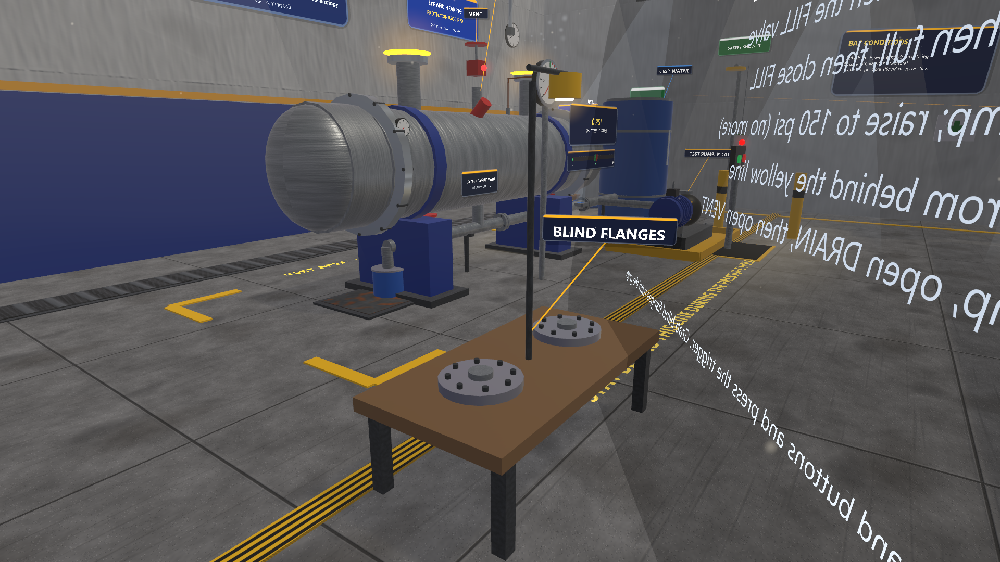
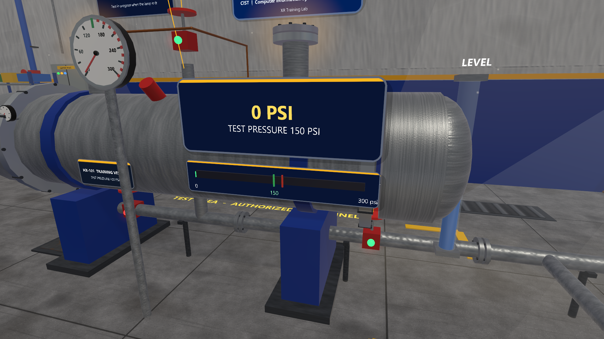
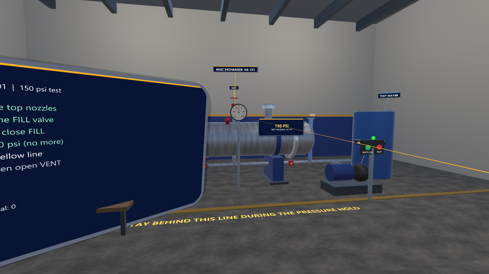
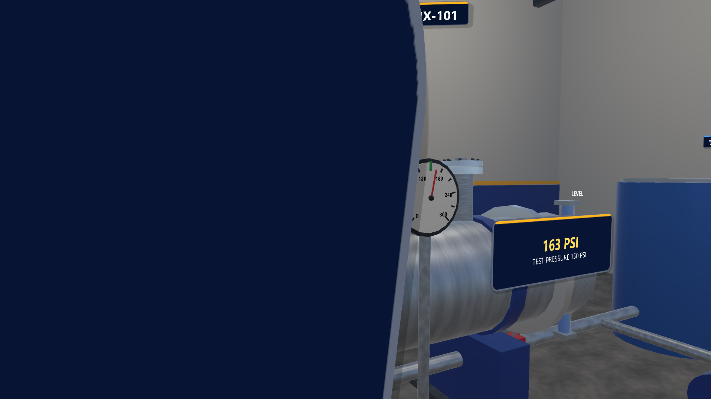

# Hydrostatic Test Bay (Unity, desktop and Vive Pro 2 / SteamVR)

Hands-on practice for a 150 psi hydrostatic test of a shell-and-tube heat exchanger (HX-101). You play it at the desktop with mouse and keyboard, or in a headset. The scenario is inspired by the web example in `training-simulations/` and the multi-user rig in `multi-player/hydrotest/`.

This is general safety-awareness practice. It is not a site procedure, a test permit or a certification, and it does not replace training by your employer.

## What is verified and what is not

| Item | Status (as of November 3, 2026) |
|---|---|
| Compiles in Unity 6000.3.20f1 | Yes, in scripted editor runs (November 1 and 2). |
| Scripted capture run (all six steps with the real rules, the question, the summary) | Yes, in the desktop editor. This is emulated, not a headset. Ten screenshots come from it. |
| Played by a person on the desktop | The owner played an earlier version before the "why this matters" panels were added. The panels, the question and the baked scene have not been played by hand. |
| Headset (Vive Pro 2, Quest or any other) | **Not tested.** Controller bindings (Vive, Index, Touch profiles) are set up in code only. |
| Fresh clone opens and plays without running Set up project | Not tested. |

The hand-test table is [../../docs/TESTING.md](../../docs/TESTING.md) section 2 (checks D1 to D6, D15, B1 to B4), with exact steps and the expected text.

## How to open and run

Requirements: Unity **6000.3.20f1** (built-in render pipeline), Windows, and a **full clone** of this repository (the project loads the shared kit from `../packages/com.pittbradford.xrtraining` by a relative `file:` path, so do not copy the folder out on its own). OpenXR 1.19.0 and the Input System are installed by `Packages/manifest.json`.

**Desktop (no headset).**

1. Unity Hub > **Add > Add project from disk** > `vive-steamvr/01-hydrostatic-test`. The first open imports and compiles (not timed; allow several minutes). A Safe Mode prompt means a script error: send the first red message.
2. Open `Assets/Scenes/HydrostaticTest.unity`. The scene and the OpenXR settings are committed. If the scene is missing or only holds a "Scenario" object, run **Pitt-Bradford > Set up project** once (it keeps a baked scene).
3. Close SteamVR, press **Play**, then click once in the Game view.

**Headset (untested).** Set SteamVR as the active OpenXR runtime (SteamVR > Settings > Developer > Set SteamVR as OpenXR runtime), start SteamVR, then press Play.

**Optional player build.** **Pitt-Bradford > Build Windows player** writes `Builds/HydrostaticTest/` (not committed; not tried by a person).

## Controls

| Action | Vive wands (untested) | Desktop |
|---|---|---|
| Move | Left trackpad or stick | W A S D |
| Look / turn | Head; right stick snap-turn (30 degrees) | Hold the right mouse button and move the mouse |
| Press (valves, PRESSURIZE and STOP buttons, answers) | Point + trigger | Aim with the centre of the view, left click (range about 4 m) |
| Grab (blind flanges) | Grip near the object | Aim at it and hold **E** (range about 3 m); release E to drop |
| Answer the reasoning question | Point + trigger | Left click, or press 1, 2 or 3 |

On the desktop no crosshair dot is drawn: the pointer is the centre of the view, and the pointer line from the wand at the lower right ends on the target. Yellow discs mark where a blind flange snaps. Valves show a red lamp (closed) or green lamp (open).

## Task list and why

The task board shows six steps. When you complete one, a panel headed **WHY THIS MATTERS** shows one plain-language sentence for about 7 seconds, a little below your line of sight, and follows your view gently.

| # | Step (as on the board) | What completes it | Why this matters (shown in the scene) |
|---|---|---|---|
| 1 | Fit both blind flanges on the top nozzles | Both flanges snapped onto the nozzles | Blind flanges seal the open nozzles, so the test water and pressure stay inside the vessel. |
| 2 | Open the VENT first, then the FILL valve | VENT and FILL both open | The vent at the top lets air out as water fills. Trapped air squeezes and stores energy under pressure. |
| 3 | Close VENT when full, then close FILL | Level full (about 8 seconds of filling), VENT and FILL both closed | A full, sealed shell means the pump presses on water, which barely compresses, not on a pocket of air. |
| 4 | Start the pump; raise to 150 psi (no more) | Press the green **PRESSURIZE** button; pressure reaches 150 psi (about 14 seconds) | The test pressure is set for this vessel. Going higher can overstress it or lift the relief valve. |
| 5 | Hold 15 s from behind the yellow line | Stand south of the yellow line while pressure stays at 150 psi; the footer counts "Holding: n / 15 s" | If a gasket or flange lets go, water and parts can spray out. Distance keeps you out of that path. |
| 6 | Stop pump, open DRAIN, then open VENT | Press **STOP**, open DRAIN, open VENT with pressure at zero | Draining first drops the pressure. Venting last lets air back in, so the shell drains without a vacuum. |

**The reasoning question.** After step 6 one multiple-choice question appears (three options, one best answer): *Why must the shell be completely full of water, with no air left inside, before you raise the pressure?* Every option then shows a line of feedback and the best answer turns green. The result is kept apart from the procedure score: the board shows the usual summary ("STRONG PRACTICE: no mistakes." or "Complete with N mistakes.") and, on its own line, "Reasoning: best answer ..." or "Reasoning: review ...". It is practice feedback, not pass or fail. A Penn State study (Wang & Messner, 2026; see [../../docs/research/UNIVERSITY-VR-AR-LANDSCAPE.md](../../docs/research/UNIVERSITY-VR-AR-LANDSCAPE.md)) found that VR beat video on procedure and spatial scores, but neither conveyed why the steps mattered; this is the reason for the panels. The reasons are written for this example, are not taken from a standard or a site procedure, and have not been reviewed by a partner.

**Mistakes counted on the board** (critical means a critical safety miss; a run with any critical miss is not "strong practice"):

- Pressing PRESSURIZE with fewer than two blind flanges fitted: critical ("The nozzles are open. Fit both blind flanges before pressurizing.").
- Pressing PRESSURIZE with VENT open, or before the vessel is full: mistake.
- Opening FILL before VENT: mistake (once).
- Opening VENT while pressure is above 20 psi, before draining: mistake. Opening DRAIN above 5 psi before test pressure has been reached: mistake ("Draining under test pressure before the hold is complete.").
- Standing in front of the yellow line during the hold: critical (first time), and the hold restarts each time you step over it.
- Over-pressure above 165 psi (relief valve lifts): critical. The scenario holds pressure at 150 psi once reached, so this is not expected to occur in normal play; the relief-valve view (screenshot 06) is staged.

The scene also has a "BAY CONDITIONS" board on the right wall (outside temperature and wind from live weather, or "simulated (no network)").

## What is simulated and what is not

Simulated: valve and vent states, fill level, pump and pressure rise, the pressure hold, the water spray when the nozzles are open and the pump runs, and the rules that score order and safety. Not simulated: real fluid and pressure physics, relief devices, permits, or site procedure. The wall, equipment tags and numbers are illustrative.

## Baked scene

The bay (walls, exchanger, valves, pump skid, gauge, sight glass, table, blind flanges, lights, signs; 222 baked objects, 223 GameObjects in the scene file including the "Scenario" object; the university and CIST plate on the back wall) is *baked* into `Assets/Scenes/HydrostaticTest.unity`, so it shows in the Hierarchy and Scene view and can be selected and edited. Generated materials and textures are in `Assets/Baked/HydrostaticTest/` (commit it with the scene). `Start()` in `HydroTest.cs` still runs at Play and *adopts* the saved objects (matched by parent, name and call order) instead of building new ones, then re-attaches the valve and button handlers, the snap zones, the script's fields and the runtime font. How it works, the rules and the recipe: [the kit README](../packages/com.pittbradford.xrtraining/README.md#baked-scenes-bake-and-adopt).

- **Edits are kept** for objects the script only builds (position, scale, material, light settings). The script still moves the gauge needle, valve wheels, sight-glass water and the blind flanges while it runs. Lighting (ambient, fog) is set by `Start()`; change it in the script.
- **Do not rename, re-parent or reorder** baked objects; the script would build a new copy beside them. To hide one, untick it instead of deleting it (a deleted one comes back at Play).
- **Still created at runtime (on purpose):** the XR rig and cameras, the task board, the "why this matters" panels and the reasoning question.
- **Re-bake** after changing the script: **Pitt-Bradford > Bake scene (play mode)**, or headless `Unity.exe -projectPath <this folder> -executeMethod PittBradford.XR.EditorTools.SceneBaker.BakeAndExit -logFile <log>` (no `-batchmode`). **Unbake** (build everything at Start again): **Pitt-Bradford > Unbake scene**. **Set up project** does not replace a baked scene.
- The hub's version of this bay (`HydroTest` with `ExternalShell`) is a separate scene; this bake does not affect it. See [../hub/README.md](../hub/README.md).

**Verified (November 2, 2026, desktop editor only, not a headset):** the ten capture shots were rendered unbaked and baked (with `-pbOfflineWeather`) and compared pixel by pixel. Two unbaked runs already differ by up to 16% of pixels by a few levels (soft lighting noise); baked against unbaked, at most 0.28% of pixels differ by more than 32 of 255 levels in any shot, from text glyph edges, the particle jets, and a light patch on the ceiling (most likely which of the six ceiling lamps Unity picks as per-pixel lights; their settings are unchanged). The scripted run completed in both cases (all six steps, the reasoning question and the summary; no script errors). A table moved in the saved scene appeared at its new position at Play, with no duplicate. The baked scene file is about 785 KB and opens in about 0.03 s.

## Files

- `Assets/Editor/ProjectSetup.cs`: the setup and build menu items.
- `Assets/Scenes/HydrostaticTest.unity` and `Assets/Baked/HydrostaticTest/`: the baked scene and its materials and textures.
- `Assets/XR`, `Assets/Resources`, `ProjectSettings`, `Packages`: OpenXR settings, shader keepers and package list (written by Set up project, committed).
- `../packages/com.pittbradford.xrtraining/Runtime/Scenarios/HydroTest.cs`: the scenario itself, including the step reasons and the rationale question. It lives in the shared kit so the hub project can reuse it, so this project has no `Assets/Scripts` code of its own. Editing it recompiles every project that uses the kit.
- `../packages/com.pittbradford.xrtraining/Runtime/WhyCue.cs`: the shared "why this matters" panel and rationale question (`WhyCue.Show`, `WhyCue.Ask`).
- `screenshots/`: the ten desktop editor renders below.
- Screenshots are made with `Unity.exe -projectPath <this folder> -executeMethod PittBradford.XR.EditorTools.CaptureRunner.Run -pbCapture <folder> -logFile <log>` (no `-batchmode`; it needs graphics).

## Screenshots

Desktop editor renders made by the capture run (November 1, 2026), not headset captures. Each view is staged by the script (valve states, fill level and pressure are set directly for views 03 to 07), so they show what the scene looks like, not a recorded play-through. In 08 to 10 the steps were completed by the capture script through the scenario's own rules, and the answer was chosen by the script.

| | |
|---|---|
|  |  |
| 01 Test bay overview | 02 Blind flanges view (the back of the task board is in the way; this shot needs re-shooting) |
|  |  |
| 03 Filling and venting (staged: vent and fill lamps green) | 04 Test pressure, 150 psi |
|  |  |
| 05 Hold from behind the line | 06 Relief valve (staged at 163 psi; the board hides the jet, this shot needs re-shooting) |
|  |  |
| 07 Why this matters (after step 2) | 08 Rationale question |
|  |  |
| 09 Feedback on every option (staged with a not-best answer) | 10 Summary: six steps OK, no mistakes, Reasoning line says "review" because the staged answer was not the best one |

## Troubleshooting

- **Safe Mode prompt on open:** a script failed to compile. Send the first red Console message.
- **Keys or mouse do nothing in Play:** click inside the Game view first. If the Console shows OpenXR messages, close SteamVR and press Play again. With no headset the project is expected to fall back to desktop controls; this was not checked with SteamVR running.
- **The view snaps back while you mouse-look:** this is check D2. A scripted capture run once showed the camera being reset by the head pose driver; report it if you see it in normal play.
- **Cyan or pink materials in the first seconds:** the editor is still compiling shader variants. Wait a moment. Report it if it stays.
- **Red Console lines or repeated errors during play:** copy the first one.
- **The conditions board says "simulated (no network)":** the live weather request failed; the scenario still works.

## Research basis

See [../../docs/research/README.md](../../docs/research/README.md).
