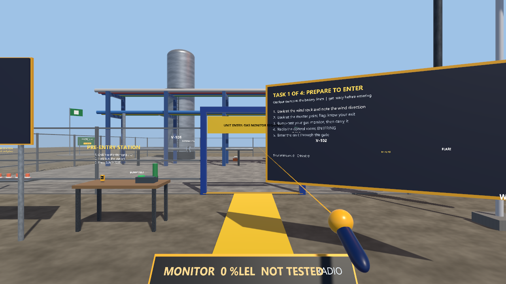

# Refinery Rounds (Vive Pro 2 / SteamVR, Unity)

Outdoor rounds at the battery limits of a refinery unit. The scenario is inspired by the "Outdoor rounds at the battery limits" scenario in the web lab (`training-simulations/industrial-scenarios.js`, id `refinery-battery-area`) and uses the same four tasks, rebuilt as a walk-around 3D scene with real wind and drifting gas.

**Status: compiles in Unity 6000.3.20f1 (checked inside the hub project) and plays in the editor in desktop mode with no console errors, November 1, 2026. Not played through to the end, and not tested on a Vive Pro 2.**

This is general safety-awareness practice. It is not a site procedure, a permit, or a certification, and it does not replace training by your employer. Real sites have their own rules for gas monitors, radio calls, barricades, and emergency response.

## Learning goals

- Prepare before entering a unit: know the wind, know your exit (muster point), bump-test and carry a personal gas monitor, tell the control room you are entering.
- React to a gas alarm: move out of the gas, upwind or crosswind, never toward the source; warn others; report.
- Handle a small hydrocarbon weep: stay clear, keep ignition sources (phone) away, barricade the area, report it, never tighten or wrap the leak yourself.
- Respond to a site emergency alarm: walk the safe route to the muster point, do not return for belongings, be counted.

## The scene

An outdoor process-unit edge built from primitives and the shared kit's procedural materials (no imported art): ground and pad, fenced area with a gate, pipe rack, two vessels (V-101 tower, V-102 drum), a flare stack with a flickering flame, a fixed gas detector post, a control-room cabin, a muster point (sign, check-in button, flag), a wind sock, and a pre-entry station with a bump-test unit and the handheld gas monitor.

**Live wind.** The wind sock and a conditions board use `Weather.Fetch` (Open-Meteo, Bradford PA). If there is no network the kit's `Weather.Fallback` is used and the board says "simulated (no network)". The sock points downwind and droops in light wind. The flare flame bends downwind.

**Gas.** Each release is drawn as a stream of translucent puffs that drift with the wind, grow, and fade. The monitor, the fixed detector, and the rules all read the same puff field, so staying "upwind" or "crosswind" really keeps you out of the gas. The reading is an illustrative % LEL (alarm at 10, high alarm at 20), not a calibrated value. Real hydrocarbon vapor is usually invisible; the cloud is drawn only for training.

**Muster point.** It is placed on the upwind side of the unit, so its position depends on the live wind (it moves when the live reading arrives). Real sites have designated muster points and alternates.

## Steps

1. **Prepare to enter.** Look at the wind sock and at the muster flag (hold your gaze about a second). Grab the gas monitor, hold it at the station and press BUMP TEST. Release it to clip it to your chest. Press ENTERING on the chest radio, then walk through the gate.
2. **Gas alarm.** Walk the round to gauge G-1 (gold marker). A release starts upwind of you and the monitor alarms. Move out of the gas (upwind or crosswind, at least 10 m from the release), press WARN, then REPORT. Walking toward the source is a critical miss.
3. **Flange weep.** Walk toward flange F-12. Stay at least 3.5 m clear and press PHONE OFF. Grab the cones from the barricade station and place three around the leak (tape strings itself between them). Press REPORT. Pressing the flange bolts is a critical miss; the rag is a mistake.
4. **Site emergency alarm.** A siren sounds and a large release starts. Walk to the green muster flag by a route that avoids the gas, then press CHECK IN on the muster sign. Going back for the tool bag is a critical miss.

Mistakes and critical misses are counted across all four tasks and shown on the task board footer.

## Controls

| Action | Vive wands | Desktop |
|---|---|---|
| Move | Left trackpad/stick | W A S D |
| Look / turn | Head; right stick snap-turn | Hold right mouse and move |
| Press (buttons, radio, bolts) | Point + trigger | Crosshair + left click |
| Grab (monitor, cones) | Grip near the object | Look at the object and press E (hold to carry, release to drop) |

The chest radio (ENTERING, WARN, REPORT, PHONE OFF, and the live monitor readout) follows you at chest height. On desktop, look down to see it. The task board follows your view.

## What is simulated and what is not

Simulated: wind from live weather, a simple gas drift and concentration model, a gas monitor with bump test and alarms, a fixed detector, a barricade check (three cones, spread out, around the leak), and the rules above.

Not simulated: real gas physics (density, dilution, terrain, buildings), real instrument behavior and calibration, permits and lockout, PPE, radio protocol, site-specific emergency plans, or anything about actual refinery equipment. No part of this has been checked against a real procedure.

## Research basis

See [../../docs/research/README.md](../../docs/research/README.md).

## Setup

1. Open `vive-steamvr/02-refinery-rounds` in Unity Hub with Unity **6000.3.20f1** (built-in render pipeline). The project uses the shared kit in `../packages/com.pittbradford.xrtraining`.
2. Run the menu **Pitt-Bradford > Set up project**. It configures OpenXR (Vive, Index, Touch profiles), the Input System, and creates `Assets/Scenes/RefineryRounds.unity`. Restart the editor if it asks for the input handling change.
3. Set **SteamVR as the active OpenXR runtime** (SteamVR > Settings > Developer > Set SteamVR as OpenXR runtime), start SteamVR, then press Play. With no headset, it runs in desktop mode.
4. Optional: **Pitt-Bradford > Build Windows player** builds to `Builds/RefineryRounds/`.
5. Screenshots (to be generated): run the built player with `-pbCapture <folder>`; the scenario's `Shots` coroutine takes six pictures (overview, wind sock and board, gas alarm cloud, weep and barricade, muster point, critical miss).

## Files

- `Assets/Scripts/RefineryRounds.cs`: the whole scenario (`RefineryRounds : MonoBehaviour, IShotScript`).
- `Assets/Editor/ProjectSetup.cs`: the setup and build menu items.
- `Packages/manifest.json`: same dependencies as project 01 (the kit by `file:` path).
