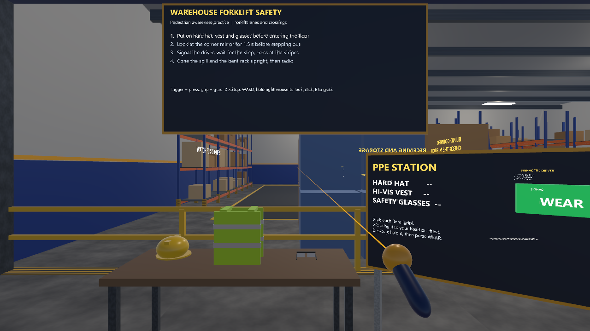

# Warehouse and forklift pedestrian safety (Vive Pro 2, SteamVR)

A Unity project for the HTC Vive Pro 2 on SteamVR (OpenXR), with a keyboard-and-mouse desktop fallback. It uses the shared kit in [`../packages/com.pittbradford.xrtraining`](../packages/com.pittbradford.xrtraining) and builds everything from primitives, so it needs no imported art.

**Status: compiles in Unity 6000.3.20f1 (checked inside the hub project) and plays in the editor in desktop mode with no console errors, November 1, 2026. Not played through to the end, and not tested on a Vive Pro 2.**

## Scenario and learning goals

You arrive at the entry of a warehouse where a forklift drives a loop around the racking. You practice general pedestrian awareness:

- put on PPE before you enter the floor,
- use a convex mirror at a blind corner before you step out,
- make eye contact with the driver, wait for the forklift to stop, and cross only at the striped crossing,
- stay in the green pedestrian walkways,
- find and mark hazards (a spill and a damaged rack upright) with cones and report them by radio.

This is general safety-awareness practice. It is not a certification, a training record, or a site procedure. Real sites have their own rules, signage, and supervisors.

## Steps on the task board

1. **PPE.** Put on the hard hat, hi-vis vest, and safety glasses from the PPE station before you cross the yellow entry line.
2. **Mirror.** From the entry walkway, look at the convex mirror on the cargo stack for 1.5 s. It shows the forklift lane that the stack hides.
3. **Cross.** Look at the driver, press SIGNAL on the post (the driver waves and the forklift stops), wait until it has stopped, then cross at the striped crossing.
4. **Report.** In the interior, find the spill and the bent rack upright. Place a cone near each, then press RADIO at the supervisor station.

Mistakes and critical misses are counted on the board like the Hydrostatic Test Bay. A **critical miss** (near miss) happens when you step into a forklift lane while the forklift is within about 6 m and not stopped for you. It triggers a red screen flash with text, a horn, haptics, and the forklift brakes hard. Other mistakes include entering the floor without full PPE, walking outside the green walkways, entering a lane away from the crossing, crossing without checking the mirror or without eye contact and a full stop, and radioing before both hazards are coned.

The steps may be done in any order, but the order above is the safe one.

## Controls

| Action | Vive wands (SteamVR) | Desktop |
|---|---|---|
| Move | Left trackpad or stick | W A S D |
| Turn | Right stick snap turn, or turn your body | Hold right mouse and move |
| Press a button | Point with the controller, trigger | Aim the crosshair, left click |
| Grab | Grip, near the object | E (aim at the object, within about 3 m) |
| Wear PPE | Bring the item to head or chest and release | Hold the item, then press WEAR at the PPE sign |

Cones are grabbed from the tray and dropped near each hazard (within about 2 m, resting on the floor).

## What is simulated and what is not

Simulated: a forklift on a fixed loop (about 2.2 m/s) that slows and stops when you are in its path, honks near the crossing, and holds still after you signal it; a driver who waves; a live convex-mirror view of the blocked lane; PPE snap zones on your head and chest; cone placement; a supervisor radio reply.

Not simulated, or simplified:

- no real forklift physics, load handling, or reversing; only one forklift and one fixed route
- eye contact is approximated by a head-direction check with a short gaze time and a line-of-sight test; it does not track eyes
- you cannot be struck or hurt; the near miss is a scored event, and you can walk through racking and walls (the play area is only clamped to the building)
- worn PPE cannot be taken off again; PPE fit, inspection, and site-specific requirements are not modeled
- no audio from a real horn recording (it is a generated tone), no site procedures, signage standards, or regulations
- not tested on a Vive Pro 2 or any other hardware

## Research

Background references and study ideas for XR safety training: [../../docs/research/README.md](../../docs/research/README.md).

## Setup

1. Install Unity Hub and add **Unity 6000.3.20f1** (the built-in render pipeline is used; no extra assets are needed).
2. In Unity Hub choose **Add project from disk** and select this folder (`vive-steamvr/03-warehouse-forklift`). Packages are resolved from `Packages/manifest.json`, including the shared kit at `../packages/com.pittbradford.xrtraining`.
3. When the editor opens, run the menu **Pitt-Bradford > Set up project**. It configures OpenXR (Vive, Index and Touch profiles), the Input System, and shader variants, then creates `Assets/Scenes/WarehouseForklift.unity`. If it asks for an editor restart (input handling), restart and run it once more.
4. Make **SteamVR** the active OpenXR runtime (SteamVR > Settings > Developer > Set SteamVR as OpenXR runtime), start SteamVR, and put on the headset.
5. Open `Assets/Scenes/WarehouseForklift.unity` and press **Play**. With no headset connected the project runs in desktop mode.
6. To make a Windows build use **Pitt-Bradford > Build Windows player**. The output goes to `Builds/WarehouseForklift/` (not committed).

Screenshots can be generated headlessly with the kit's capture driver (`-pbCapture <folder>`); six viewpoints are scripted: overview, PPE station, crossing with the forklift stopped, mirror view, hazard markers, and the near-miss flash.

## Files

- `Assets/Scripts/WarehouseForklift.cs` - the scenario, rules, and screenshot script
- `Assets/Scripts/Forklift.cs` - the forklift, driver, and its behavior
- `Assets/Scripts/WfBillboard.cs` - keeps a label facing the player
- `Assets/Editor/ProjectSetup.cs` - the Pitt-Bradford menu items
