# Warehouse and forklift pedestrian safety (Unity, desktop and Vive Pro 2 / SteamVR)

A Unity project for desktop (keyboard and mouse) and for the HTC Vive Pro 2 on SteamVR (OpenXR). You arrive at the entry of a warehouse where a forklift drives a loop around the racking, and practice general pedestrian awareness. It uses the shared kit in [`../packages/com.pittbradford.xrtraining`](../packages/com.pittbradford.xrtraining) and builds everything from primitives except the two people: the walking co-worker and the forklift driver are shrunk Microsoft Rocketbox avatars (MIT) committed under `Assets/Resources/Rocketbox` (about 18 MB). If that folder is deleted the project falls back to the primitive figures.

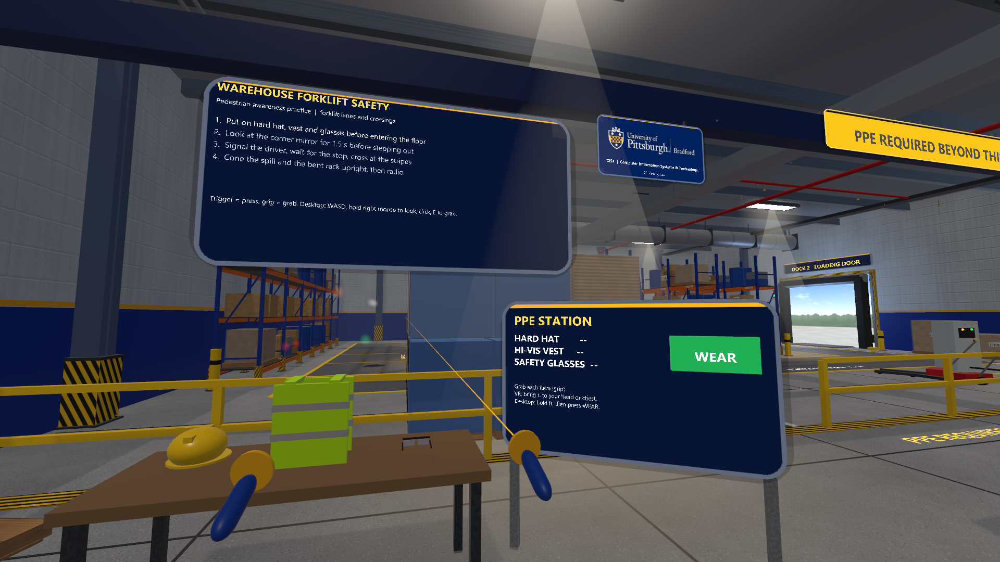

This is general safety-awareness practice. It is not a certification, a training record or a site procedure. Real sites have their own rules, signage and supervisors.

## What is verified and what is not

| Item | Status (as of November 3, 2026) |
|---|---|
| Compiles in Unity 6000.3.20f1 | Yes, in scripted editor runs (November 1 and 2). |
| Scripted capture run (13 views) and its self-test of the co-worker event and awareness check | Yes, in the desktop editor, unbaked and baked: `[selftest] PASS`, awareness score 2 of 3 as scripted. This is emulated: a script stands in for the learner. |
| Played through by a person | **No.** No person has played the four steps or the co-worker event by hand. |
| Headset (Vive Pro 2, Quest or any other) | **Not tested.** |
| Fresh clone opens and plays without running Set up project | Not tested. |
| Timing from crossing to the awareness check | Not measured by a person. |

The hub keeps its own copy of `WarehouseForklift.cs` (`../hub/Assets/Scripts/Scenarios/`), which does not have the co-worker event yet. The hand-test table is [../../docs/TESTING.md](../../docs/TESTING.md) section 2 (checks D1 to D5, D9 to D11, D16, D17, B1 to B4), with exact steps and the expected text.

## How to open and run

Requirements: Unity **6000.3.20f1** (built-in render pipeline; the two Rocketbox people are already in the project), Windows, and a **full clone** of this repository (the project loads the shared kit from `../packages/com.pittbradford.xrtraining` by a relative `file:` path). OpenXR 1.19.0 and the Input System come from `Packages/manifest.json`.

**Desktop (no headset).**

1. Unity Hub > **Add > Add project from disk** > `vive-steamvr/03-warehouse-forklift`. The first open imports and compiles (not timed; allow several minutes). A Safe Mode prompt means a script error: send the first red message.
2. Open `Assets/Scenes/WarehouseForklift.unity`. The scene and the OpenXR settings are committed. If the scene is missing or only holds a "Scenario" object, run **Pitt-Bradford > Set up project** once (it keeps a baked scene; restart the editor if it asks about the input handling change, then run it again).
3. Close SteamVR, press **Play**, then click once in the Game view.

**Headset (untested).** Set SteamVR as the active OpenXR runtime (SteamVR > Settings > Developer > Set SteamVR as OpenXR runtime), start SteamVR, put on the headset, then press Play.

**Optional player build.** **Pitt-Bradford > Build Windows player** writes `Builds/WarehouseForklift/` (not committed; not tried by a person).

## Controls

| Action | Vive wands (untested) | Desktop |
|---|---|---|
| Move | Teleport: push either thumbstick (or the trackpad) forward to show an arc, let go to jump there (green = valid, red = refused) | Hold T, let go to teleport; W A S D also walks |
| Turn | Thumbstick or trackpad left or right turns 45 degrees (either hand), or turn your body | Hold the right mouse button and move the mouse |
| Press a button | Point with the controller, trigger | Aim with the centre of the view, left click (range about 4 m) |
| Grab | Grip, near the object | Aim at the object and hold **E** (range about 3 m); release E to drop |
| Wear PPE | Bring the item to your head or chest and release | Hold **E** on the item, keep E held and click **WEAR** at the PPE sign |

Cones are grabbed from the tray and dropped near each hazard (within about 2 m, resting on the floor). No crosshair dot is drawn on the desktop: the pointer is the centre of the view.

## Task list and why

Four steps on the task board. The steps may be done in any order, but the order below is the safe one and the rules flag the others.

| # | Step (as on the board) | What completes it | Why this matters |
|---|---|---|---|
| 1 | Put on hard hat, vest and glasses before entering the floor | Wear all three items from the PPE station before you cross the yellow entry line | PPE only protects if it is on before you reach the hazard. |
| 2 | Look at the corner mirror for 1.5 s before stepping out | From the entry walkway, look at the convex mirror on the cargo stack (within about 9 m, within about 14 degrees of the centre of your view) for about 1.5 seconds; the count falls back if you look away. It shows the forklift lane that the stack hides | A blind corner hides traffic. The mirror lets you see what is coming before you step out. |
| 3 | Signal the driver, wait for the stop, cross at the stripes | Look at the driver, press SIGNAL on the "SIGNAL THE DRIVER" post within 8 seconds (the driver waves and the forklift stops for about 14 seconds), wait until it has stopped, cross at the striped crossing and leave it on the north side | A driver who has seen you and stopped will not drive into your path. Crossing only at the stripes is where drivers expect pedestrians. |
| 4 | Cone the spill and the bent rack upright, then radio | Place a cone near each hazard (within 2 m), then press RADIO at the supervisor station | Marking a hazard warns others and the report gets it fixed. |

After each step a **WHY THIS MATTERS** panel shows a one-sentence reason for a few seconds (added November 3, 2026; the same kit panel Refinery Rounds uses). The reasons are general safety awareness, not a procedure. The scenario summary still ends with the awareness check, so there is no extra reasoning question. Compiled in the editor; not hand-played, not tested on a headset.

**Mistakes counted on the board.** A **critical miss** (near miss) happens when you step into a forklift lane while the forklift is within about 6 m and not stopped for you. It triggers a red screen flash with "NEAR MISS Forklift within 6 m", a horn, haptics, and the forklift brakes hard. Other mistakes include entering the floor without full PPE, walking outside the green walkways (after about 1.2 seconds), entering a lane away from the crossing, crossing without checking the mirror, without eye contact or without a full stop, and radioing before both hazards are coned. The board summary reads "STRONG PRACTICE: no mistakes.", "Complete with N mistakes." or "CRITICAL SAFETY MISS (n). Review before real work.".

## Co-worker hazard and awareness check (optional, on by default)

In this scenario you are a pedestrian, not the forklift driver, so the event is built around what a pedestrian should notice and do.

1. **The event.** It only starts after board step 3 (crossing) is done. Eight seconds later the forklift is sent to put a pallet away on the west-wall racking; it drives there from wherever it is on its loop (that travel time was not measured). It stops in the marked **LOADING ZONE** on the west lane, turns to the rack, raises the forks, drives in, sets the pallet on the shelf (in code; the screenshots do not show this step clearly), backs out, lowers, and turns back into the lane. When it stops in the loading zone a co-worker (a realistic Rocketbox avatar in blue overalls and a white hard hat) comes out of the **STAFF ENTRANCE** door, crosses the north lane, and walks close past the working forklift to the cone station. The driver sounds the horn when the co-worker comes within 4.5 m and holds ("Holding: person behind me") until they are more than 3.2 m away. Nothing warns you before the co-worker appears.
2. **The awareness check.** 4.5 s after the co-worker appears, the scene freezes: physics, the forklift and the co-worker stop (`Time.timeScale = 0`), audio pauses, you cannot walk (you can still look around and point), and a dark shell around your head blanks the view behind a panel. The panel is headed "AWARENESS CHECK, Question 1 of 3". Three questions are asked one at a time, answered by pointing and pulling the trigger (desktop: aim and click):
   - *Where was the co-worker in the hi-vis vest?* In front of you / to your left / to your right / behind you, relative to the way your head was facing at the freeze.
   - *Which way were they walking, as seen from you?* Toward you / away from you / across from your left to your right / across from your right to your left.
   - *How far away was the forklift?* Less than 6 m / 6 to 12 m / more than 12 m.

   Answers are scored automatically against the true positions at the moment of the freeze. Near a boundary both neighbouring answers are accepted (15 degrees for direction; any walking-direction component of 0.4 or more; 1 m for distance), and the summary says when an answer was accepted as "close to the line". No feedback is given during the check. The scene then resumes.
3. **Stop, watch, wait.** After the check a panel in front of you says: *STOP where you are. WATCH them. WAIT until they are clear.* The same three steps are on the "FORKLIFT LOADING?" stand beside the walkway. The scenario records whether you held your position (moved less than 0.8 m and did not enter a lane) and looked at the co-worker (head direction within 15 degrees, line of sight, at least 0.5 s) until the co-worker and forklift were clear. This does not add mistakes to the task board, so the original scoring is unchanged.
4. **Summary.** When all four board steps are done, a **Scenario summary** panel appears in front of you: the board result and counts, then a separate **Awareness check** section (score out of 3, each question with your answer and the simulation's answer) and the stop-watch-wait result. It is labelled general safety-awareness practice, not a test, a certification or a training record.

Inspector settings on the `Scenario` object (`WarehouseForklift` component): **Coworker Hazard** (off = the original scenario, with no door, loading zone, stand, co-worker or summary panel), **Awareness Check** (off = the co-worker event without the freeze), **Event Delay** (8 s) and **Check Delay** (4.5 s).

Why: Choi, Ahn and Seo (2020) used SAGAT queries (the simulation pauses and the person answers questions about the surroundings) in a VR forklift study and found that operators were likely to have reduced awareness of nearby workers while loading or unloading. Our learner is a pedestrian rather than the operator, so this adapts the idea rather than reproducing it. The co-worker appears without warning; Kim et al. (2021) reported that a virtual accident triggered by inattention reduced risk habituation for about a week, but this scenario has no accident and has not been studied. See [../../docs/research/UNIVERSITY-VR-AR-LANDSCAPE.md](../../docs/research/UNIVERSITY-VR-AR-LANDSCAPE.md).

Limits: one scripted co-worker on a fixed route, once per run; directions are judged from head direction, not eye tracking; a real SAGAT study would pause at random times and ask about more elements.

## Signage and look

Nothing is plain text floating in the air. Signs are rounded, shadowed panels with a metal back (the kit's `Ui.Panel`): the yellow PPE sign on the entry gantry, RECEIVING AND STORAGE on the north wall, WATCH FOR FORKLIFTS on the west wall (above the racking, where the old text was hidden behind it), the dock sign, the BLIND CORNER sign on the cargo stack, the SAFETY CONES plate on its post, and the PPE, signal and radio stands. The task board hangs in a fixed place, so it also has a solid back. The forklift driver's message is a white speech-bubble panel above the cab that turns to face you. The University of Pittsburgh at Bradford and CIST plate (`Ui.BrandPlate`) hangs from the gantry beside the task board, in view from the start; it shows the approved shield logo that the kit ships in `Runtime/Resources/Branding/pitt-bradford.png` (without that file it shows a text wordmark). Painted floor words and the text on buttons are unchanged.

The BLIND CORNER text used to face into the cargo stack, so from the walkway it read mirrored; it now reads correctly from the walkway (see screenshot 08). The SAFETY CONES text sits on a plate (screenshot 09). Ambient light comes from separate ceiling, wall and floor colours instead of one flat colour.

## Design values

These are scenario conventions chosen for the exercise, not standards: the **6 m** near-miss distance, the **1.5 s** mirror look, the **8 s** window after pressing SIGNAL, and the forklift speed of about 2.2 m/s. The step three sentence also says the driver has to stop and sound the horn at crossings, so the practice does not suggest the walker carries the whole responsibility.

## What is simulated and what is not

Simulated: a forklift on a fixed loop (about 2.2 m/s) that slows and stops when you are in its path, honks near the crossing, and holds still after you signal it; a driver who waves; a live convex-mirror view of the blocked lane; PPE snap zones on your head and chest; cone placement; a supervisor radio reply.

Not simulated, or simplified:

- no real forklift physics, load handling or reversing; only one forklift and one fixed route
- eye contact is approximated by a head-direction check with a short gaze time and a line-of-sight test; it does not track eyes
- you cannot be struck or hurt; the near miss is a scored event, and you can walk through racking and walls (the play area is only clamped to the building)
- worn PPE cannot be taken off again; PPE fit, inspection and site-specific requirements are not modeled
- no audio from a real horn recording (it is a generated tone), no site procedures, signage standards or regulations
- not tested on a Vive Pro 2 or any other hardware

## Baked scene

`Assets/Scenes/WarehouseForklift.unity` is **baked**: the warehouse that `Start()` builds (shell, lights, floor markings, racking and cartons, cargo block, dock, signs and stands, PPE items, cones, mirror, hazards, the forklift in its start pose, and the co-worker event's staff door, loading-zone paint and stand) is saved in the scene as about 2,170 ordinary GameObjects after the round 3 rebake (627 before it), so you can see, select and edit them in the Hierarchy and Scene view. Generated materials and textures are in `Assets/Baked/WarehouseForklift/` (commit it with the scene). At Play the same `Start()` runs and the kit helpers adopt the saved objects instead of making new ones. How baking and adoption work, the editing rules (do not rename, re-parent or reorder baked objects; untick instead of deleting) and the menus **Pitt-Bradford > Bake scene (play mode)** / **Unbake scene** are described in the kit README: [../packages/com.pittbradford.xrtraining/README.md](../packages/com.pittbradford.xrtraining/README.md#baked-scenes-bake-and-adopt). Re-bake after changing the build code. **Set up project** does not replace a baked scene.

Specific to this project:

- **Still made at runtime (never baked):** the XR rig, the player body and PPE zones, the task board, the near-miss flash, the corner-mirror camera and its render texture (the mirror face gets its material at every Play), the forklift's speech bubbles, the co-worker, and the awareness-check blanking shell, question panels, prompts and summary.
- **Moved by the script while it runs, so position edits do not last:** the forklift (drives its route; it is baked in its start pose), its lift and cargo, the driver's arm, the PPE items and cones once grabbed.
- **Rack cartons:** all cartons are baked. When the co-worker hazard is on, `Start()` removes the cartons in the west-wall bay where the forklift puts its pallet, at every Play (also on baked cartons). The bake skips that removal and the runtime mesh merging (static batching), so the scene file keeps the plain objects.
- **The `Coworker Hazard` toggle** (inspector, on the `WarehouseForklift` component) needs no re-bake. The scene was baked with it on. Turn it off and, at Play, the baked staff door, loading-zone paint and stand are hidden (the objects `Co-worker event`, `Loading zone markings`, `Loading zone sign` are set inactive), no co-worker is made and the cartons stay on the shelf, as in the unbaked scenario. If a scene is baked with the toggle off, those three objects are simply not in the scene and are built at Play when it is turned back on (re-bake only if you want to see them in the editor).

**Verified (November 2, 2026, desktop editor, emulated, no headset):** the bake saved 627 objects (play mode had 690; the rest are the runtime-only objects above); the scene file is about 1.7 MB and opens in under 0.05 s. The 13 capture shots were rendered with the scene unbaked and baked (`-pbOfflineWeather`) and compared: at most 0.35% of pixels differ by more than 8 of 255 levels in any shot, at text glyph and sign panel edges, the hard hat's resting position (about 1 px), and the animated beacon, driver's arm and live co-worker shots, which also differ between two baked runs (up to 0.39%). The scripted self-test passed on the baked scene (awareness score 2 of 3 as expected, `[selftest] PASS`). At Play the baked and unbaked scenes hold the same objects (694, same names and counts, no duplicates); a table moved in the saved scene stayed at its new position at Play; with `Coworker Hazard` off the event scenery was hidden, no co-worker was made and all 52 cartons stayed.

## Scripted self-test of the co-worker event

The capture run ends with a scripted self-test (`CoworkerShots` in `WarehouseForklift.Awareness.cs`). It puts the learner, with PPE on, in the interior walkway facing the loading zone, marks board steps 2 and 3 done, and lets the event play live: the forklift drives to the loading zone, the co-worker appears, and the scene freezes. It checks that nothing moves during the freeze, presses the real answer buttons (questions 1 and 3 with the simulation's answer, question 2 with a wrong one, so the expected score is 2 of 3), checks that the scene resumes, keeps the learner still and looking at the co-worker, and then checks that the event finishes, the forklift drives off, the board's mistake counts are unchanged, and the summary panel appears. Results are written to the log as `[selftest]` and `[awareness]` lines. Run of November 1, 2026 (excerpt):

```
[awareness] check starts. Truth: co-worker 50 deg right of where you faced, 5.7 m away; walking toward/away component 0.71 (toward +), across component -0.71 (left-to-right +); forklift 6.3 m
[selftest] paused: timeScale = 0, forklift + co-worker moved 0.0000 m in 0.6 s of real time
[selftest] awareness check score 2 of 3; expected 2 (Q2 deliberately answered wrong)
[selftest] forklift holding for the co-worker = True (phase BackOut), co-worker at (-7.97, 0.00, 7.15)
[awareness] behaviour: held position = True (moved 0.00 m, entered lane = False), looked at co-worker = True (gaze 9.8 s)
[selftest] forklift moved off after loading = True; mistakes 0 (was 0), critical 0 (was 0)
[selftest] PASS
```

The self-test turns off the head's `TrackedPoseDriver` for its run: with XR stopped by the capture driver, that component reset the camera rotation every frame and undid the scripted head direction. This affects only the capture run. Whether the same happens in normal desktop play with no headset has not been checked (this is check D2).

## Files

- `Assets/Scripts/WarehouseForklift.cs`: the scenario, rules and screenshot script.
- `Assets/Scripts/WarehouseForklift.Detail.cs`: round 3 textures, set dressing, fixtures, probe and dust.
- `Assets/Scripts/WarehouseForklift.Awareness.cs`: the optional co-worker event, awareness check, summary panel and self-test.
- `Assets/Scripts/CoWorker.cs`: the walking co-worker built from primitives.
- `Assets/Scripts/Forklift.cs`: the forklift, driver and its behavior (including the put-away at the racking and holding for the co-worker).
- `Assets/Scripts/WfBillboard.cs`: keeps a label or the driver's speech bubble facing the player.
- `Assets/Editor/ProjectSetup.cs`: the Pitt-Bradford menu items.
- `Assets/Scenes`, `Assets/XR`, `Assets/Resources`, `ProjectSettings`: the baked scene, OpenXR settings and shader keepers (written by **Set up project**, committed).
- `Assets/Baked/WarehouseForklift/`: materials and textures written by **Bake scene**; the baked scene refers to them (see "Baked scene").
- `screenshots/`: the 21 desktop editor renders (14 below, 15 to 21 in "Detail, lighting and sound (round 3)").
- Screenshots are made with `Unity.exe -projectPath <this folder> -executeMethod PittBradford.XR.EditorTools.CaptureRunner.Run -pbCapture <folder> -logFile <log>` (no `-batchmode`; it needs graphics). The editor enters play mode, the scenario's `Shots` coroutine stages and photographs views 01-09, then runs the co-worker self-test for views 10-13, and the editor exits. A built player also accepts `-pbCapture <folder>`.

## Screenshots

Desktop editor renders made by the capture run above (re-shot November 3, 2026). They are not headset captures. Views 01-09 are staged by the script (the forklift is placed and frozen, cones are dropped by the script). Views 10-13 are taken during the scripted self-test while the event plays live, with a script standing in for the learner. None of them is a recorded play-through by a person.

| | |
|---|---|
| 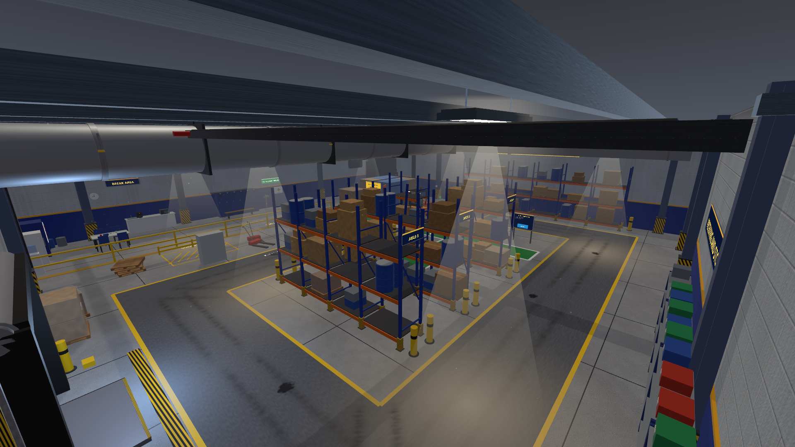 | 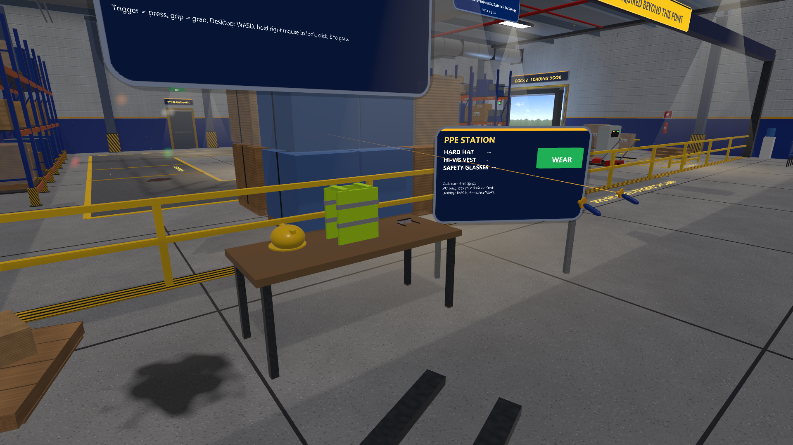 |
| 01 Overview | 02 PPE station |
| 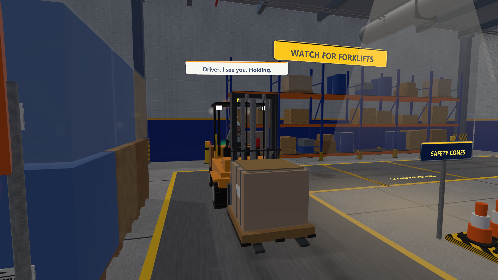 | 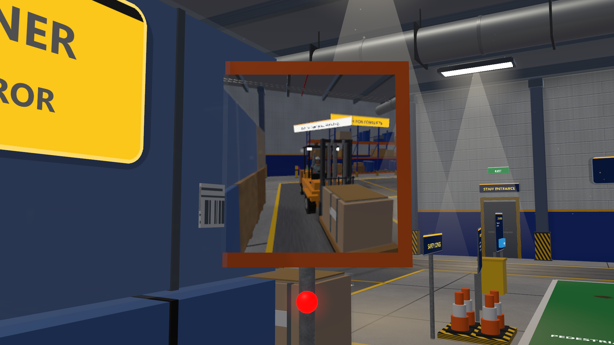 |
| 03 Crossing, forklift stopped (bubble "Driver: I see you. Holding.") | 04 Corner mirror |
| 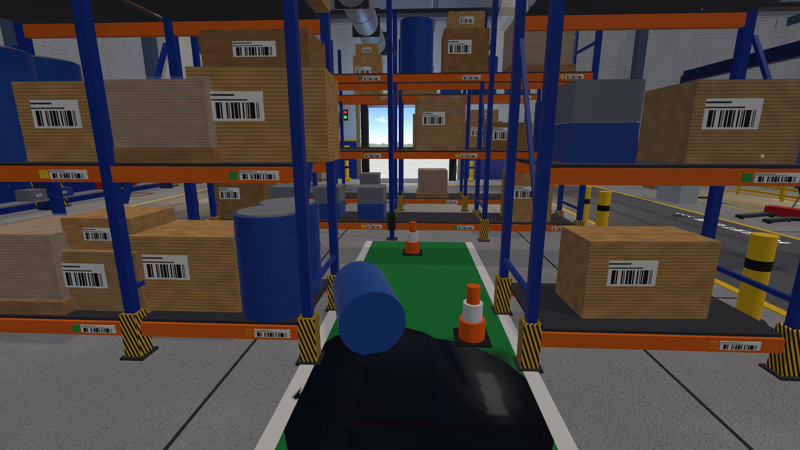 | 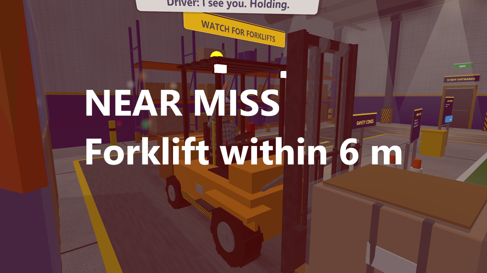 |
| 05 Hazard markers (cones placed by the script on the green walkway) | 06 Near miss (the flash is staged next to a stopped forklift, so the bubble still reads "I see you. Holding.") |
|  | 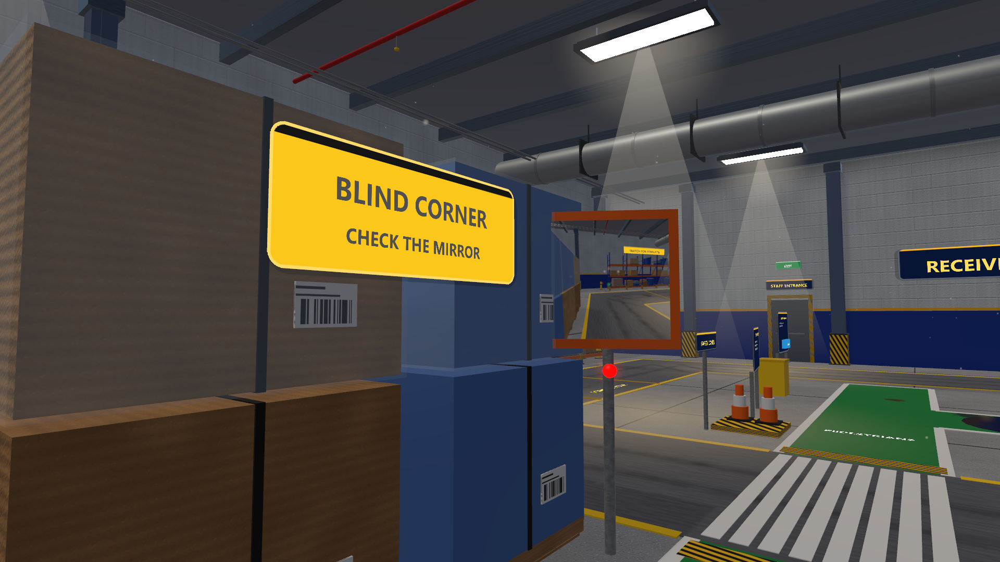 |
| 07 Start view | 08 Blind corner sign |
| 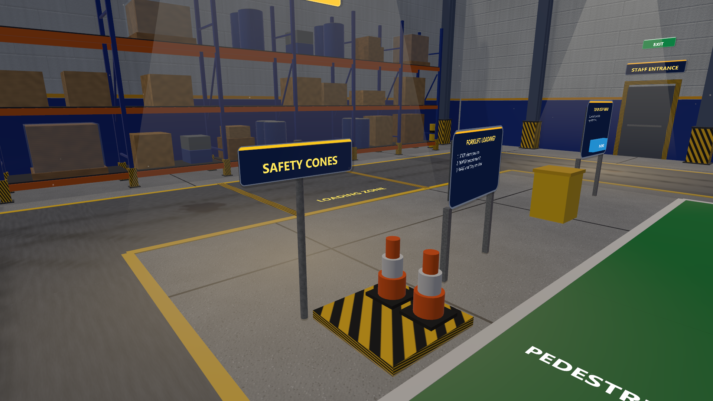 | 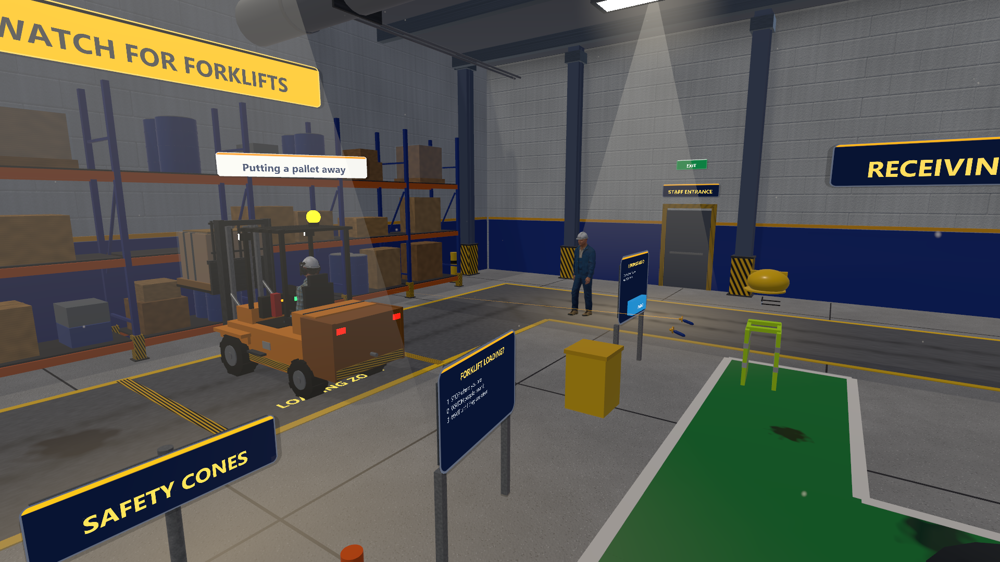 |
| 09 Cone station (loading-zone stand behind) | 10 Co-worker near the staff door; forklift putting a pallet away |
| 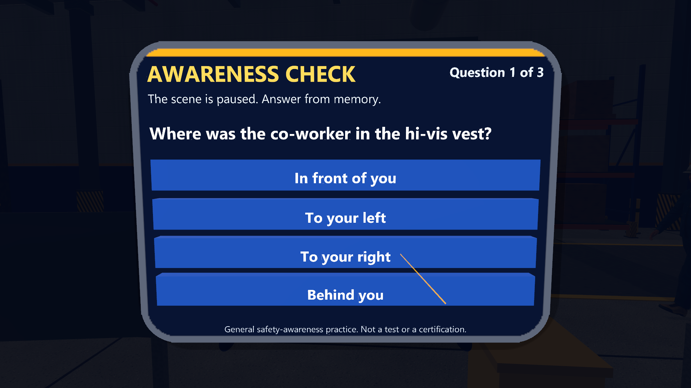 | 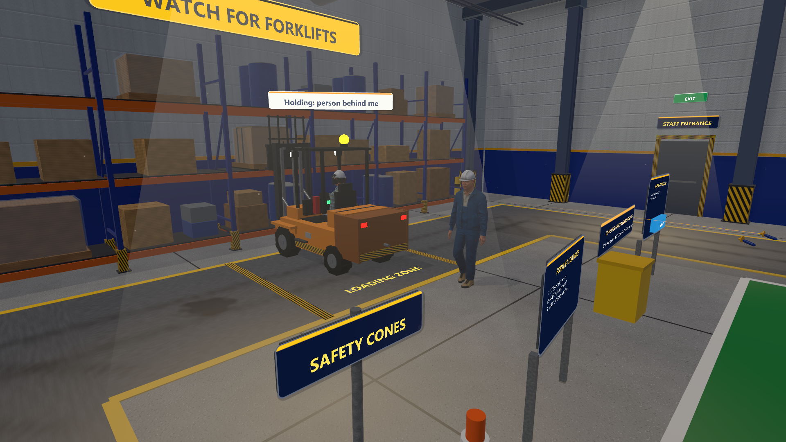 |
| 11 Awareness check, question 1 (learner's view) | 12 Driver holding for the co-worker |
| 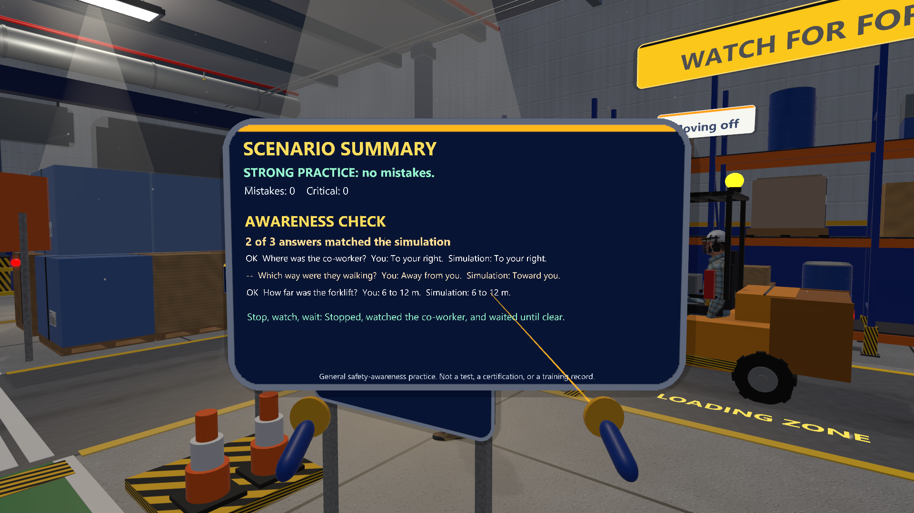 | |
| 13 Summary with the awareness check (scripted answers, 2 of 3) | |
| 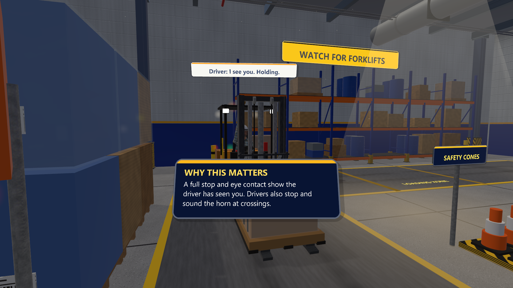 | |
| 14 "Why this matters" after the crossing step (the driver also has to stop and sound the horn) | |

## Detail, lighting and sound (round 3)

Verified November 3, 2026 (desktop editor, emulated): 0 compile errors; scene unbaked then re-baked (2,168 objects, 5.6 MB scene file); the 21-view capture ran on the baked scene and the scripted co-worker self-test printed `[selftest] PASS`. The older numbers above (627 objects, 13 views, 0.35% pixel comparison) describe the November 2 state.

Added November 3, 2026. All of it is built in code (primitives and generated textures) and baked with the scene; the project stays pack-free (no Asset Store content, no Rocketbox, no `assets-private`). Compiled and baked in the desktop editor; not played by a person, not tested on a headset, and no frame rate was measured (the scene file grew from 628 to about 2,180 objects, so expect it to cost more than before).

**Scene detail** (`WarehouseForklift.Detail.cs`, plus edits in `WarehouseForklift.cs`): racking with frame ties, diagonal braces, base plates, barcode labels and coloured location tags on every beam, and varied loads (taped and labelled cartons, wrapped pallets, drum pairs, stacked crates); the cargo block stands on pallets under shrink-wrap with straps and labels; floor saw cuts, wheel-track decals along the forklift route, oil stains, a glossy spill pool, a painted charging bay with charger and guard rail, fire points; steel columns with hatched guards; ceiling ducts, a red sprinkler main with heads, a cable tray, conduit; light fixtures with frames and hangers; dock leveller, rubber seals, door guides, control box and traffic lamps, wheel chocks; yellow bollards at rack ends; staging (wrapped pallets, pallet stacks, drums, crates, three pallet jacks, a spill-kit bin); extinguishers with red signs, a first-aid cabinet and eyewash, exit signs; a break area (table, chairs, counter, microwave, coffee maker, vending machine, fridge, cooler, clock); lockers and a bench; tote shelving along the north wall; a notice board with pinned papers; aisle signs. New signs use the kit's `Ui.Panel`.

**Models.** The forklift (`Forklift.cs`) now has hazard-striped skirts, fenders, cowl, dash with display and lamps, seat with headrest and armrests, levers, battery hood, tail lights, tow pin, overhead guard with work lamps, tyres with hubs and tread blocks that turn with the speed, mast with inner rails, hydraulic ram, sprockets and chains that shorten as the carriage rises, backrest, tapered fork tips, a wrapped and strapped load, a seated driver with legs, glasses and gloves, and a strobe beacon with a flashing vertex light. The co-worker (`CoWorker.cs`) gained neck, ears, nose, hair, safety glasses, hat peak and ribs, chin strap, belt, pockets, radio with antenna, ID badge, vest zip and pocket, gloves, soles and cuffs. The optional external-model hook (`CoWorker.ModelFactory`) is untouched.

**Textures (generated, procedural).** Sealed concrete with aggregate and tone patches (tiles seamlessly), painted block wall with roller streaks and grime, corrugated cardboard, wood, shipping label with barcode, tyre marks, stain, soft dot. No normal maps (the bake saves textures as plain colour maps).

**Lighting.** Dimmer ambient, warm ceiling fixtures against a cool daylight point light at the open dock door, additive light shafts (kit `Fx.LightShaft`), glowing light pools on the floor, dust motes (kit `Fx.Dust`), and one realtime reflection probe (kit `Fx.ReflectionProbe`, 128 px, rendered once a few frames after start) so the sealed floor and metal pick up the room. Pixel lights are capped at four; the break-area light and the beacon are vertex lights. Built-in render pipeline, no post-processing.

**Sound** (kit `Sfx`; nothing plays during a bake). Synthesized in code: forklift engine loop (pitch and volume follow speed), reversing beeper (only while backing out of the rack), hydraulic whine at each lift and lowering, forklift horn (sounds when the forklift approaches the crossing and for the near miss), HVAC beds over the floor and the entry, plant drone at the north wall, wind at the dock door, button, UI confirm and error, answer select (still audible while the awareness check pauses audio), near-miss alarm sweep, radio clicks, mirror snap, cone thud, co-worker footsteps; the player's concrete footsteps come from the kit. Recorded CC0 samples used through the kit's automatic override: `pallet_drop` and `snap` (rubberduck, OpenGameArt, CC0; see `../packages/com.pittbradford.xrtraining/Runtime/Resources/Audio/CREDITS.md`). Levels were not auditioned by a person.

Still plain: all forms are boxes and cylinders (no rounded bevels), the people are stiff, wall-mounted items are flat, vending and fridge fronts are simple, no normal or detail maps, and the dock opening is a bright flat panel.

Screenshots 15 to 21 are new (desktop editor renders, not a headset): 15 racking aisle, 16 forklift close-up, 17 dock and staging, 18 break area, 19 light shafts, 20 lockers and first aid, 21 co-worker close-up. Files added: `Assets/Scripts/WarehouseForklift.Detail.cs`.

## Render cost

Round 3 detail roughly tripled the render cost; round 4 cut it again with no object removed. Editor CPU counters in Play mode (median, mono editor Game view, measured on the hub copy of this scene because the hub runs the same scripts; **not** a Vive frame rate): set-pass calls 3,543 to **552**, draw calls 4,295 to **1,240**, triangles 359 k to **97 k**.

How: the bake now runs the kit's `RenderBudget` pass (flags and settings only, nothing is merged on disk). Groups that never move are declared with `P.Static(...)` and become batching-static; small, thin, emissive and transparent parts stop casting shadows; at most two non-directional lights stay on with a shorter range (the rest are switched off but stay in the scene), with a little more ambient light to make up; the soft indoor key light no longer casts realtime shadows. Baked materials are colour-quantised and GPU-instanced. The look is close to before but slightly flatter, with less pooled light; re-shoot screenshots were compared by eye and not replaced. GPU time and the frame rate on a headset are **not measured**. Details and the full table: `../hub/README.md`.

## Troubleshooting

- **Safe Mode prompt on open:** a script failed to compile. Send the first red Console message.
- **Keys or mouse do nothing in Play:** click inside the Game view first. If the Console shows OpenXR messages, close SteamVR and press Play again. With no headset the project is expected to fall back to desktop controls; this was not checked with SteamVR running.
- **The view snaps back while you mouse-look:** this is check D2; report it if you see it in normal play.
- **WEAR does nothing:** you must be holding an item (E held) when you click WEAR, and that item must be PPE.
- **You cannot walk and the screen is dark:** the awareness check is running. Answer the three questions by clicking.
- **Nothing happens after you cross:** the co-worker event waits 8 seconds and then needs the forklift to reach the loading zone. If nothing happens in 2 minutes, report it. You can switch the event off with **Coworker Hazard** (see above).
- **Cyan or pink materials in the first seconds:** the editor is still compiling shader variants. Wait a moment.
- **Red Console lines or repeated errors during play:** copy the first one.

## Visual pass 2 (2026-11-05)

Normal maps are now generated for every textured material (block joints, concrete grain, planks, cardboard flutes), noise textures are 512 px, windows and the dock door show a daylight picture, a merged contact-shadow mesh (one draw call) grounds standing objects, and the kit asks for 4x MSAA and forced anisotropic filtering (warehouse ambient up, lighter floor and lanes, light pools stronger, daylight dock door). Editor render counters moved by a few set-pass or draw calls only (see [../hub/README.md](../hub/README.md) and `docs/PROJECT-STATUS.md`); they are CPU counters, not a Vive frame rate. Screenshots in `screenshots/` were re-shot as desktop editor renders (not a headset). Re-baked and re-shot; hand check passes.

## Research

Background references and study ideas for XR safety training: [../../docs/research/README.md](../../docs/research/README.md).

## People

The co-worker (Construction_Male_02) and the forklift driver (Construction_Male_01) are Microsoft Rocketbox avatars, MIT licence (`Assets/Resources/Rocketbox/LICENSE.md`; Gonzalez-Franco et al. 2020, doi 10.3389/frvir.2020.561558). The committed copies are shrunk: textures at 1024 px, specular maps dropped, only the idle and walk clips kept. `tools/people/export-subset.py` makes them from the hub's local library; in Unity, Pitt-Bradford > People > Set up Rocketbox controllers builds the materials and animator controllers. The co-worker plays the library's walk and idle clips. The library has no sitting clip, so `SeatedDriver.cs` bends the driver's hips and knees on top of an idle clip and raises his right arm to wave. His seat height and pose were set by eye from desktop renders; they have not been checked in a headset.
