# Resistor Selection and Check Bench (Unity, desktop and Vive Pro 2 / SteamVR)

A Unity 6 (`6000.3.20f1`, built-in render pipeline) training example, inspired by the kind of work done by makers of passive electronic components (resistors including current-sense and anti-sulfur types, fuses, varistors, thermal sensors). You stand at an electronics bench, ground yourself, read a resistor color code, measure the part, choose the resistor for an LED circuit, and fit a part suited to a sulfur-rich atmosphere.

It is **generic education only**: it makes no claims about any company's real processes, products or datasheets. The derating curve, the pad size and the LED limits are illustrative numbers invented for the exercise. This is general awareness practice, not a procedure, a qualification or a certification.

Everything is built from Unity primitives by code (no imported art); the static world is baked into the scene file (see "Baked scene"). It uses the shared kit in [`../packages/com.pittbradford.xrtraining`](../packages/com.pittbradford.xrtraining).

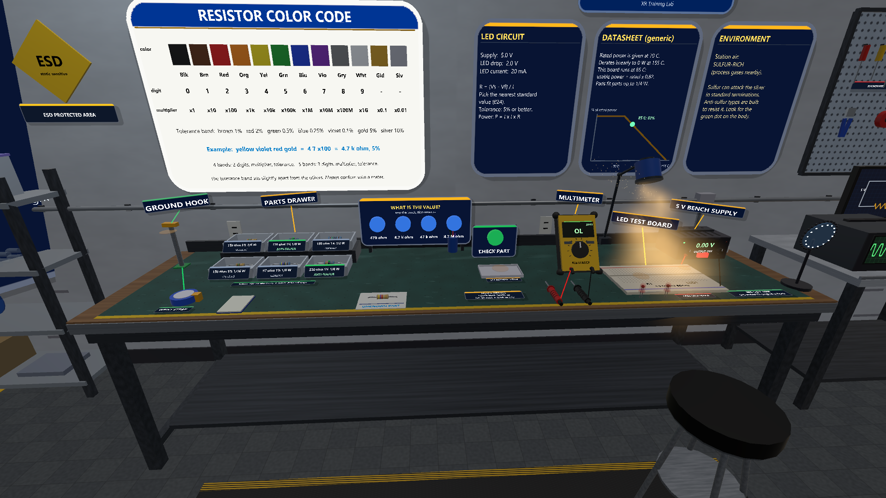

## What is verified

| Item | Status (as of November 3, 2026) |
|---|---|
| Compiles in Unity 6000.3.20f1 | Yes, in scripted editor runs (November 1 to 3). |
| Scripted capture run (fifteen views: strap, meter reading, LED lit, LED burned out, set dressing) | Yes, in the desktop editor, unbaked and baked. The script places parts directly; it does not use the hands. |
| `ResistorMath.cs` (color bands, E24, Ohm's law, derating, part check) | **Run on November 3, 2026**: every line of the test list below passed (71 assertions) in a stand-alone .NET 9 console program that compiles `ResistorMath.cs` outside Unity. That program is not committed. It does not test the scene. |

The hand-test table is [../../docs/TESTING.md](../../docs/TESTING.md) section 2 (checks D1 to D5, D12, D13, B1 to B4), with exact steps and the expected text.

## How to open and run

Requirements: Unity **6000.3.20f1** (built-in render pipeline; no extra assets), Windows, and a **full clone** of this repository (the project loads the shared kit from `../packages/com.pittbradford.xrtraining` by a relative `file:` path in `Packages/manifest.json`). OpenXR 1.19.0 and the Input System come from the same file. Add the Windows Build Support module only for the optional player build.

**Desktop (no headset).**

1. Unity Hub > **Add > Add project from disk** > `vive-steamvr/04-resistor-bench`. The first open imports and compiles (allow several minutes). A Safe Mode prompt means a script error: send the first red message.
2. Open `Assets/Scenes/ResistorBench.unity`. The scene and the OpenXR settings are committed. If the scene is missing or only holds a "Scenario" object, run **Pitt-Bradford > Set up project** once (it keeps a baked scene; restart the editor once if it asks about the input handling change).
3. Close SteamVR, press **Play**, then click once in the Game view.

**Headset.** Set SteamVR as the active OpenXR runtime (SteamVR > Settings > Developer > Set SteamVR as OpenXR runtime), start SteamVR with the Vive Pro 2, then press Play.

**Optional player build.** **Pitt-Bradford > Build Windows player** writes `Builds/ResistorBench/ResistorBench.exe` (not committed).

## Controls

| | Vive wands | Desktop |
|---|---|---|
| Move | Teleport: push either thumbstick (or the trackpad) forward to show an arc, let go to jump there (green = valid, red = refused) | Hold T, let go to teleport; W A S D also walks |
| Turn | Thumbstick or trackpad left or right turns 45 degrees (either hand), or turn your body | Hold the right mouse button and move the mouse |
| Press (buttons, switch, answers) | Point + trigger | Aim with the centre of the view, left click (range about 4 m) |
| Grab | Grip near the object | Aim at it and hold **E** (range about 3 m) |
| Release | Let go of the grip | Release **E** |

Probes: in a headset you can hold one in each hand and touch the leads. On the desktop only one object can be held at a time, so release a probe with its tip within about 12 cm of a lead and it clips on. Yellow glowing discs mark where a part, the strap or an LED snaps. No crosshair dot is drawn on the desktop: the pointer is the centre of the view.

## Task list and why

On the bench: an ESD mat with a wrist-strap hook, a two-tier parts rack ("parts drawer") with six labelled bins of three parts each, a color-code poster on the wall, an unknown resistor on a card, a multimeter with two probes, a small circuit board with places for one resistor (R1) and one LED (LED1), a 5 V supply with a switch, a selection tray with a CHECK PART button, and three wall cards (LED circuit, generic datasheet with a derating line, environment). The bins hold 150 ohm 5% 1/8 W standard; 150 ohm 1% 1/8 W anti-sulfur; 150 ohm 1% 1/2 W standard; 150 ohm 5% 1/16 W standard; 47 ohm 1% 1/8 W standard; 330 ohm 1% 1/8 W anti-sulfur.

| # | Step (as on the board) | What completes it | Why this matters |
|---|---|---|---|
| 1 | Clip on the ESD strap before touching parts | Grab the wrist strap and release it near the ground hook (it snaps on). Grabbing any part before that is a mistake | Static charge can damage electronic parts. Grounding yourself first drains it. |
| 2 | Read the bands of the unknown part, measure it, answer | Press the matching answer (470 ohm / 4.7 k ohm / 47 k ohm / 4.7 M ohm), then put both probes on the part's two leads. The meter shows a simulated reading within half the part's tolerance. The step completes when the answer is right and the meter has read that part | The color code gives the nominal value and tolerance; a meter confirms it. Always confirm with a meter. |
| 3 | Work out the LED resistor; test a part in the tray | The circuit card gives 5 V, 2 V LED drop, 20 mA. R = (5 - 2) / 0.020 = 150 ohm, a standard (E24) value. Power = 0.02 x 0.02 x 150 = 0.06 W. The datasheet card derates a rated power linearly from 100% at 70 C to 0 at 155 C; at the board's 85 C that is 82%, so a 1/8 W part is good for about 0.103 W (enough), a 1/16 W part for 0.051 W (not enough), and a 1/2 W body is oversize for the pads. Take a part from a bin, put it in the tray, press CHECK PART. A wrong value, loose tolerance (looser than 5%), too little derated power, or an oversize body is a mistake | A part must have the right value, enough power rating at the real temperature, and fit the board. A bigger rating is not automatically safer. |
| 4 | Sulfur-rich air: fit an anti-sulfur part, switch on | The environment card says the station air is sulfur-rich. Install an **anti-sulfur** 150 ohm part (green dot on the body, "ANTI-SULFUR" on the bin label) in R1, put an LED in LED1, and switch on the supply. The LED lights at about 20 mA. Step 3 must be done first: otherwise the board says "Test the part in the selection tray first (step 3)." | In a sulfur-rich atmosphere, a standard part's terminations can be attacked; anti-sulfur types are built to resist it. |

After each step a **WHY THIS MATTERS** panel shows a one-sentence reason for a few seconds, and after the fourth step one multiple-choice question ("why also measure a part you have already read?") gives feedback on every option and a reasoning line apart from the procedure score (added November 3, 2026; the same kit panels the Hydrostatic Test Bay and Refinery Rounds use). It is practice feedback, not a certification. Compiled in the editor.

**What the rules count.** A wrong value dims the LED (below about 16.5 mA) or sets it above the design current (above about 23.5 mA): a mistake. Powering with a clearly wrong part (over 30 mA, for example the 47 ohm part, or no resistor at all) burns the LED out with a puff of smoke: a **critical miss**. A standard (non-anti-sulfur) part, or one that would overheat at 85 C, is a mistake. A spare LED is on the bench. The board summary reads "STRONG PRACTICE: no mistakes.", "Complete with N mistakes." or "CRITICAL SAFETY MISS (n). Review before real work.".

## Design values

These are scenario conventions, not standards or any manufacturer's data: the 5 V, 20 mA LED circuit, the 30 mA burn-out limit, the linear derating curve, the meter error within half the tolerance, and the **green dot** that marks an anti-sulfur part on the bench.

## What is simulated and what is not

Simulated: color-code mapping and reading, a meter reading with a small repeatable error within half the part's tolerance, Ohm's law for the LED, a generic linear derating curve, LED brightness vs current, burn-out above 30 mA, an ESD strap "grounded when clipped to the hook" rule, and the idea that sulfur-rich air calls for an anti-sulfur type.

Not simulated: real ESD physics, meter loading and in-circuit measurement, temperature rise, real sulfur corrosion, real datasheet curves, current-sense (low-value) resistors, fuses, varistors, thermal sensors, or any manufacturer's processes. The strap is clipped to a bench hook instead of being worn. Sulfur and ambient temperature are fixed by the cards.

## Look and signage

Signs and labels use the shared kit's signage helpers (`Ui.Panel`, `Ui.Tag`, `Ui.BrandPlate` in `Signage.cs`) instead of bare floating text:

- **Rounded panels** with a border, accent bar and soft shadow for the answer panel, the CHECK PART sign (both on a thin steel backing), the color-code poster and the three wall cards.
- **Name tags with leader lines** that turn to face the player for the ground hook, parts drawer, multimeter, LED test board and 5 V supply.
- **Laminated labels lying flat on the mat** for the wrist strap, selection tray, meter probes, spare LEDs, the anti-sulfur legend and the ESD mat.
- **Bin label cards** tipped back on the front of each bin; the back row of bins stands on a riser so its labels are not hidden.
- A **university / CIST plate** on the wall above the cards. It shows the approved shield logo that the kit ships in `Runtime/Resources/Branding/pitt-bradford.png` (as in the screenshots); without that file it shows a text wordmark.
- Text printed on objects (meter and supply displays, button faces, breadboard silkscreen, the reading card) is left as it was.
- Cheap realism: concrete floor, painted wall with a base trim, ceiling tiles and fixture frames, wood-grain bench top with an apron, foot rails and a lower shelf, textured ESD mat, a light under each ceiling fixture plus a fill and one shadow-casting key light, soft round smoke puffs.

## Detail, lighting and sound (round 3)

Added on November 3, 2026 (desktop editor).

**Scene detail (all procedural, in `Assets/Scripts/BenchDetail.cs` and `ResistorBench.cs`):**
- Room: ESD floor tile (grouted checker texture), anti-fatigue rubber mat with hazard-tape edges, floor marking lines, conduit run with clamps, outlets, junction box, scuffs, ESD warning sign and "ESD PROTECTED AREA" plate, wall clock, fluorescent tubes inside the ceiling panels, a ceiling cable tray, and side and front walls so the room is closed.
- Bench: rubberised ESD mat texture (dot grid, scratches, worn front edge), steel edge trim, edge ruler, backboard, power strip with a lit switch on the conduit drop, mains cable and ties, pen mug and notepad, stool, task lamp (clamp, two-joint arm, shade, bulb disc) and a desk magnifier with an LED-ring lens.
- Instrument cart: oscilloscope (lit screen with a traced waveform, knobs, BNC sockets, status LED), soldering station (display, knob, coil stand with an iron resting in it, sponge, solder reel) and a monitor showing a painted schematic of the 5 V LED circuit.
- Pegboard tool rack (screwdrivers, pliers, cutters, tweezers, hex keys, wire stripper, wire coil, tape, parts cups) with label plates; a four-shelf rack with component reels, translucent part tubes and labelled boxes; a six-by-three small-parts drawer cabinet with labels.
- Parts: resistors now have a barrel body with end caps, glossy colour bands and tinned leads with a bent tip; LEDs have a translucent epoxy dome and barrel over a glowing die with the anvil and post visible, a halo sprite (additive, bloom stand-in) and different leg lengths; the breadboard has a painted hole grid, rails, centre channel and column numbers (model scale, not the real 2.54 mm pitch); probes have a finger guard, grip bands, tip collar and strain-relief boot; the meter has a rubber holster, range ticks, buttons, a backlight strip and boots at the jacks; the supply has knobs, status LEDs, vent slots and feet.
- Lighting: cool fluorescent ceiling lights plus a warm spot task lamp, a realtime reflection probe (refreshed once at start), `QualitySettings.pixelLightCount = 5`. Fog is not used. The snap-zone markers are now small translucent gold pads.
- Effects (runtime-only, soft sprites, small counts): dust motes and a faint beam in the lamp cone, a thin smoke wisp from the soldering iron, a spark burst, a brief light flash and smoke puff when an LED burns out, LED halo that follows the current.
- "Why this matters" and the question panels keep their distance above the bench (`WhyDistance` / `AskDistance` unchanged).
- Not done: normal maps (textures are colour maps only), and no bench-wood scratch texture beyond the existing grain.

**Sound** uses the kit's `Sfx` (see [../../docs/agents/KIT-AUDIO-FX.md](../../docs/agents/KIT-AUDIO-FX.md)); nothing plays during a bake. Used here: `hvac_loop` as a quiet lab ambience bed, `esd_click` when the strap clips on, `switch` for the supply power switch, `pressure_tone` (pitched low, very quiet) as a hum while the supply is on, `meter_beep` when a reading appears, `led_on` when the LED lights, `spark_pop` and `smoke_puff` when it burns out, `ui_confirm` when a step completes, `ui_error` for mistakes, Tile footsteps on the ESD floor, plus the kit's built-in `grab`, `release` and `snap`. Whether each is a recorded CC0 sample or synthesised is decided by the kit (see its README and `Runtime/Resources/Audio/CREDITS.md`); this project adds no audio files. There are no dedicated drawer-slide or bin-lid sounds (the catalogue has none), and the range-switch click is not played because the meter dial is not interactive.

**Cost note:** the baked scene grew from 398 to 934 objects (the extra set dressing is mostly small static pieces), 230 materials and 71 textures.

**Verified (November 3, 2026, desktop editor):** compile with 0 `error CS`; unbake, then re-bake (934 objects captured, 2.3 MB scene file); the scripted capture ran on the baked scene and produced all 15 views; the same capture also ran unbaked. `ResistorMath.cs` was not changed.

New screenshots (desktop editor renders, not a headset):

| | |
|---|---|
| 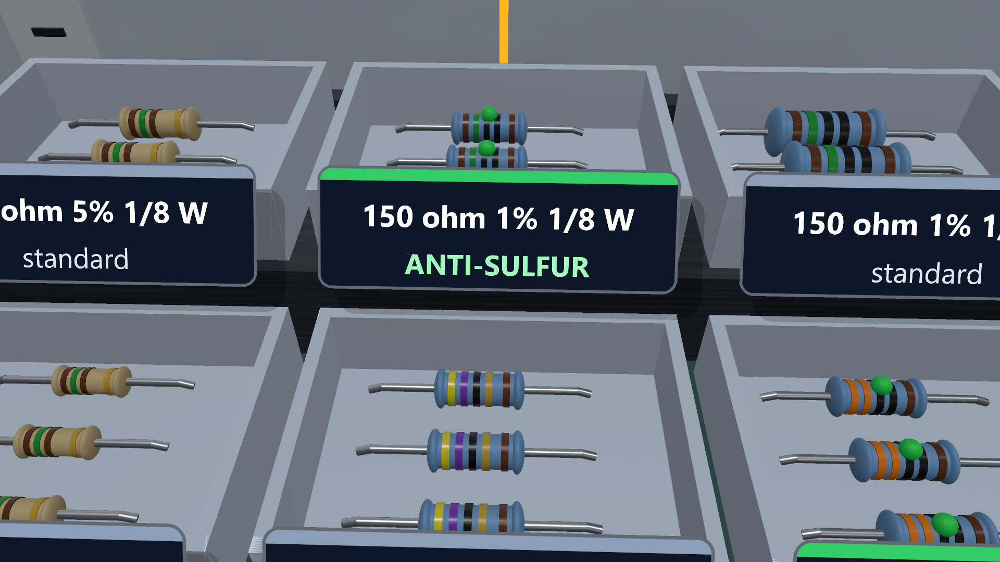 | 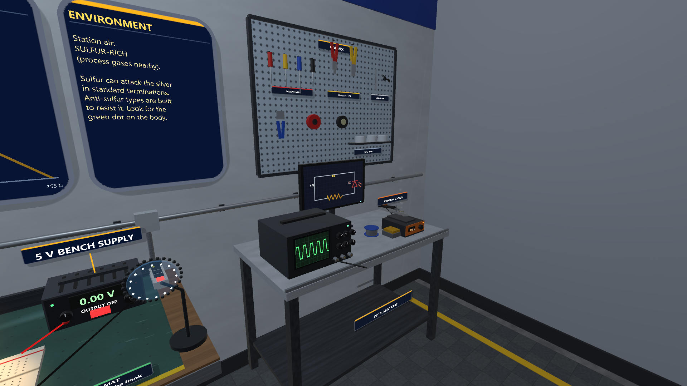 |
| 11. Parts close-up: barrel resistors with glossy bands and bent leads | 12. Instrument cart, schematic monitor and pegboard tool rack |
| 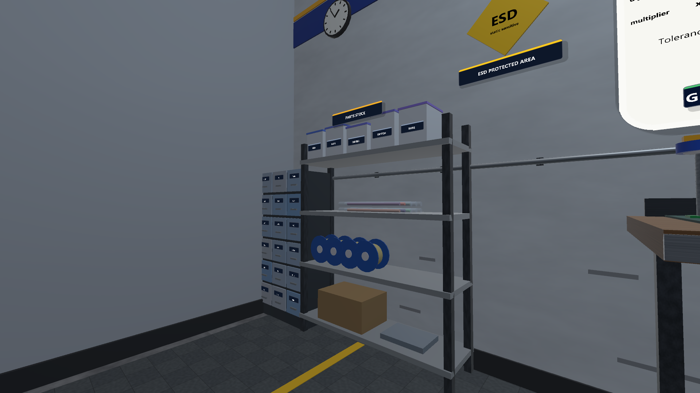 | 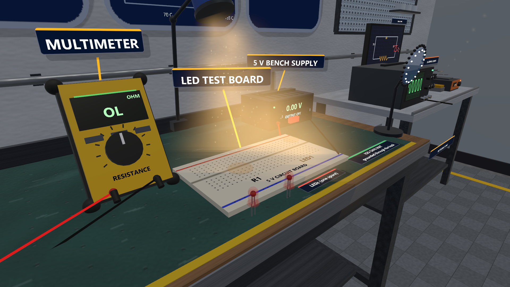 |
| 13. Shelf rack and drawer cabinet (task board hidden for this view) | 14. Task lamp, painted breadboard grid, dust in the cone |
| 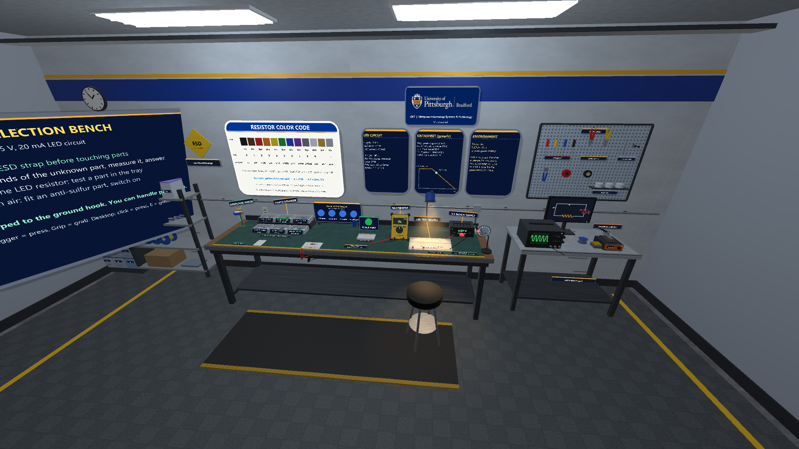 | |
| 15. Whole room: ESD floor, anti-fatigue mat, stool, bench, cart | |

## Baked scene

`Assets/Scenes/ResistorBench.unity` is **baked**: the room, lights, bench, parts rack and bins with their label cards, mat labels, reading card and answer panel, selection tray and CHECK PART button, multimeter body and jacks, breadboard, power supply and its switch, wall poster and cards, name tags, the university plate, the wrist strap, both meter probes, the snap zones and the wires (round 3: 934 objects; 935 GameObjects in the scene file including the "Scenario" object) are normal GameObjects in the saved scene, so you can see, select, move and restyle them in the editor. Their generated materials and textures are in `Assets/Baked/ResistorBench/` (230 materials and 71 textures after round 3; identical materials are saved once). Commit that folder with the scene. `Start()` still runs: the kit helpers adopt the saved objects (matched by parent, name and call order) and the script re-attaches the button and grab handlers, the snap zones, the meter and supply displays, and the leads.

**Still created at runtime (on purpose):** the resistors (all 19, including the unknown part), the two LEDs with their light and smoke, the XR rig and hands, and the task board. The parts move between bins, tray, meter and board, carry their simulated measured value, and the LEDs change colour and burn out, so they are rebuilt each play and are not in the scene.

Edits to baked objects are kept at Play (for example, moving the multimeter in the scene moves it in play, and the probe leads follow its jacks). Do not rename, re-parent or reorder baked objects; to hide one, untick it instead of deleting it. After changing the script, re-bake with **Pitt-Bradford > Bake scene (play mode)**; **Pitt-Bradford > Unbake scene** goes back to building everything at Start. Headless: `Unity.exe -projectPath <this folder> -executeMethod PittBradford.XR.EditorTools.SceneBaker.BakeAndExit -logFile <log>` (no `-batchmode`). How it works and the conversion recipe: [kit README, "Baked scenes"](../packages/com.pittbradford.xrtraining/README.md#baked-scenes-bake-and-adopt). **Set up project** does not replace a baked scene.

**Verified (November 2, 2026, desktop editor):** the seven capture shots were rendered with the scene unbaked and baked (`-pbOfflineWeather`) and compared pixel by pixel; at most 0.54% of pixels differ by more than 8 of 255 levels in any shot. The differences are text glyph edges (the runtime font atlas fills in a different order), sub-pixel edges of the sign panels (their textures are now imported PNGs), the random smoke puff in shot 6, and the resting place of the probes after they are unclipped and fall back onto the bench in shots 5 and 6 (they land slightly differently; repeated baked runs match each other exactly there). In both runs the scripted capture completed: the strap snapped to the hook, the meter read 4.7 k on the unknown part, the anti-sulfur 150 ohm part lit the LED, and the 47 ohm part burned out the second LED, with no script errors. The baked scene file is about 1 MB and opens in under 0.1 s.

## Files

- `Assets/Scripts/ResistorBench.cs`: the scenario (`ResistorBench : MonoBehaviour, IShotScript`) plus the small components `BenchResistor` and `BenchLed`.
- `Assets/Scripts/BenchProbe.cs`: the meter probe component (in its own file so the baked scene can save it).
- `Assets/Scripts/ResistorMath.cs`: pure C# (no Unity types): color bands, E24, Ohm's law, derating, simulated measurement, part check.
- `Assets/Baked/ResistorBench/`: materials and textures written by **Bake scene**; the baked scene refers to them.
- `Assets/Editor/ProjectSetup.cs`: the menu items.
- `Assets/Scenes`, `Assets/XR`, `Assets/Resources`, `ProjectSettings`: the baked scene, OpenXR settings and shader keepers (written by **Set up project**, committed).
- `Assets/Scripts/BenchDetail.cs`: round 3 set dressing and its procedural textures (floor, wall, shelving, instrument cart, pegboard, stool, lamp).
- `screenshots/`: the fifteen desktop editor renders (re-shot November 3, 2026, round 3).
- Screenshots (optional), with the project closed in the editor (do not pass `-batchmode`; it needs graphics): `Unity.exe -projectPath <absolute path to 04-resistor-bench> -executeMethod PittBradford.XR.EditorTools.CaptureRunner.Run -pbCapture <absolute screenshots folder> -logFile <log>`. It enters play mode, takes fifteen shots (`01-bench-overview` to `15-room-wide`) and exits. For the capture only, the scenario stops any OpenXR session that started (the editor may start the OpenXR Mock runtime, which otherwise tilts the pictures and blocks the field of view), hides the desktop hands, and moves the hidden player to each camera position so the name tags face the picture. The Mock Runtime feature is switched off in the committed OpenXR settings.

## Screenshots

All pictures are **desktop editor renders** made by the scenario's scripted capture (`-pbCapture`), not headset captures. The scripted run places parts directly (it does not use the hands), so the pictures show the scene and its responses, not a hand-played session. Name tags turn to face the viewer, so they look slightly different from each viewpoint. The yellow ellipses in views 3 to 5 are the glowing snap spots for the tray, R1 and the strap.

| | |
|---|---|
| 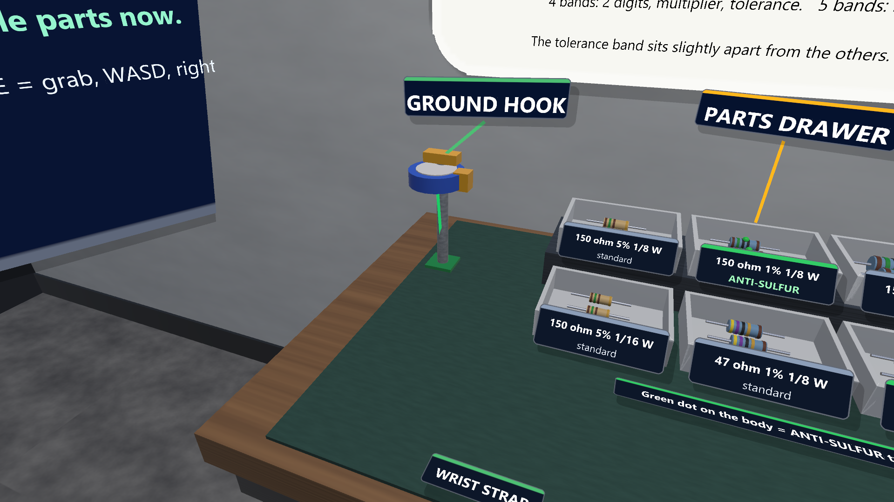 | 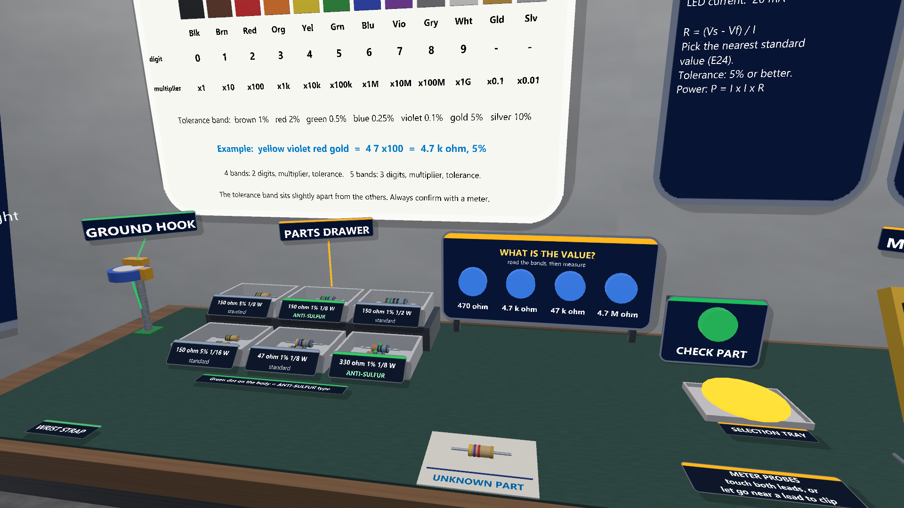 |
| 2. ESD strap clipped to the ground hook | 3. Tiered parts rack with bin labels, answer panel, unknown part, CHECK PART and tray |
| 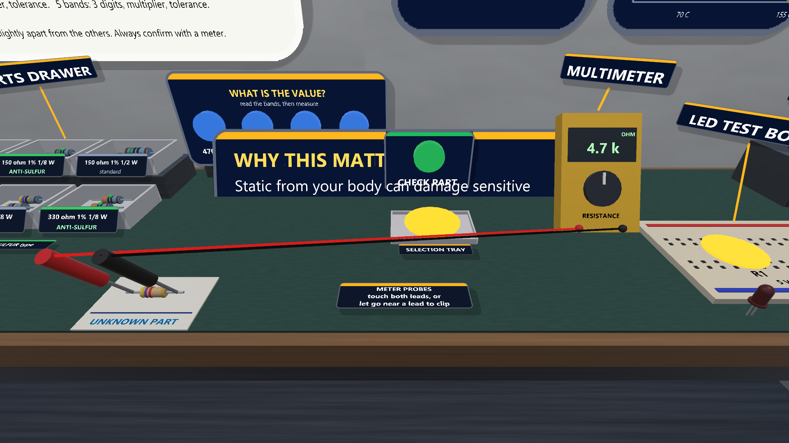 | 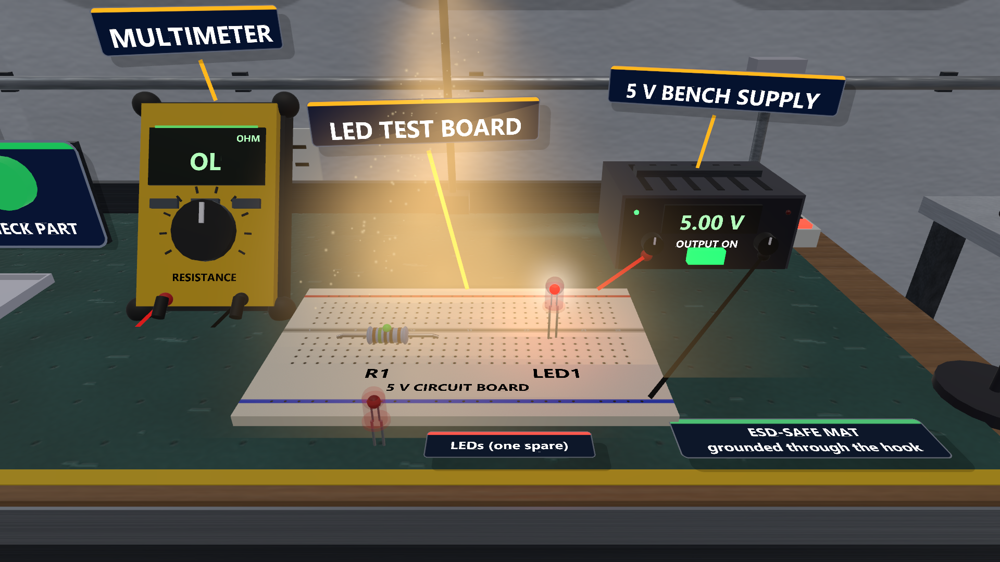 |
| 4. Both probes on the unknown part; meter reads 4.7 k | 5. Anti-sulfur 150 ohm part in R1, LED lit, supply showing 5.00 V OUTPUT ON |
| 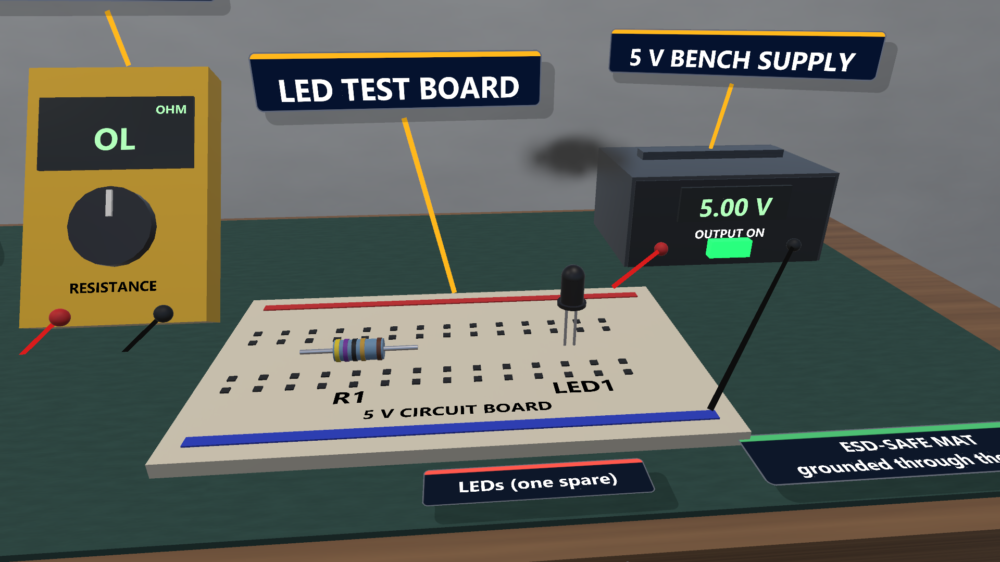 | 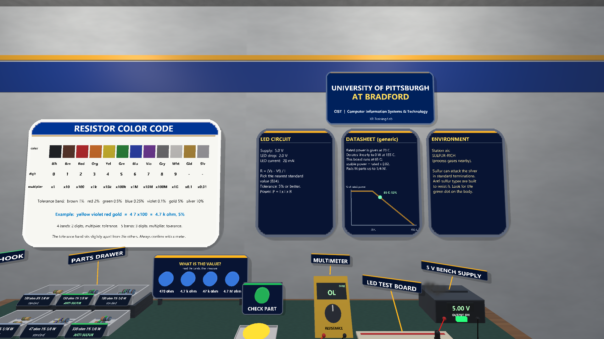 |
| 6. 47 ohm part powered: LED burned out (dark), smoke puff | 7. Color-code poster, circuit / datasheet / environment cards, university plate |
| 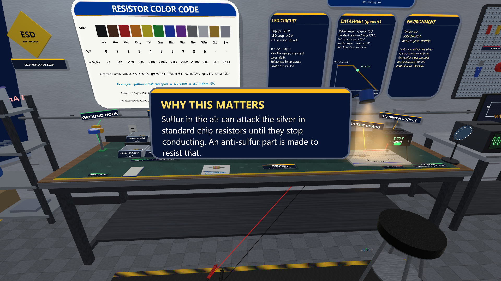 | 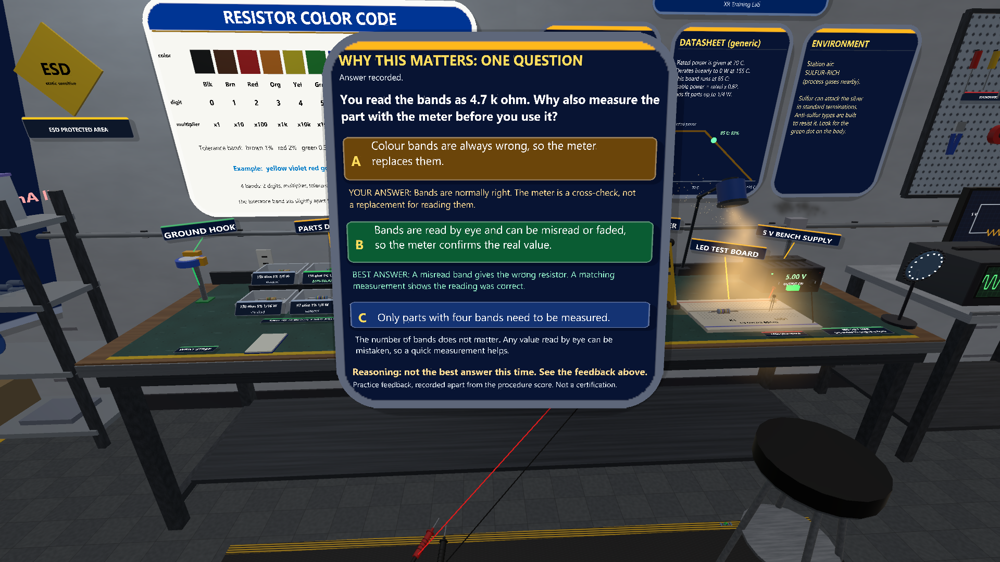 |
| 8. "Why this matters" after the last step (also shot as 09, the question before answering) | 10. The question after a not-best answer: feedback on every option and a reasoning line |

The overview (view 1) is at the top of this page.

## Plain C# test list (`ResistorMath`)

Run on November 3, 2026: every line below passed in a stand-alone .NET 9 console program (not committed) that compiles `Assets/Scripts/ResistorMath.cs` outside Unity. Each line is input, then expected output. The round trip was run for 47, 100, 150, 330, 470, 1 000, 4 700, 47 000, 1 M and 4.7 M ohm at 1% and 5%, which includes every value stocked in the bins.

- `ColorBands(150, 5)` -> `[1,5,1,10]` (brown green brown gold)
- `ColorBands(150, 1)` -> `[1,5,0,0,1]` (brown green black black brown)
- `ColorBands(4700, 5)` -> `[4,7,2,10]` (yellow violet red gold)
- `ColorBands(4.7, 5)` -> `[4,7,10,10]` (multiplier gold = x0.1)
- `ColorBands(1e6, 5)` -> `[1,0,5,10]`
- `ColorBands(99.6, 5)` -> `[1,0,1,10]` (rounds up to 100)
- `ColorBands(0.05, 5)` -> `null`; `ColorBands(100, 3)` -> `null` (no 3% color)
- `ValueFromBands([4,7,2,10])` -> `4700`; `ValueFromBands([1,5,0,0,1])` -> `150`; `ValueFromBands([12,0,0,10])` -> `-1`
- `ToleranceColor(5)` -> `10`; `ToleranceColor(1)` -> `1`; `ToleranceColor(3)` -> `-1`; `ToleranceFromColor(11)` -> `10`
- Round trip: for each value in the bin list, `ValueFromBands(ColorBands(v, t))` equals `v` for t in {1, 5}
- `LedResistor(5, 2, 0.02)` -> `150` (within 1e-9)
- `NearestStandard(150)` -> `150`; `NearestStandard(140)` -> `150`; `NearestStandard(98)` -> `100`; `NearestStandard(0)` -> `0`
- `LedCurrent(5, 2, 150)` -> `0.02`; `LedCurrent(5, 2, 0)` -> `Infinity`; `LedCurrent(1, 2, 150)` -> `0`
- `PowerW(0.02, 150)` -> `0.06`
- `DeratedWatts(0.125, 70)` -> `0.125`; `(0.125, 85)` -> `0.10294` (+/- 1e-5); `(0.125, 155)` -> `0`; `(0.125, 200)` -> `0`; `(0.5, 85)` -> `0.41176`; `(0.0625, 85)` -> `0.05147`
- `ClassifyLed(0.02)` -> `Normal`; `(0.0638)` -> `Burnt`; `(0.0091)` -> `Dim`; `(0.0245)` -> `Over`; `(0)` -> `Off`; `(Infinity)` -> `Burnt`
- `MeasuredOhms(4700, 5, 7)` lies in [4582.5, 4817.5] and returns the same value on repeat calls
- `Confirms(4731, 4700, 5)` -> true; `Confirms(5000, 4700, 5)` -> false
- `CheckPart(150 ohm 5% 1/8 W, 5, 2, 0.02, 85, 5, 0.25).Passed` -> true
- `CheckPart(150 ohm 1% 1/2 W, ...)`: `FitsOk` false, `PowerOk` true, `Passed` false
- `CheckPart(150 ohm 5% 1/16 W, ...)`: `PowerOk` false (0.051 W derated vs 0.060 W)
- `CheckPart(47 ohm 1% 1/8 W, ...)`: `ValueOk` false
- `CheckPart(150 ohm 10% 1/8 W, ...)`: `ToleranceOk` false
- `FormatOhms(4700)` -> `"4.7 k"`; `(150)` -> `"150"`; `(1e6)` -> `"1 M"`; `(150.4)` -> `"150.4"`; `(4731)` -> `"4.73 k"`
- `WattsText(0.125)` -> `"1/8 W"`; `(0.0625)` -> `"1/16 W"`

## Render cost

Round 3 detail roughly tripled the render cost; round 4 cut it again with no object removed. Editor CPU counters in Play mode (median, mono editor Game view, measured on the hub copy of this scene because the hub runs the same scripts; **not** a Vive frame rate): set-pass calls 1,924 to **562**, draw calls 2,497 to **804**, triangles 611 k to **132 k**.

How: the bake now runs the kit's `RenderBudget` pass (flags and settings only, nothing is merged on disk). Groups that never move are declared with `P.Static(...)` and become batching-static; small, thin, emissive and transparent parts stop casting shadows; at most two non-directional lights stay on with a shorter range (the rest are switched off but stay in the scene), with a little more ambient light to make up; the soft indoor key light no longer casts realtime shadows. Baked materials are colour-quantised and GPU-instanced. The look is close to before but slightly flatter, with less pooled light; re-shoot screenshots were compared by eye and not replaced. Details and the full table: `../hub/README.md`.

## Troubleshooting

- **Safe Mode prompt on open:** a script failed to compile. Send the first red Console message.
- **Keys or mouse do nothing in Play:** click inside the Game view first. If the Console shows OpenXR messages, close SteamVR and press Play again. With no headset the project is expected to fall back to desktop controls.
- **The view snaps back while you mouse-look:** this is check D2; report it if you see it in normal play.
- **"You touched parts without the ESD strap on":** clip the strap to the ground hook first (step 1). Grabbing any resistor or LED counts as touching a part.
- **The meter keeps reading "OL":** both probe tips must be on the two leads of the same part. Release each probe within about 12 cm of a lead so it clips on.
- **CHECK PART says "Put a resistor in the selection tray first.":** release the part with E while it is over the yellow disc of the tray.
- **The LED does not light:** the supply must read "5.00 V" and "OUTPUT ON", R1 needs a part and LED1 needs a (not burned out) LED.
- **Cyan or pink materials in the first seconds:** the editor is still compiling shader variants. Wait a moment.
- **Red Console lines or repeated errors during play:** copy the first one.

## Visual pass 2 (2026-11-05)

Normal maps are now generated for every textured material (block joints, concrete grain, planks, cardboard flutes), noise textures are 512 px, windows and the dock door show a daylight picture, a merged contact-shadow mesh (one draw call) grounds standing objects, and the kit asks for 4x MSAA and forced anisotropic filtering (ambient and the ESD floor tile lighter). Editor render counters moved by a few set-pass or draw calls only (see [../hub/README.md](../hub/README.md) and `docs/PROJECT-STATUS.md`); they are CPU counters, not a Vive frame rate. Screenshots in `screenshots/` were re-shot as desktop editor renders (not a headset). Re-baked and re-shot; hand check passes.

## Research

See [../../docs/research/README.md](../../docs/research/README.md) for the annotated bibliography and study ideas for this line of work.
