# Hub project (Unity, built-in render pipeline)

The local Unity project where the training scenarios are dressed with higher-quality Asset Store art, and where the lobby with portals to each scenario lives. It uses the shared kit in `../packages/com.pittbradford.xrtraining`.

**Status:** work in progress. The Hydrostatic Test Bay scene builds and plays in the Unity editor in desktop mode. It has not been tested on a Vive Pro 2. The lobby scene builds and plays in the editor (desktop mode); the portals have not been tried with a headset.

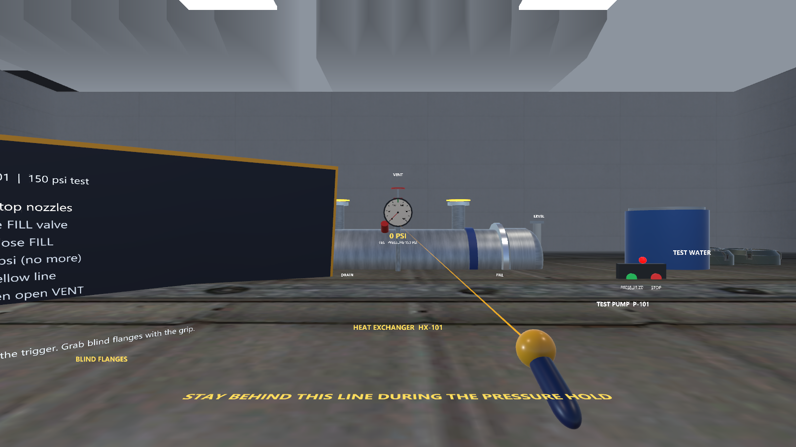

## Third-party assets stay local

The hub imports Asset Store packs (IGBlocks warehouse, Sci-Fi Warehouse Kit, Modern Office, Shipping Container, Warehouse, and five Courtyard prop folders). Their licenses do not allow redistributing the files, so the `.gitignore` commits only our own code and settings (`Assets/Editor`, `Assets/Scripts`, `Assets/Settings`, `Assets/XR`). Scenes that reference the packs are saved under `Assets/Scenes/Local/`, which is also ignored. A fresh clone therefore has no art; the scenarios still run from primitives in the other projects.

## Build the Hydrostatic Test Bay scene

1. Open `vive-steamvr/hub` in Unity Hub with Unity **6000.3.20f1**, with the packs imported.
2. Run **Pitt-Bradford > Build hub scene: Hydrostatic Test Bay (local assets)**. `Assets/Editor/HubDressing.cs` builds the warehouse shell (a floor, four wall strips and a roof), plant props, a supervisor's corner and Courtyard props around the shared `HydroTest` scenario, then saves `Assets/Scenes/Local/HydrostaticTest_Hub.unity`. A missing pack is skipped with a log line.
3. Press Play. Controls are the same as in [../01-hydrostatic-test/README.md](../01-hydrostatic-test/README.md).

## Lobby

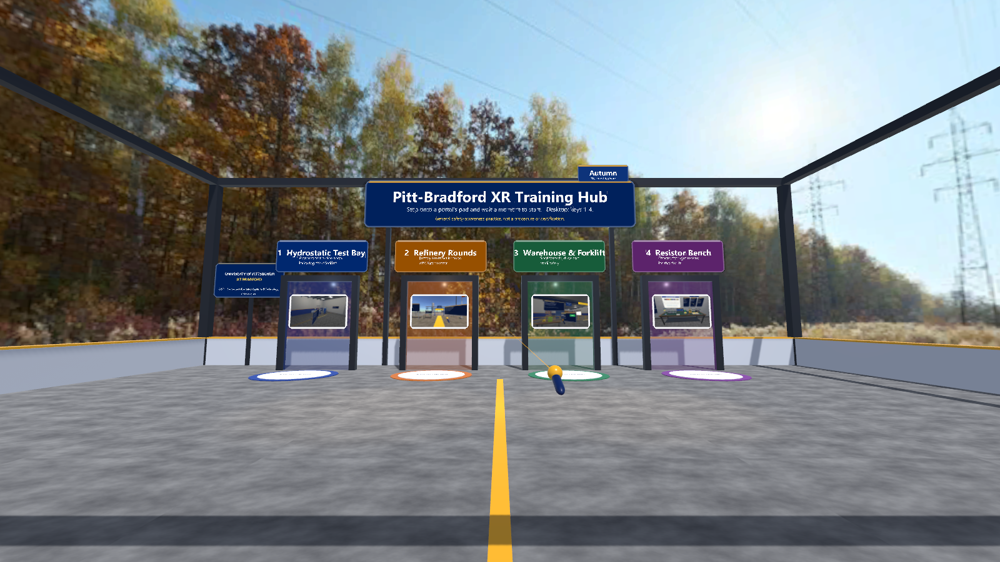

Run **Pitt-Bradford > Build hub: lobby and all scenarios**. It saves five scenes under `Assets/Scenes/Local/` and registers them in the build settings (Lobby first): `Lobby`, `HydrostaticTest_Hub` (dressed with the packs), and plain `RefineryRounds_Hub`, `WarehouseForklift_Hub`, `ResistorBench_Hub`.

- **Portals:** step onto a portal's pad and stay about 1.4 s (progress shows on the pad), or press 1-4 on the desktop. `Assets/Scripts/Lobby/LobbyHub.cs` builds the hall from primitives, so the lobby itself needs no packs; the builder only adds a few office props.
- **Back to the lobby:** in any scenario hold both grips for 1.5 s, or press Backspace (`ReturnToLobby.cs`). A hint shows for the first 8 seconds.
- **Scenario scripts:** `Assets/Scripts/Scenarios/` holds copies of the scripts from projects 02-04. If you change those projects, copy the scripts here again.

Checked in the editor (play mode): the lobby renders, and standing on pad 2 loaded `RefineryRounds_Hub`. Not checked: the Backspace and two-grip return, the other three portals, any headset.

## Scenario thumbnails and seasonal skies

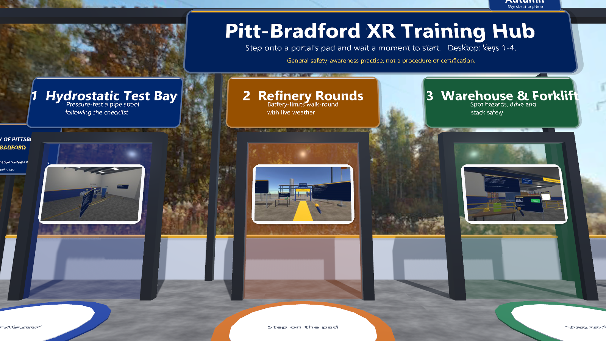

- **Thumbnails.** Each portal shows a 320x180 picture of its scenario on a rounded white frame inside the doorway. The pictures are downscaled from the editor-render screenshots of projects 01-04 (`01-test-bay.png`, `07-start-view.png` twice, `01-bench-overview.png`; none contains the logo image) by `tools/prepare_lobby_images.py` (Python 3 with Pillow: `python vive-steamvr/hub/tools/prepare_lobby_images.py thumbnails`). They live in `Assets/Scripts/Lobby/Resources/Thumbnails/`, which is inside the committed `Assets/Scripts` folder; the `.meta` files set "Non-power-of-2: None" so Unity keeps them at 320x180. A missing picture is skipped and the portal looks as before.
- **Open lobby.** The closed hall is now an open roof terrace: a waist-high parapet with a gold rail, four corner columns and an open ring beam, no ceiling. The welcome board and the university plate stand on posts.
- **Seasonal sky.** `SeasonSky` (kit, `Runtime/SeasonSky.cs` and `Runtime/SeasonSky.shader`, shader name `PittBradford/SeasonSky`) shows one 360 photo per season and starts on today's season (northern hemisphere). Every 30 s it moves to the next season with a glitch of about 1.1 s: the sky breaks into mosaic blocks that grow, gets monitor scan lines and a little red/blue colour split, swaps to the next photo at the peak, then sharpens again. The mosaic is computed from the view direction, not from screen pixels, so both eyes in a headset see the same blocks; only the faint scan lines are screen-space. A chip on top of the welcome board names the season and says "Sky: stand-in photo" (or "Sky: Bradford, PA" if the manifest marks a picture as taken there).
- **The pictures are stand-ins.** The four photos are CC0 images from Poly Haven chosen for a north-eastern look (open field, hillside, autumn woods, snowy field). **They are not photos of Bradford, PA.** Credits are in the kit's `Runtime/Resources/Skies/skies.json` and in `assets/skies/CREDITS.md`. To use your own 360 photos, see [../../docs/HOW-TO-RUN.md](../../docs/HOW-TO-RUN.md) section 3.
- **Refinery Rounds** (the only outdoor scenario) also uses `SeasonSky`, held on today's season with no rotation or glitch during training. Its own sun and trilight ambient are unchanged; the far fog is pulled halfway towards the photo's horizon colour. The other scenarios are indoors and keep their skies.
- **Public API:** `Next()` starts a transition now, `Show("winter")` jumps to a season, `CurrentLabel` / `CurrentId` / `Current`, `SeasonChanged` event, `Paused`, `Interval` (0 = no rotation), `HoldTransition(phase)` freezes the glitch for screenshots. If the shader or the images are missing it logs a warning and the scene keeps its flat or procedural sky. `Configurator.KeepShaderVariants` now also keeps `PittBradford/SeasonSky` in builds, and the hub builder references the shader from the scene.

| | |
|---|---|
| 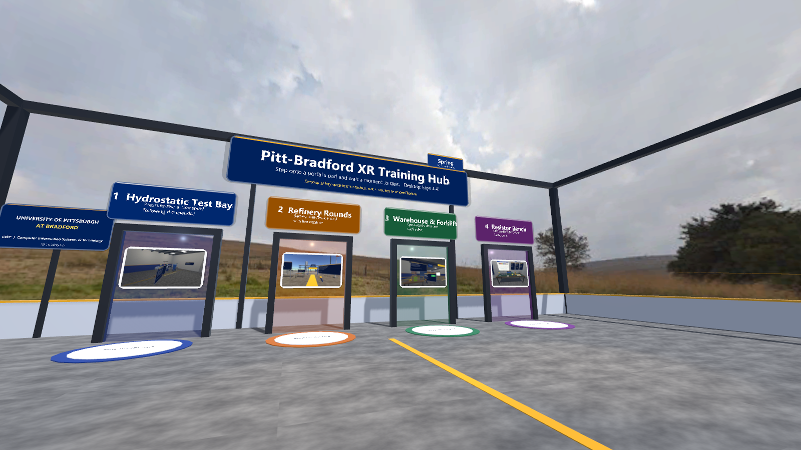 | 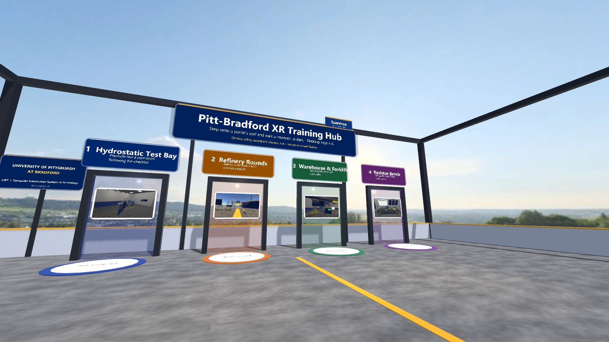 |
| 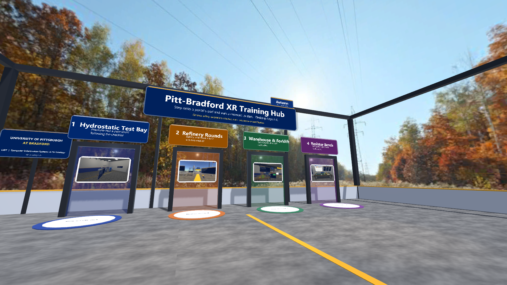 | 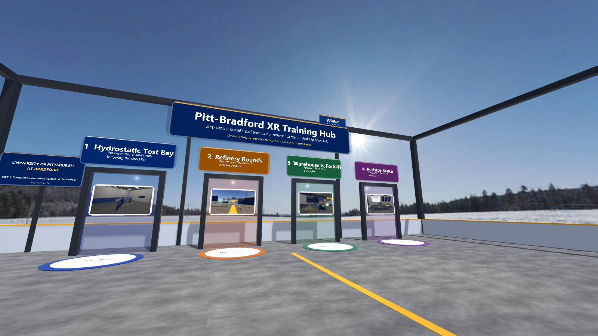 |
| 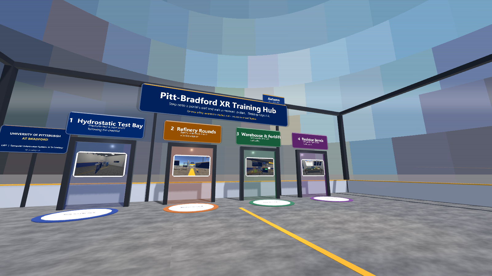 | 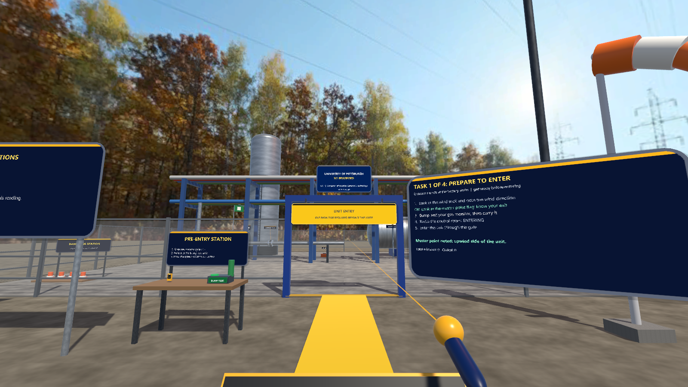 |

All six are Unity editor renders, desktop, not a headset (the transition frame is frozen at its peak with `HoldTransition(0.5f)`; the university logo was swapped for the text wordmark before rendering because screenshots are committed).

Checked in the editor (play mode, Nov 1): scripts and the shader compile without errors; the menu build saves all five scenes; the lobby shows all four seasons, the chip updates, the portals show their thumbnails; with the interval shortened to 3 s the sky rotated through all four seasons with the transition; `RefineryRounds_Hub` shows the autumn sky. Not checked: any headset (stereo rendering of the sky and of the glitch is unverified), frame rate, a Windows player build.

## Look and feel (realism and signage)

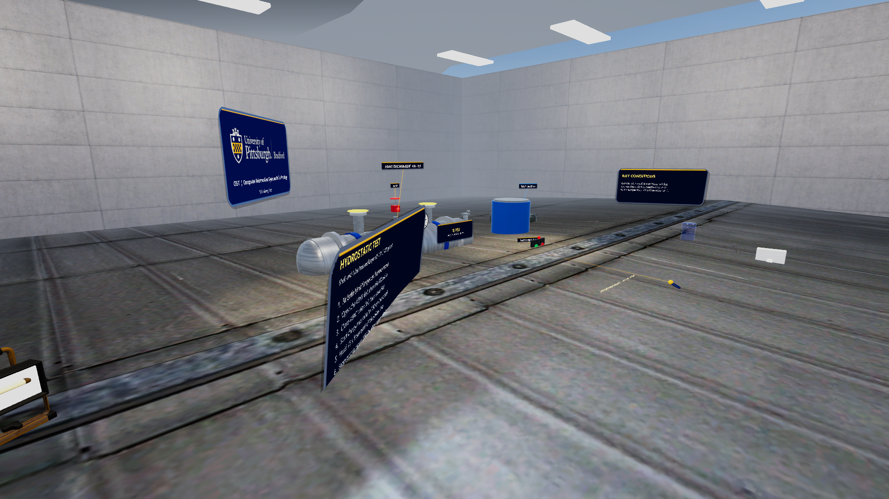

- Every hub scene has a University of Pittsburgh at Bradford and CIST plate (`Ui.BrandPlate`). The logo file lives in `Assets/Resources/Branding/pitt-bradford.png`, which is git-ignored (university branding is not committed); without it the plate shows a text wordmark. The "CIST | Computer Information Systems & Technology" wording was confirmed by the owner on November 2, 2026.
- `Assets/Scripts/Lobby/HubPolish.cs` adds room tone, a pump hum, tone-mapping, bloom and a vignette; press **P** on the desktop to switch post-processing off. Frame rate on a headset has not been measured.
- The kit's signage helpers (`Signage.cs`) give rounded panels, name tags with leader lines, and a depth-correct text shader (`PBText.shader`).

## Baked scenes

Every hub scene (`Lobby`, `HydrostaticTest_Hub`, `RefineryRounds_Hub`, `WarehouseForklift_Hub`, `ResistorBench_Hub`) is **baked**: all its GameObjects are saved in the scene, visible in the Hierarchy and editable, instead of being generated at Start (see [../packages/com.pittbradford.xrtraining/README.md](../packages/com.pittbradford.xrtraining/README.md) for how bake and adopt work). Object counts in the saved scene files: Lobby 125, Hydrostatic Test Bay 239, Refinery Rounds 398, Warehouse and Forklift 632, Resistor Bench 403. Edits you make to baked objects persist at Play.

- **Build, then bake.** **Build hub: lobby and all scenarios** rebuilds the scenes from scratch and so removes any bake. After it, open each scene in turn and run **Pitt-Bradford > Bake scene (play mode)** (about 15 seconds each). **Unbake scene** returns a scene to generating at Start.
- The scenes and their baked assets (`Assets/Baked/`) are local only, like the other hub scenes, because the hub's `.gitignore` commits only our code.
- Still created at runtime on purpose: the VR rig, task boards, why-panels, the co-worker and awareness check, resistors and LEDs, gas puffs, room tone and pump hum.
- Not verified: headset, a built player, hand play of the baked hub scenes (checked by loading each through the portals in the editor, with a screenshot of each).

## Dressing and people (all five scenes)

All five scenes are dressed from code in `Assets/Editor/HubSceneDressing.cs` (`DressWarehouse`, `DressRefinery`, `DressHydro`, `DressLobby`, `DressResistor`), called from the builders, so a rebuild reproduces everything, people included. Props are placed by their rendered bounds (the packs' pivots differ), their colliders are switched off so nothing blocks the rig, hands or forklift, and they are marked batching-static.

- **Warehouse and Forklift:** loaded racking along the north wall, pallet staging row, parked IG forklifts (east and west strips), loaded pallets and a hand truck by the dock, a shipping container with crates, extinguisher stations, an office corner (Modern Office: desk, chair, computer, cabinet, water cooler, plant, world map), duct runs and hanging lights overhead, security cameras, barrels, ladders. Eight people: two pickers at the racking, two talking by the east wall, a supervisor with documents, one crouching at a pallet, one at the office desk, one by the entry. The walking co-worker of the awareness check is now a Rocketbox avatar (`Assets/Scripts/People/PeopleLibrary.cs` sets `CoWorker.ModelFactory`; the scenario's `Speed` parameter drives Idle/Walk).
- **Refinery Rounds:** two boilers, flue pipes, ladders, a stacked container yard, ducts, barrels, a generator with fuel cans and floodlights near the flare, pallets and crates, cabin details. Props stay within about 22 m of the unit centre, so the muster point (26 m downwind) is clear. Eight people: a guard by the gate, operators at the tower and the drum, a pair at the control-room cabin, one at the generator, and a pair at the muster point (`FollowTarget.cs` keeps them with the sign when the wind moves it).
- **Hydrostatic Test Bay:** the equipment sits in a room built around it (inner 14.8 m by 13.2 m; Sci-Fi kit wall pieces stretched to fit, a door prop and exit sign in the front wall, a drop ceiling just above the scenario's light panels, Pitt blue and gold wainscot). Inside: duct runs, sprinkler pipes and hanging lights overhead, pipe runs on the walls, a tool bench area (work table with a laptop, three stocked shelving units, a tool cart, a briefing screen, a ladder and a work light), a supervisor's corner (desk, computer, chair, cabinet, water cooler), a receiving stack by the door (hand truck, cartons, pallets, barrels) with two extinguishers, the generator and fuel cans. Six people, all behind the stay-behind line: a supervisor logging the readout, a technician at the tool bench, two operators talking near the pump skid, a safety officer at the line, and someone at the desk. The valves, pump panel, gauge, blind-flange table and task board are untouched. No catwalk: the kit's stairs are too big for a 5.7 m room and a catwalk without stairs would not be reachable.
- **Lobby (round 2, `Assets/Editor/HubLobbyDressing.cs`):** light porcelain-tile floor with a welcome medallion on the entry path; a reception area (taller backdrop wall with a RECEPTION sign, world map and clock, desk with a branded front panel, computer, laptop, phone, plants, waiting chairs, a roll-up banner and a pergola with pendant lamps); a lounge (LOUNGE sign, projector screen showing a scenario picture, meeting table with four chairs, coffee corner, rug, pergola); two angled **scenario gallery walls** facing the entrance (four framed pictures each, 960 x 540 renders of the scenarios in `Assets/Scripts/Lobby/Resources/Gallery/`, captions under each); a CIST corner (department name wall, display table with a laptop); a "How it works" board; four hanging banners; plants beside every portal; two small seating clusters. Ten Rocketbox people in groups: receptionist, a visitor and a delivery driver at the desk, a coffee chat, a faculty member waving at the arrival, a guard at the entrance, three visitors at the gallery walls. The four pads, portal frames, welcome board, season chip, brand plate and paths stay clear (the dressing sits at |x| beyond 5 or near the south edge). The portal blurbs were corrected (Hydro: heat exchanger; Warehouse: walking the floor around forklifts).
- **Resistor Bench:** the open room is closed with painted side and front walls (blue and gold stripe to match the back wall), a student table with two computers and a laptop, three stocked shelving units, a projector screen, two world maps, a clock, a door, plants and bins. Four people: an instructor (Talk) beside the wall cards, two students at the side table (WorkTable, Note) and someone looking around. The bench, parts bins, wall cards, answer panel and the rig area stay clear.
- **Rebuild:** **Pitt-Bradford > Build hub: warehouse and refinery only** rebuilds just these two (the other scenes keep their bake); then open each and run **Bake scene (play mode)**. **Build hub: lobby and all scenarios** resets all five scenes (the earlier dressing is re-applied from code), so bake all five afterwards.
- **Courtyard props** import at 100x and rely on a 0.01 root scale; `HubDressing.Spawn` keeps the prefab's own root scale. The Hydrostatic Test Bay was re-checked after that change: its generator and lights are normal size, and its hall roof prefab (pivot at floor level) is no longer used.
- **Checked (Unity editor, desktop):** all five scenes rebuilt and baked again; no duplicated objects after the bake (one `Dressing` root per scene) and no magenta materials; people play their activity in Play mode (animator times advance, no T-pose). Pads load scenes (pad 1 to Hydro, pad 2 Refinery, pad 3 Warehouse, pad 4 Resistor loaded by standing the rig on the pad). The scripted self-test (`Assets/Scripts/Dev/ShotRunner.cs`, same flow as `-pbCapture`) ran the Hydro flow with all six steps OK and no mistakes, the Resistor flow, the Refinery flow to its end, and the Warehouse flow including the awareness pause (movement 0.0000 m while paused; score 2 of 3 as designed). **Not checked:** any headset, frame rate on a Vive Pro 2, hand play.
- **Triangle counts, round 1** (editor, baked scene, counted in edit mode: static meshes plus skinned people): Lobby 125 k (128 mesh renderers, 6 people), Hydro 149 k (270, 6), Resistor 77 k (301, 4), Warehouse 125 k (630, 8), Refinery 189 k (380, 9). Counting in Play mode gives about 5 to 10 times more, because static batching replaces each MeshFilter's shared mesh with the combined mesh; the 1.4 M and 1.5 M quoted earlier for Warehouse and Refinery were most likely read that way and should be disregarded. Props are marked batching-static; no LODs yet.
- Screenshots (Unity editor desktop render, not a headset): `docs/images/hub-dressed-warehouse-*.png`, `hub-dressed-refinery-*.png`, `hub-dressed-hydro-*.png`, `hub-dressed-lobby-*.png`, `hub-dressed-resistor-*.png`.

## Round 2 review (November 3, 2026)

A critical second pass over all five scenes, looking at renders from the start view and from walking height at several spots per scene (Unity editor desktop renders, Play mode, people animated; no headset). Before and after pictures: `docs/images/hub-dressed-*.png` (round 1) against `docs/images/hub-r2-*.png` (round 2).

**What was wrong, and what was done**

| Scene | Found | Fixed |
|---|---|---|
| Lobby | A 24 x 18 m hall with a concrete floor, two desks, six people and little else; two portal blurbs were inaccurate | Everything in the Lobby bullet above; blurbs corrected |
| Warehouse | Two shipping containers overlapped (a water cooler and a cabinet stood inside one); cartons, a bin and a plant overlapped neighbours | Duplicate container removed, overlaps moved; a bounds audit (`HubReview.Audit`) then found no sunk or overlapping dressing |
| Refinery | The Sci-Fi shipping containers rendered near black; two barrels stood inside a boiler | Containers get tinted copies of their materials (red, blue, green); barrels moved |
| Hydro | A 25-lamp grid left over from the old 39 m hall (42 lights in total); dark Sci-Fi pallets and crates; bare walls | 4 room lamps; crates tinted; notice board, two posters, a map and yellow walkway lines added; valves, gauge, pump panel, flanges and task board checked clear |
| Resistor | A student wore a hard hat in a classroom; two work-light spots sat above the ceiling | Student changed to an adult avatar; the work lights are Hydro only now |
| People | Checked in Play mode: nobody is sunk or faces a wall; the Rocketbox "Documents" pose is still used only at desks | none needed |

Left alone on purpose: the oversized-looking cartons on the warehouse racking and the task boards belong to the scenario scripts shared with projects 02-04.

**Performance (editor, Play mode, Game view, Ultra quality level, `Assets/Scripts/Dev/PerfProbe.cs`, 120 frames at the start view, first 30 frames skipped, 2026-11-03).** These are CPU-side render counters, not a frame rate. They say nothing about GPU time at 2448 x 2448 per eye and 90 Hz, and no Vive Pro 2 was used.

| Scene | SetPass calls, round 1 (mean) | SetPass calls now: median / mean / worst frame | Draw calls now (median) | Triangles now (median) | Lights, round 1 / now |
|---|---|---|---|---|---|
| Lobby | 251 | 352 / 351 / 352 | 433 | 284 k | 7 / 5 |
| Hydrostatic Test Bay | 1066 | 515 / 514 / 1029 | 636 | 346 k | 42 / 13 |
| Refinery Rounds | 756 | 551 / 550 / 1097 | 762 | 340 k | 13 / 2 |
| Warehouse and Forklift | 3196 | 1301 / 1415 / 2929 | 1895 | 221 k | 9 / 7 |
| Resistor Bench | 1736 | 787 / 787 / 1572 | 855 | 178 k | 6 / 4 |

- The Lobby is higher than in round 1 because it has about ten times the content; it stays well under the target of about 2,000 SetPass calls. Every other scene fell by 27 to 60 percent (mean against mean).
- "Worst frame" is about twice the median in four scenes: one frame in the sample renders an extra camera (the cause was not isolated). The round 1 figures are means from the earlier version of the probe, whose worst frames reached 6,661 (Warehouse).
- **Biggest cause: pixel lights.** In the built-in forward pipeline every pixel light is another pass over each object in its range. `HubPolish.PixelLights` (default 1) now caps them, so only the sun is per-pixel and the fill lamps become per-vertex; the shadow distance is 25 m with 2 cascades; the previous values are restored when the scene unloads. Changing only the pixel-light setting took the Warehouse from about 6,700 to about 1,700 (worst frame, same scene), and renders with 1 and 4 pixel lights looked the same.
- Other measures: the Hydro lamp grid went from 25 to 4 lamps; prop lamps are off (their glow stays in the material); `HubPerfPass` gives small props (under 0.5 m) no shadows and a one-level LODGroup that culls them when they cover only a few pixels (about 5 m away for a 0.4 m prop), culls medium props (under 1.2 m) beyond about 25 m, and culls people beyond about 45 m (their animators stop updating while off screen); the Warehouse rack, shell and floor-marking groups are batching-static (menu **Hub: static-batch the baked scenes**, run after baking); GPU skinning is on in the player settings (unverified on a headset).
- The Warehouse scenario's **mirror camera** was a second full render of the scene whenever the mirror was within 16 m. In the hub copy of `WarehouseForklift.cs` it is now drawn by hand every third frame, and only within 12 m and roughly in front of the head. This hub copy now differs from project 03's.
- Not done: GPU instancing (static batching already merges repeated props), lower-detail meshes (the packs ship none), lightmaps. Not measured: headset frame rate, stereo cost, a built player, Quest.

**Checked after the final rebuild and bake** (all five scenes baked; one `Dressing` root in each, so no duplicates): all four portals load their scenes with the rig stood on the pad; the scripted self-test (`ShotRunner`) ran the Warehouse flow to PASS (awareness pause moved 0.0000 m, score 2 of 3 as designed) and the Hydro, Resistor and Refinery screenshot flows to the end with no error lines (10, 8 and 13 screenshots); a person's hand bone moves in Play mode with the culling settings on. Not checked: headset, hand play, frame rate.

**Rebuild order now:** (1) **Build hub: lobby and all scenarios**, (2) open each scene and run **Bake scene (play mode)**, (3) **Hub: static-batch the baked scenes (run after baking)**. If a scenario's look changes, re-snap the gallery pictures (`HubLobbyDressing.SnapGallery`, called in Play mode from the unity CLI), run **Build hub: lobby only** and bake the Lobby again. `Assets/Editor/HubReview.cs` and `Assets/Scripts/Dev/PerfProbe.cs` are development tools.

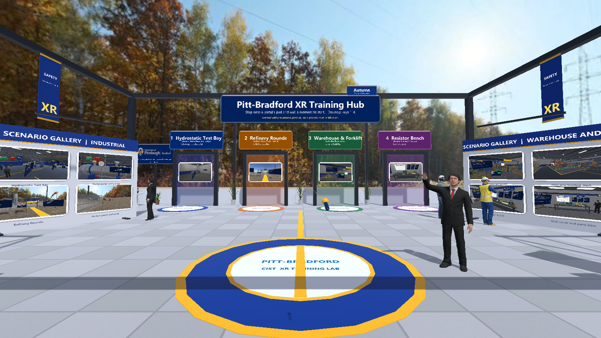
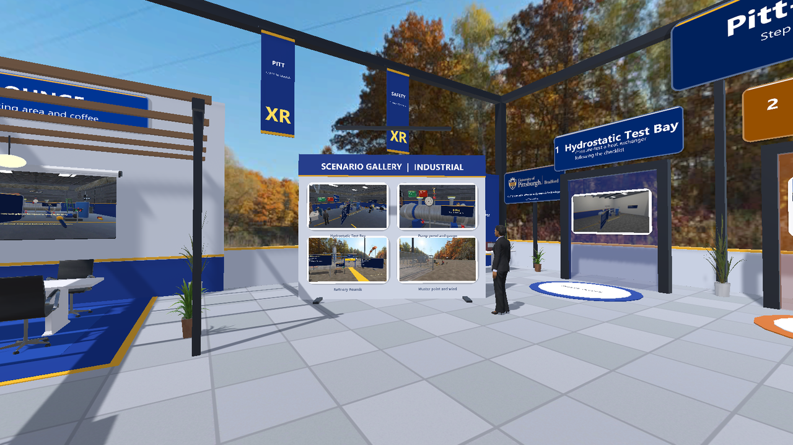
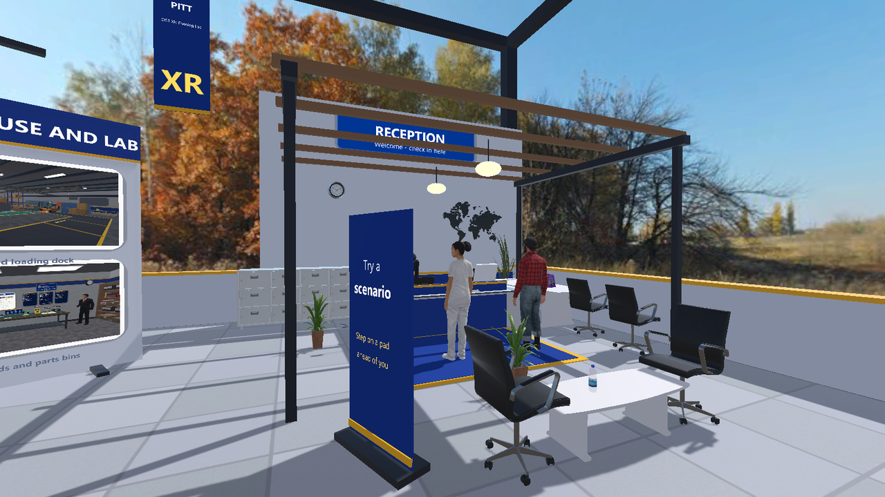
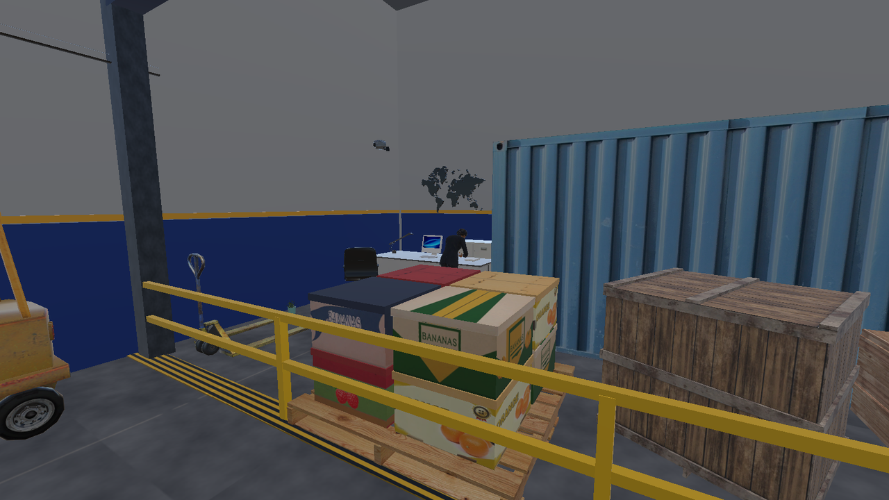
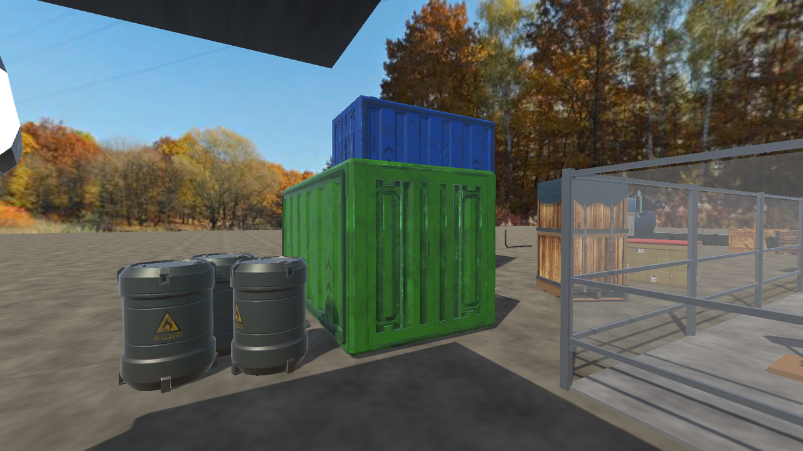
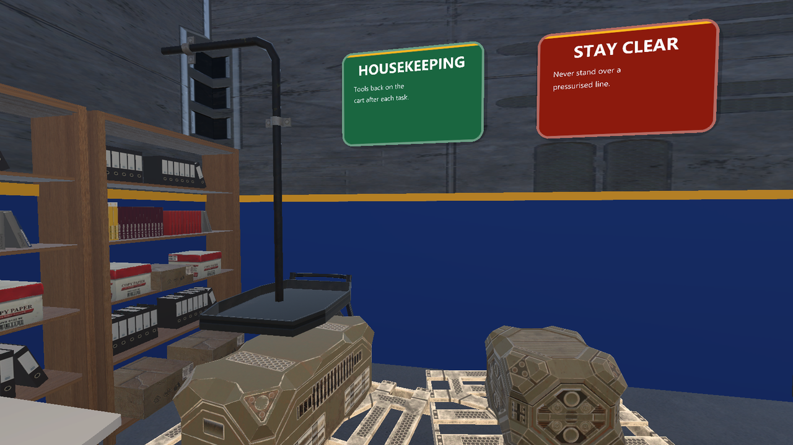
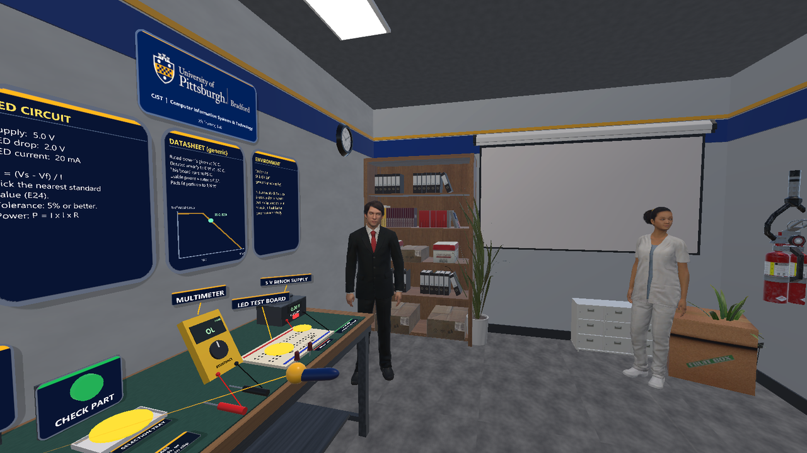

All round 2 pictures are Unity editor desktop renders in Play mode, not a headset.

## Files

- `Assets/Editor/HubSetup.cs`: project configuration (built-in pipeline, OpenXR).
- `Assets/Editor/HubDressing.cs`: the Hydrostatic Test Bay scene builder and shared helpers.
- `Assets/Editor/HubSceneDressing.cs`, `HubLobbyDressing.cs`, `HubPerfPass.cs`: scene dressing, the lobby dressing and the culling / static-batching pass. `HubReview.cs`: review helpers for the unity CLI. `Assets/Scripts/Dev/PerfProbe.cs`: render counters.
- `Assets/Editor/HubLobbyBuilder.cs`: builds the lobby and all scenario scenes.
- `Assets/Scripts/Lobby/`: `LobbyHub` and `ReturnToLobby`; `Resources/Thumbnails/` holds the portal pictures.
- `tools/prepare_lobby_images.py`: makes the thumbnails and copies the season skies into the kit.
- `Packages/manifest.json`: packages, including the kit by `file:` path.

## Known limits

- Lighting, audio and post-processing have only had a first pass; the Hydro room replaced the old 39 m hall in round 1 (see round 2 for the render budget).
- Desktop editor screenshots only; nothing here has been run on a headset.

## People (Microsoft Rocketbox, local only)

The scenes can include realistic, animated people from the **Microsoft Rocketbox Avatar Library** (MIT license, https://github.com/microsoft/Microsoft-Rocketbox; cite Gonzalez-Franco et al. 2020, DOI 10.3389/frvir.2020.561558). The files (about 1.1 GB: 11 avatars plus walk, idle, talk and work animations) live in `Assets/Rocketbox`, which is git-ignored like the Asset Store packs, so nothing third-party is committed. To get them: sparse-checkout `Assets/Avatars/...` and `Assets/Animations/...` from that repository into `Assets/Rocketbox` (the avatars used are listed in `Assets/Editor/PeopleSetup.cs`). `Assets/Editor/Rocketbox/RocketboxImport.cs` (our own script) sets the import options, and **Pitt-Bradford > People > Set up Rocketbox controllers** builds the animation controllers. The MIT license text is kept at `Assets/Rocketbox/LICENSE.md`.
