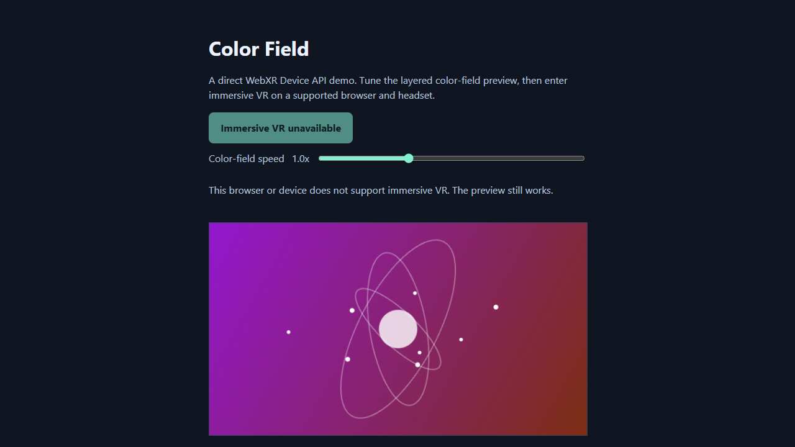

# WebXR Color Field

The WebXR Device API used directly, with no engine and no library: the page requests an `immersive-vr` session, makes its own WebGL2 context XR-compatible, creates an `XRWebGLLayer`, and draws every frame from `XRFrame` viewer and controller poses. A hand-written WebGL2 renderer (about 400 lines in `main.js`) draws the same scene into the desktop preview and into the headset's two eye views.

## What changed in this version

- **Before:** the immersive session only cleared each eye to a changing colour. **Now** it renders a real stereo scene: a faceted gem with an inner core, three orbiting rings with satellites, a glowing grid floor with ripples, a colour-shifting sky with aurora-like bands and stars, and rising sparkles, all in code with its own GLSL shaders (no models, no textures, no third-party code).
- **WebXR specifics:** `requestSession("immersive-vr", { optionalFeatures: ["local-floor"] })` with a fallback to the `local` reference space (assuming a 1.5 m eye height), per-view viewport and projection from the session, `inputSources` grip and target-ray poses drawn as markers and rays, and the `select` event (trigger) changing the palette.
- **HUD:** the shared brand bar and panel; Enter VR button (same states as before: checking, enter, unavailable), Change palette, speed slider, live status, collapsible controls.
- **Access:** drag/touch orbit, wheel or pinch zoom, arrow keys, `C` palette, `+`/`-` speed, `R` reset; `prefers-reduced-motion` starts at the slowest speed and stops the idle camera drift.

## Prerequisites

- A browser with WebGL2. For immersive VR, a WebXR browser, runtime and headset.

## Launch

These pages load libraries, fonts and sky photos from elsewhere in the repository (`../vendor`, `../brand-kit`, `../assets`), so serve the **repository root**, not this folder. No internet is needed.

```
python -m http.server 8000                     # from the repository root
node tools/vr-capture/static-server.mjs 8000   # alternative that copes with many parallel requests
```

Open <http://localhost:8000/webxr/>. WebXR needs a secure context: `localhost` qualifies; another device needs HTTPS with a certificate it trusts.

Drag to orbit the preview; select **Enter VR** where the browser reports support (the button explains when it does not).

## Checks that were run

- `node tools/vr-capture/demos-check.mjs` (all four demos, desktop and 390 px phone, every non-local request blocked): no console or page errors, no failed requests, no horizontal scroll, buttons at least 40 px tall, brand bar present, every loaded asset exists and is credited, assets under 8 MB, glTF triangles under 100k.
- `node tools/vr-capture/demos-xr-check.mjs`: enters an **emulated** Meta Quest 3 immersive session (Meta's IWER runtime inside desktop Chrome), pulls the emulated trigger and checks for errors. This shows the code path runs. **It is not a headset test; nothing here has been run on a real Quest or Vive Pro 2.**

## Limitations

- Immersive VR depends on browser, OS, runtime and headset; unsupported browsers still show the preview.
- The renderer is deliberately small: one directional light, no shadows, no controller models, no hand tracking.
- Stereo rendering in the emulator looks right, but projection, comfort and performance on real hardware are untested.

## Credits

Everything is generated in code; there are no third-party assets. Fonts and the brand bar come from `vendor/fonts` and `brand-kit` (see [../CREDITS-web-demos.md](../CREDITS-web-demos.md)).

## Upstream

- [WebXR Device API specification](https://immersive-web.github.io/webxr/)
- [MDN: WebXR Device API](https://developer.mozilla.org/docs/Web/API/WebXR_Device_API)

## Screenshots



Desktop browser (Chrome, software GL). The "Immersive VR unavailable" button is the real desktop state. Phone-width view: [../screenshots/phone/](../screenshots/phone/webxr-color-field.png). The image below is from an **emulated** Quest 3 session (IWER), not a real headset.


## Session setup review

Checked with an emulated Quest 3 (`node tools/vr-capture/demos-sdk-check.mjs`): nothing is required but the `immersive-vr` mode; `local-floor` is optional with the `local` fallback described above; the `end` event restores the button; the canvas follows a resize. Added in the review: WebGL context loss. On `webglcontextlost` the page stops drawing, ends any immersive session and says so; on `webglcontextrestored` it rebuilds its programs and geometry and the preview keeps running (tested with `WEBGL_lose_context`). An immersive session cannot be resumed after a loss; the person presses Enter VR again.
